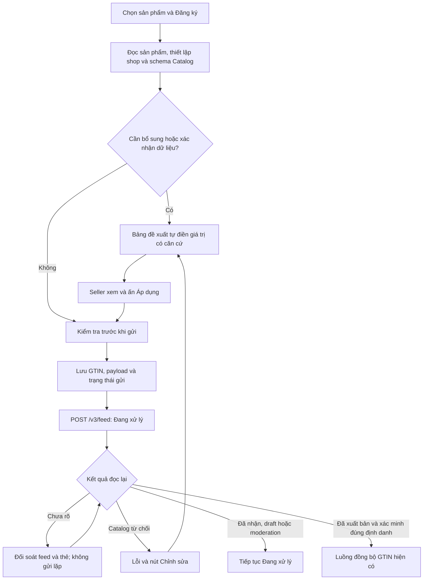

# Đăng ký Znack: bộ lọc và bảng đề xuất

Nền mã: `v1.5.10` (`e9cd5243ad98b1ba178bb2a4a7863d9710d8d948`).
Nhánh sửa: `fix/znack-registration-filter-semantics`. Tài liệu này mô tả mã sửa; không xác nhận bản Latest đã được thay thế.

## Hành vi

| Mục | Nội dung |
| --- | --- |
| Chưa tạo | Chưa gửi/tạo thẻ, lỗi kiểm tra trước khi gửi, GTIN cục bộ chưa được xác nhận trên Catalog. Không biến sự thiếu xác nhận thành quyền gửi lặp. |
| Đang xử lý | Bắt đầu gửi, chưa rõ kết quả gửi, đã nhận feed, draft/moderation, chờ ký. Hiện ngay từ `FEED_SUBMITTING`, kể cả chưa nhận `feed_id`. |
| Lỗi | Catalog thực sự từ chối thẻ hoặc feed của GTIN. Lỗi cục bộ và timeout không thuộc mục này. |
| Chỉnh sửa | Dùng bảng đề xuất hiện có; áp dụng nội dung đã duyệt rồi gửi lại cùng GTIN. Thẻ đã tồn tại giữ đúng `good_id`; feed bị từ chối nhưng chưa tạo thẻ không được bịa `good_id`. |

## Đề xuất tự điền

- Giữ giá trị đã xác định từ sản phẩm, thiết lập shop và mẫu đăng ký dùng chung. Dùng các mặc định đã xác minh cho giấy tờ/nước sản xuất theo quy tắc hiện có. Luồng đăng ký tự động giữ quy tắc điền quy chuẩn từ giấy tờ đã xác minh; bảng sửa giữ quy chuẩn của nguồn/thẻ, không sao chép quy chuẩn từ một giấy tờ mới chỉ đang được đề xuất.
- Chuẩn hóa lựa chọn schema; đề xuất lựa chọn duy nhất trong bảng duyệt và điền hệ giá trị tương ứng. Không tự chọn phần tử đầu tiên khi có nhiều quốc gia, hệ size hay biến thể khác nhau.
- Đề xuất giấy tờ theo thứ tự nguồn hiện có và hiển thị cảnh báo để seller quyết định bằng Áp dụng. Việc hiển thị đề xuất không gửi API ghi.
- Bấm Chỉnh sửa một dòng đã xác định biến thể sẽ vào thẳng bảng đề xuất. Ánh xạ nhiều biến thể chưa rõ vẫn cần được xác định trước khi gửi.
- Áp dụng đọc lại nguồn và Catalog, kiểm tra phạm vi tài khoản, khóa chữ ký/yêu cầu chưa rõ và trạng thái checkpoint. Lưu lịch sử trước khi thay payload. Giữ thao tác chính và bố cục màn hình hiện có.

Nếu nguồn hoàn toàn thiếu một dữ kiện bắt buộc hoặc có nhiều dữ kiện mâu thuẫn chưa giải quyết, app không thể tự tạo sự thật cho sản phẩm. Bảng vẫn ghi rõ trường cần bổ sung; chỉ gửi khi nội dung đủ hợp lệ. Kết quả POST chưa rõ được đối soát riêng, không coi là dữ liệu sản phẩm thiếu.

## Kiểm chứng

- `clean verify` toàn ứng dụng: 2.861 ca, 2.859 đạt, không lỗi; 2 ca chỉ dành cho Windows bỏ qua trên Linux. Lượt này chạy trước hai chỉnh sửa cuối từ rà soát (khóa chọn trùng biến thể và bỏ suy ra quy chuẩn từ giấy tờ tạm đề xuất).
- Sau hai chỉnh sửa cuối: `verify` toàn bộ nhóm đăng ký và đồng bộ liên quan: 738 ca đạt, không lỗi/không bỏ qua; artifact JAR được dựng lại từ mã cuối.
- `node --test tools/*.test.mjs`: 110 ca đạt.
- `git diff --check`: đạt. Rà soát cuối không còn phát hiện cụ thể.

Log trong phiên cloud: `/workspace/znack-v3-research/filters-full-verify.log`, `filters-final-registration-verify.log`, `filters-node.log`.

Các ca kiểm thử dùng Catalog giả lập/HTTP cục bộ để kiểm chứng đường gửi và trạng thái. Chưa xác minh bằng một lần ghi Catalog production thật trong phiên cloud này; không có seller credentials được gắn vào môi trường.
