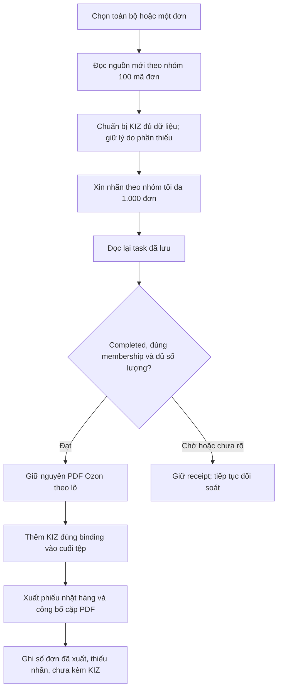

# Xuất PDF Ozon theo lô — 03.11.2026

Nhánh `fix/ozon-batch-pdf-20261103`, kế thừa PR #17. Nguồn PDF giữ nguyên lô `6f302cf2883e528b146f01e16e5bf256b51242d0`; nguồn cuối bổ sung cache ảnh `8b28133b28f57c53486aece15b0ca26c219d313d`. Chưa đóng gói hoặc thay Latest. “DBF/DPF” trong yêu cầu được xử lý là file PDF nhãn đang được app xuất.

## Các điểm đã sửa

- Chuẩn bị trước đây gọi chi tiết từng đơn. Dùng `POST /v4/posting/fbs/list` với tối đa **100 `order_numbers` gốc**, phân trang và đối chiếu đúng `posting_number`; 1.000 đơn đủ dữ liệu chỉ cần 10 lượt đọc danh sách. Dữ liệu thiếu/legacy vẫn đọc chi tiết đúng đơn, không dùng bản cũ làm bằng chứng mới. Danh sách thiếu requirements/optional không được dùng để bỏ yêu cầu KIZ. Giữ kiểm tra cửa hàng, cursor, nguồn mới và giới hạn tốc độ.
- API nhãn vốn đã dùng `POST /v3/posting/fbs/package-label/create`, tối đa **1.000 đơn/tác vụ**, sau đó `POST /v2/posting/fbs/package-label/get`. Lỗi thật nằm ở bước xử lý PDF: app yêu cầu mọi trang phải chứa mã đơn; nhãn thật có trang vận đơn và trang sản phẩm không đáp ứng cách nhận diện đó, khiến cả nhóm chuyển sang tạo/tải từng nhãn riêng.
- Luồng In tất cả/in một đơn mới giữ **toàn bộ PDF của đúng tác vụ đã xác nhận** khi membership trùng lựa chọn, trạng thái completed, số đã in và danh sách chưa in khớp. Giữ thứ tự Ozon; không ghép trang với KIZ bằng thứ tự request. Sau phần PDF Ozon, app thêm phần KIZ đã kiểm tra đúng binding sản phẩm/biến thể. Do giữ nguyên tài liệu Ozon, phần đầu có thể gồm cả trang vận đơn lẫn trang sản phẩm do Ozon cấp.
- Nếu thiếu mapping, thiếu KIZ hoặc điều kiện KIZ cục bộ chưa đạt, nhãn vận đơn Ozon cấp vẫn được xuất. Báo cáo ghi rõ đơn chưa kèm KIZ. Không in/bịa KIZ thay thế, không đánh dấu KIZ đã được Ozon nhận, không trừ kho cho nhãn KIZ chưa in. Nhận đơn/mua KIZ không thuộc phép thử PDF này; mua mã vẫn cần xác nhận riêng theo luồng hiện hành.
- Bỏ giới hạn tách lô lỗi cố định 16 lần, từng làm đơn hợp lệ bị kẹt cùng nhiều đơn bị từ chối. Chỉ chia nhóm sau lỗi 400/422 đã xác nhận từ chối, không có task nhận; số lần chia bị chặn theo cây của tập chọn. Không tạo lại tác vụ đã có receipt hoặc chưa rõ kết quả; 401/403/429 giữ báo cáo và cooldown.
- Chỉ tạo PDF nhỏ riêng cho các phần KIZ cần cách ly lỗi; không dựng/tải từng PDF vận đơn cho lô đầy đủ. Tệp nhãn/phiếu nhặt hàng chỉ công bố sau khi ghi thành công, rồi mới xác nhận receipt và tiêu thụ đúng proof KIZ.
- Ảnh thu nhỏ trước đây chỉ ở RAM. Đã lưu thumbnail 96×128 bằng cache key riêng để dùng lại sau khởi động. Không ghi thumbnail đè ảnh độ phân giải đầy đủ. Báo cáo đo riêng thời gian tải nhãn, ghép PDF và phiếu nhặt hàng; tiến trình ghép không bị gọi là tải từng nhãn.

Trường hợp in lại một phần tác vụ cũ có chứa đơn ngoài lựa chọn vẫn phải chọn đúng trang, hoặc xin tác vụ riêng cho phần được chọn. Không xuất lẫn nhãn đơn ngoài lựa chọn chỉ để tăng tốc. Đây là đường dự phòng; không cam kết mọi trường hợp đều có đúng một tác vụ.

## Đo và kiểm chứng

| Môi trường / phạm vi | Kết quả | Thời gian |
| --- | --- | --- |
| API thật, xuất mới 1 đơn, nguồn `6f302cf` | 1/1 đơn, 2 trang Ozon; 1 nhóm nhãn, 0 tải riêng, 0 KIZ | 6,111 giây |
| API thật, in lại task đã biết; khởi động tiến trình riêng, trước khi có thumbnail trên đĩa, nguồn `8b28133` | 1/1, 2 trang; 1 get + 1 tải; chặn mọi mutation API | 6,523 giây; phiếu nhặt hàng 1,846 giây |
| API thật, tiến trình mới dùng thumbnail đã lưu, nguồn `8b28133` | 1/1, 2 trang; cùng task, 1 get + 1 tải, 0 mutation API | 4,989 giây; phiếu nhặt hàng 0,302 giây |
| HTTP localhost + dữ liệu tổng hợp, 100 đơn | 100/100 trang, 1 tạo task + 1 get + 1 tải; kiểm tra độc lập từng trang và thứ tự Ozon | 0,183 giây |
| HTTP localhost + dữ liệu tổng hợp, 1.000 đơn | 1.000/1.000 trang, 1 tạo task + 1 get + 1 tải; không tải riêng | 0,506 giây |

Thời gian thật bao gồm network/server, dựng file nhãn và phiếu nhặt hàng. Hai mốc mô phỏng dùng PDF văn bản và không tạo 1.000 nhãn KIZ; **không phải thời gian dự báo cho 1.000 đơn thật**, ảnh lạnh hoặc máy seller. Không cộng thời gian đọc product metadata chuẩn bị hồ sơ thử vào đồng hồ export; không in vật lý lên máy in.

Nguồn API hiện có 348 đơn chưa hoàn tất trong cửa sổ đọc, gồm 326 delivering, 21 awaiting_packaging và **1 awaiting_deliver**. Chỉ có một đơn đủ trạng thái để đo xuất mới. Không nhận thêm 21 đơn hoặc tiêu KIZ để dựng mẫu thử. Đọc sau export xác nhận trạng thái đơn thử giữ nguyên. PDF thật và dữ liệu seller ở thư mục riêng, không đưa vào repository.

API tạo nhãn quy định `awaiting_deliver`, khuyến nghị chờ 45–60 giây sau khi lắp ráp. App không thể bảo đảm Ozon cấp nhãn cho đơn mà sàn từ chối. Những đơn API báo chưa in được vẫn phải nằm trong kết quả thiếu; không đổi số đếm thành “đã in đủ”. API có thể quyết định format/số trang khác nhau; luồng whole-task kiểm chứng tập đơn và số lượng từ task, **không tuyên bố đã ghép từng trang vận đơn với KIZ**.

## Hồi quy và bàn giao

- Baseline 99 ca đạt. Sửa tách nhiều đơn lỗi tái hiện 1 thất bại/2 ca trước sửa. Ca cache ảnh tái hiện 1 thất bại/3 ca trước sửa.
- Lượt kiểm thử backend/UI liên quan cuối hoàn thành **142/142 ca**, 0 lỗi/thất bại/bỏ qua; sau chữ báo bố cục PDF, 7 ca UI được chạy lại và đạt. Sau cache ảnh, **48/48 ca** (45 PDF + 3 ảnh) đạt; các tập này có giao nhau, không cộng thành tổng mới.
- Có kiểm tra 1.001 nhãn qua hai nhóm, server trả một phần, thứ tự trang đảo, PDF nhiều trang không chứa mã đơn, nhiều đơn bị từ chối cùng lô, receipt mất/không rõ, cooldown, owner thay đổi, KIZ thiếu/đã giữ chỗ, rollback, ảnh offline và độ phân giải đầy đủ. Luồng mixed giữ nguyên trang Ozon và chỉ thêm/tiêu thụ KIZ đã xác minh.
- Lượt thử thật đầu trên `6d9b277` phát hiện đường tải riêng; PDF/receipt đã tạo nhưng wrapper ghi bằng chứng gặp lỗi serialize `File` sau export. Đã đối soát từ tệp và DB, giữ nguyên receipt, không lặp một yêu cầu chưa rõ. Lượt `6f302cf` và hai lượt in lại sau đó hoàn thành có biên nhận. Không dùng lượt đầu làm benchmark chính.
- [Biên nhận đã loại dữ liệu seller](2026-11-03-ozon-batch-pdf-verify.json). Private journals/raw/PDF ở `/tmp/vncode-ozon-pdf-live-20261103`; `/tmp` có thể mất khi đổi môi trường. Không chạy lại driver mà chưa đọc journal. Không commit mã đơn, task_id, KIZ, API key hoặc PDF có dữ liệu seller.
- Không kích hoạt license thật, nhận đơn, mua/gán KIZ thật hoặc sửa dữ liệu cài đặt seller. Dùng profile/authority license test riêng đã được phép. Chưa nghiệm thu bộ cài/native Windows hoặc máy in, chưa merge hoặc phát hành.
