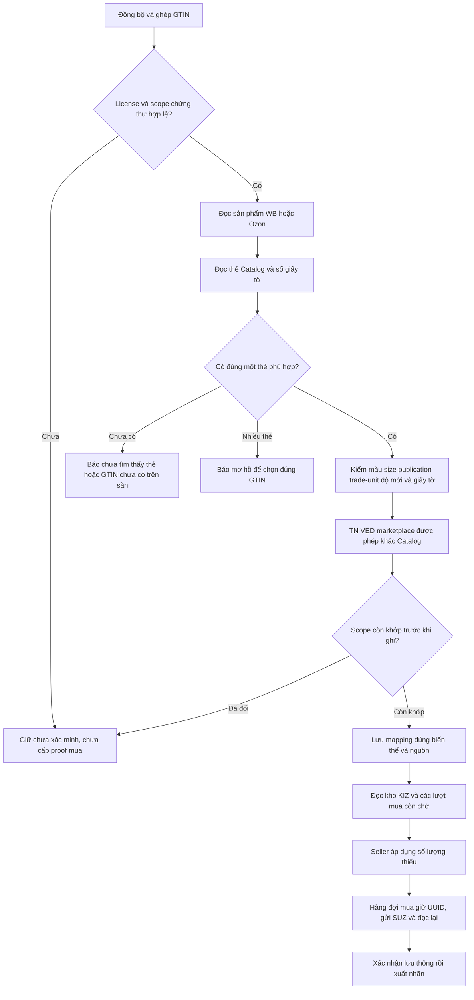

# Code Doctor: mapping mua KIZ, kiểm API thật và bỏ chặn TN VED — 07.11.2026

Nguồn sửa **`5ad16bf3f7ed7d4d3911fd44ab39f42c9f24483c`**, nhánh `audit/code-doctor-20261106`, kế thừa `8feb54d`. [PR #21](https://github.com/ntccong2468-lab/Bancapnhat/pull/21) còn draft. Latest hiện là **v1.6.4/source `86d76d8`**, các sửa audit chưa phát hành.

Đã áp dụng [Code Doctor](../../.agents/skills/code-doctor/SKILL.md), lần theo UI → đồng bộ nguồn → chọn GTIN → proof đúng biến thể → tồn kho/phần thiếu → hàng đợi mua. Người dùng yêu cầu **API thật, không nghiệm thu bằng giả lập**, sau đó chỉ đạo **khác TN VED vẫn được mapping mua KIZ**.

## Kết quả API thật

| Kiểm tra | Kết quả quan sát |
| --- | --- |
| WB Content API | HTTP 200, đọc đủ **388 bài / 1.982 biến thể / 4 trang** |
| National Catalog | HTTP 200, **1.380 thẻ**, 2 trang danh sách + 56 batch chi tiết, tối đa 25 GTIN/batch |
| Trạng thái Catalog qua parser production | 1.260 PUBLISHED, 117 NOT_SIGNED, 2 DRAFT, 1 ERRORS; không có lỗi parse |
| Ozon `/v1/roles` | **HTTP 403/code 7, API key deactivated**; chưa kiểm được mapping Ozon bằng tài khoản này |
| Mẫu WB trước sửa | Có ba barcode chuẩn hóa, một thẻ Catalog thật; review trả **GTIN_AMBIGUOUS** |
| Cùng mẫu sau sửa, đọc WB/Catalog/registry mới bằng SDK production | TN VED vẫn khác; registry HTTP 200, một giấy tờ active; review sau bổ sung registry chọn **một GTIN**, không có issue |

Đợt đọc danh sách dùng HTTP thật qua `urllib` chuẩn của Python. Lượt xác minh sau sửa gọi trực tiếp `WbProductSnapshotReader`, `ZnackApiClient.productCards`, `permitDocuments` và parser/rules production. Article, màu, size, size Nga và tập barcode WB trước/sau khớp hoàn toàn. Hai chuỗi GTIN 13/14 số trong request là cùng một mã chuẩn hóa: request có bốn chuỗi, ba mã chuẩn hóa và server trả đúng một thẻ; không coi alias độ dài là hai thẻ.

Lượt SDK trước sửa: **07.11.2026 12:32:26–12:32:31 MSK**. Lượt sau sửa: **12:40:31–12:40:37 MSK**. [Biên nhận API](kiz-mapping-20261107/live-api.json), [assertion trước/sau](kiz-mapping-20261107/real-regression.json).

**Phạm vi nghiệm thu:** đã xác nhận HTTP thật, parse dữ liệu thật và lựa chọn GTIN theo quy tắc mới. Hồ sơ phân tích riêng chưa có cấu hình chứng thư/OMS của cửa hàng. Không tạo license/chứng thư giả, không ghi proof mapping đã xác minh, không gọi `enqueue`/mua KIZ, không kích hoạt license. Vì vậy **chưa nghiệm thu đồng bộ nguồn đầy đủ có ràng buộc chứng thư hoặc mua KIZ có phí**. Trạng thái `SIGNATURE_NOT_TESTED` trong biên nhận là kiểm cấu hình của hồ sơ phân tích trống, không phải phản hồi API hoặc kết luận về app đang cài của seller.

## Nguyên nhân và phần đã sửa

**1. Báo mơ hồ do đếm barcode WB thay vì thẻ Catalog thực sự.**

`WbCatalogMappingService.eligible` từng đòi toàn bộ barcode hợp lệ về checksum chỉ có một mã. `review` cũng dùng `codes.size()>1` để báo `GTIN_AMBIGUOUS`. Dữ liệu thật có 1.832 biến thể với hai mã và một biến thể có ba mã; phần lớn barcode không xuất hiện trong danh sách Catalog. Trên mẫu có thẻ thật, API trả một thẻ nhưng app vẫn báo nhiều thẻ khớp.

Đã chọn từ các thẻ Catalog thực sự có dữ liệu và vượt qua các điều kiện hiện hành. Một thẻ hợp lệ được chọn dù WB có thêm barcode phụ. Khi có nhiều thẻ đủ điều kiện vẫn báo mơ hồ; GTIN dùng sai các biến thể vẫn bị chặn bởi kiểm tra trùng. Khi cần báo lỗi, ưu tiên thẻ Catalog quan sát được để không che nguyên nhân thực sự bằng barcode khác chưa có thẻ.

**2. Bỏ chặn khác TN VED theo yêu cầu mới.**

Đã bỏ so sánh `GtinTnvedIdentity.compatible(...)` ở cả `WbCatalogMappingService.problem` và `OzonCatalogMappingService.problem`. Mapping mua KIZ có thể dùng thẻ với TN VED khác mã trên marketplace. Metadata cho đơn mua vẫn dùng TN VED và giấy tờ của thẻ Catalog. Quy tắc mới thay thế quyết định trước đây giữ chặn TN VED trong KIZ mapping.

Mẫu thật có article/màu/size khớp, khác nhóm TN VED và một giấy tờ được registry xác nhận active. Sau sửa, chính mẫu đó vượt qua lựa chọn dữ liệu mapping. Kiểm doanh nghiệp/chứng thư, publication, trade-unit, độ mới, đúng biến thể, giấy tờ, tồn kho, UUID và đối soát hàng đợi mua được giữ lại.

**3. Báo rõ thẻ không tìm thấy.**

Khi parser trả đúng `missing_catalog_card`, hai service mapping chuyển thành `GTIN_CARD_NOT_FOUND` thay vì lỗi cục bộ chung. Các lỗi mạng, quyền truy cập hoặc dữ liệu chưa rõ vẫn giữ mã lỗi tương ứng; không biến chúng thành thẻ đã xác minh.

Tệp sửa: [WB mapping](../../src/main/java/com/vncode/app/features/kizmapping/WbCatalogMappingService.java), [Ozon mapping](../../src/main/java/com/vncode/app/features/kizmapping/OzonCatalogMappingService.java) và hai lớp test cập nhật kỳ vọng TN VED mới. Không tắt test, đổi schema/dependency/version hoặc thay UI. Test giả lập không được chạy hay dùng làm bằng chứng nghiệm thu trong lượt này.

## Các phần chưa đủ điều kiện trên dữ liệu đang đọc

- Sau bổ sung phản hồi registry thật cho mẫu đã kiểm, review toàn bộ dữ liệu cho **1 ứng viên đạt điều kiện dữ liệu / 1.981 biến thể có barcode chưa tìm thấy thẻ tương ứng**. Đây là review, chưa phải số mapping đã được lưu có proof.
- **228 biến thể có một ứng viên published khớp article/màu/cỡ nhưng GTIN chưa nằm trong barcode WB.** Kết quả này không đồng nghĩa không có thẻ Catalog. Cần cập nhật GTIN đúng biến thể, hoặc có hồ sơ đăng ký đúng biến thể đã được app xác minh để sử dụng đường proof mua hiện có. Không tự gán GTIN chỉ dựa vào tên gần giống.
- Luồng bổ sung giấy tờ vẫn gọi theo từng GTIN. Dữ liệu thật có 3.816 chuỗi barcode chuẩn hóa có checksum hợp lệ, 3.815 chưa có trong danh sách Catalog đang đọc. Đây là số lượng dữ liệu và rủi ro số request theo mã hiện tại, **không phải phép đo đã chạy 3.815 request hoặc thời gian đồng bộ toàn app**. Lượt kiểm này giữ đường đọc bổ sung để không bỏ qua thẻ chưa xuất hiện ở danh sách; chưa tối ưu nó thành batch.
- Ozon bị chặn bởi credential. Phần bỏ TN VED trên Ozon đã sửa và build, chưa có nghiệm thu HTTP Ozon thành công.
- Gửi đơn mua qua SUZ và ký thật chưa được thử. Môi trường chỉ cấu hình khóa WB/Ozon/Catalog, chưa có bộ cấu hình/chứng thư ký SUZ của cửa hàng. Không gửi khóa Catalog sang SUZ hoặc dựng proof để vượt bước này.

## Luồng sau sửa



Đây là sơ đồ luồng source; các bước đọc/chọn dữ liệu đã kiểm với API thật nêu ở trên. Phần proof theo chứng thư và gửi đơn mua chưa được nghiệm thu trong môi trường này. Kho seller nhập vẫn dùng quy tắc riêng hiện có; bản sửa tác động mapping GTIN phục vụ mua KIZ.

## Lệnh đã chạy và bằng chứng

```sh
/workspace/toolchains/mvn-vncode -B -Dmaven.test.skip=true package
```

**BUILD SUCCESS**, exit 0, 20,538 giây; kết thúc **07.11.2026 12:39:10 MSK**. JAR version hiện tại 1.6.4, chưa công bố; hash và hai class mapping khớp output trong [build.json](kiz-mapping-20261107/build.json). Không chứa probe hoặc `LicenseDomainFixture`. Các test mô phỏng không được chạy trong lệnh này; không dùng số test của phiên trước làm kết quả nguồn mới.

Các lệnh API đã chạy có dạng sau, với `PRIVATE_API_DIR` là thư mục `/tmp` quyền 0700 chứa dữ liệu thật ngoài Git; `DEPS` là classpath từ `/tmp/ozon-combined-classpath.txt`. Xem [mã probe và cách tái lập](kiz-mapping-20261107/README.md) để tạo thư mục mới; không dùng dữ liệu app đang cài.

```sh
python3 PRIVATE_API_DIR/fetch-live.py

/workspace/toolchains/jdk-25.0.4.1/bin/javac \
  -cp "target/classes:DEPS" -d PRIVATE_API_DIR/classes \
  PRIVATE_API_DIR/KizMappingApiAudit.java PRIVATE_API_DIR/KizMappingFreshRead.java

# SDK dùng proxy/CA được môi trường cung cấp; credential chỉ đọc từ Secrets
/workspace/toolchains/jdk-25.0.4.1/bin/java \
  -Dhttps.proxyHost=proxy -Dhttps.proxyPort=8080 \
  -Dhttp.proxyHost=proxy -Dhttp.proxyPort=8080 \
  -Djavax.net.ssl.trustStore=/etc/ssl/certs/java/cacerts \
  -cp "PRIVATE_API_DIR/classes:target/classes:DEPS" \
  com.vncode.app.features.kizmapping.KizMappingFreshRead PRIVATE_API_DIR after
```

Đường dẫn tham số đã rút gọn để không lưu thư mục raw seller vào repo. Lượt truy cập đầu chạy inline bằng cùng các endpoint được lưu trong `read-access.py`. Các bản helper lưu trong repo thêm guard thư mục riêng, được compile/kiểm cú pháp; không tính đó là thêm lượt gọi API.

OpenQodex **0.16.0** chạy scanner-only trên bốn tệp Java thay đổi, base `8feb54d`; chọn **Gitleaks 8.21.2**, status **ran**, 0 ứng viên, exit 0. Hai mươi mốt scanner khác không chọn, không có reviewer AI độc lập. [Trạng thái scanner](kiz-mapping-20261107/scanner.json). Kiểm riêng 15 tệp bàn giao/memory/helper: lần đầu có ba SHA256 mã nguồn bị nhận nhầm là API key; đã đối chiếu đủ ba. Metadata được trình bày bằng cặp `path`/`sha256` rõ loại, lượt quét cuối 0 ứng viên, không thêm suppression. [Biên nhận](kiz-mapping-20261107/handoff-secret-check.json).

```sh
NODE_USE_ENV_PROXY=1 NODE_USE_SYSTEM_CA=1 \
  OPENQODEX_HOME=/tmp/products-five-openqodex-state OPENQODEX_AUTO_UPDATE=off \
  node /tmp/products-five-openqodex/package/dist/bin.js scan \
  --cwd /workspace/vncode-znack-reconcile \
  --base 8feb54d81509b39e98db9dbecdacc26230f21712 \
  --config /tmp/products-five-gitleaks-only.yaml \
  --format sarif --report-dir /tmp/kiz-mapping-live-openqodex
```

Raw API response, GTIN, mã bài, giấy tờ, request và profile đọc dữ liệu thật giữ ngoài Git. Bằng chứng công khai chỉ có số liệu, trạng thái, hash và mã nguồn helper không chứa credential. Không có marketplace/Catalog mutation, mua mã, ký CryptoPro, kích hoạt license hoặc gửi Gmail trong lượt này.
