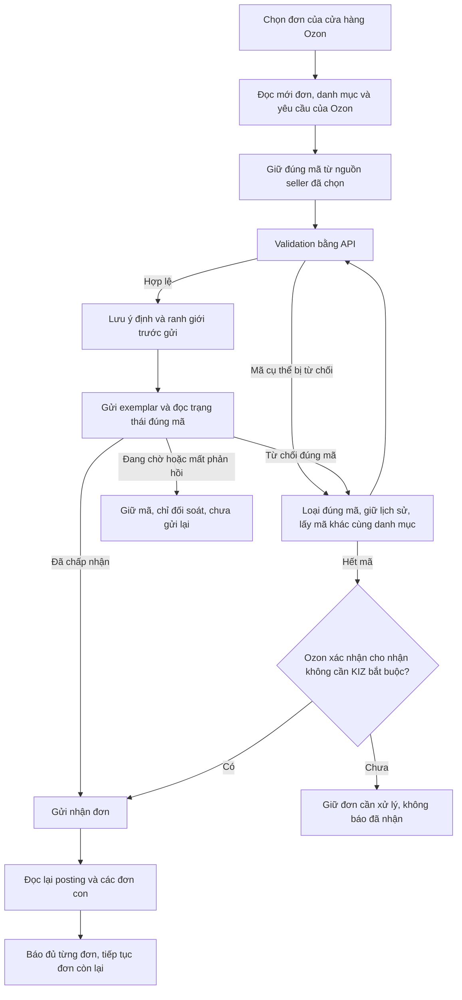

# Code Doctor — PDF kết hợp và nhận toàn bộ đơn gilet Ozon, 1.6.5 chưa phát hành

Ngày 07.11.2026, MSK (UTC+03:00). Nối tiếp phần gộp ban đầu `286549c` / bàn giao `15a7441`, theo thứ tự người dùng yêu cầu: sửa PDF Ozon thiếu KIZ kết hợp, đề xuất mapping khác cách ghi tên/SKU; sau đó nhận thật toàn bộ đơn gilet bằng file PDF seller gửi và tự thay mã bị từ chối. **Quy tắc mới chỉ cho Ozon; giữ nguyên WB. Chưa công bố Latest.**

## Lỗi đã chứng minh và sửa

| Lỗi | Bằng chứng trước sửa | Thay đổi |
| --- | --- | --- |
| Có KIZ đã giữ nhưng PDF chỉ có vận đơn | 4 ca job pending thất bại; preparation không được gọi vì chỉ stage VALIDATED/ACCEPTED mới được gỡ carrier-only. | `8845573`: `OzonPrintBundleService` đưa job RESERVED/SET_PENDING/VERIFYING/RECONCILE_REQUIRED có binding về bước đối soát. Không tự cho in nếu thiếu/sai proof. |
| KIZ bị Ozon từ chối thì dừng hoặc chỉ bỏ qua marking tùy điều kiện nhận | Hai ca validation/status dừng bằng `OZON_ACCEPT_KIZ_REJECTED`. | `OzonAcceptanceKizService` và `OzonAcceptanceKizReplacement`: xác định đúng product/slot/code, loại mã bị từ chối, lấy mã tiếp theo của đúng danh mục seller, validate/gửi/đọc lại. |
| KIZ đã in trước khi nhận bị từ chối không thể thay | Ca mới lỗi `Invalid Ozon exemplar job transition: ACCEPTED -> VALIDATED`. | Cho mở lần gán mới riêng trong transaction thay mã đã chứng minh bị từ chối, giữ journal và proof nguồn. Không nới bảng chuyển trạng thái chung hoặc sửa lịch sử PDF cũ. |

Nhận đơn UI theo lô đi qua `OzonDashboardController` → `OzonShipService.shipPerUnit` → `OzonUnitShipService` → bộ xử lý KIZ chung của Ozon vừa sửa. Đường ship trọn gói Ozon cũng gọi bộ này. Báo cáo lô hiện có giữ đủ completed/pending/failed/notProcessed và đối soát cuối lô; không tự đánh dấu toàn lô thành công nếu API còn từ chối.

## Quy tắc sau sửa

- Kho seller nhập theo danh mục, không đòi GTIN bằng GTIN bài Ozon. Kho mua và các proof mua vẫn giữ quy tắc riêng; không tự mua trong lượt nghiệm thu.
- Chỉ thay sau từ chối **đúng mã**. Lỗi GTD/chứng từ, sai product/slot, quyền, mạng hoặc đang processing không loại hàng loạt mã.
- Thêm bảng `ozon_accept_kiz_replacements` cùng index active/job bằng `CREATE ... IF NOT EXISTS`, giữ schema 6 và dữ liệu cũ. PREPARED có thể tiếp tục sau mở app; SENDING/AWAITING chỉ đọc lại, không replay mutation.
- Mã thay và binding mới, proof danh mục, payload đầy đủ được lưu cùng transaction; giữ các mark khác, GTD/RNPT và metadata từ lần đọc mới. Không dùng một pool mã bất kỳ của cửa hàng.
- Giữ giới hạn API/cooldown và kiểm owner/license; dừng theo yêu cầu hủy của seller. Giới hạn bảo vệ 1.000 lần thay trong một lần xử lý không biến đơn chưa xong thành thành công; có thể tiếp tục từ journal khi còn việc.

## Nghiệm thu API thật

[Biên nhận đã loại dữ liệu seller](ozon-165-20261107/live-api.json).

- PDF seller đọc được **200/200 mã DataMatrix đầy đủ**, 0 trùng, 0 lỗi đọc.
- Cặp Ozon mới đọc `/v1/roles` HTTP 200, đọc catalog và posting thật. Secrets cũ trong môi trường chưa được xác nhận đã đổi; không lưu credential vào Git.
- Từ 6 đơn gilet ban đầu, tiếp tục đọc và nhận các đơn phát sinh trong lúc thử, tổng **9/9 đơn**. Mỗi đơn đối chiếu danh mục gilet và native ID từ catalog Ozon thật.
- `/v5/.../validate`, `/v6/.../set`, `/v5/.../status` thật xác nhận **9 mã riêng biệt**; `/v4/posting/fbs/ship` thật một lần/đơn. HTTP 200 của ship chưa được coi là hoàn tất khi GET ngay sau vẫn awaiting_packaging.
- Đối soát read-only bằng service production xác nhận **9/9 receipt**, **9/9 đơn `awaiting_deliver`**, 9/9 mã đúng binding được Ozon chấp nhận. Lượt đọc lại sau cùng có **0 đơn gilet chờ nhận** trong tập vừa quét; không hứa bao gồm đơn phát sinh sau thời điểm này.
- **Không có mã trong 9 mã thật bị từ chối**, vì vậy nhánh thay mã không phát sinh trên API thật ở lượt này. Nhánh đó được chứng minh bằng hồi quy có phản hồi xác định ở cả validation/status, mất kết quả, mở lại, hết kho và sai danh mục. Không cố gửi mã hỏng để tạo kết quả đẹp.
- Dùng profile SQLite riêng và local test authority ngoài JAR để gọi domain production; không kích hoạt license từ xa, gửi Gmail, mua KIZ, ghi GTIN/sản phẩm, hoặc gọi WB. Đây không phải thao tác bấm trên app Windows đang cài.
- Nguồn API thật: đơn đầu dùng sửa PDF `8845573`; 8 đơn sau dùng runtime bổ sung thay mã (JAR đối chiếu `35e65f65…` và output tương đương). Nhánh mở job đã in được bổ sung sau 9 đơn này, nghiệm thu hồi quy riêng, không nhận là đã kích hoạt nhánh này qua API thật.

## PDF thật và giới hạn công cụ kiểm

Một đơn gilet đã chờ giao từ trước được xuất qua service production với vận đơn Ozon tải thật và một mã từ file mới: **2 trang**, vận đơn nguyên bản + nhãn KIZ kết hợp. Giải mã độc lập ở **203/300 dpi khớp binding**, content stream trang vận đơn khớp nguồn Ozon. Không gửi KIZ hay nhận thêm đơn trong lượt xuất PDF đó.

Công cụ hậu kiểm ban đầu dùng sai kiểu reflection `int` thay `float` và lỗi sau khi PDF đã được xuất. Đã đọc lại file/SQLite bằng verifier chỉ đọc, **không chạy lại tạo nhãn**. File thật, mã thật và raw response chỉ ở thư mục riêng ngoài Git. [PDF/ảnh tổng hợp cho review](assets/ozon-165-20261107/paired-pending-rejected-fixture.pdf) là **fixture**, không phải PDF seller.

Phương án mapping khác tên/SKU là [đề xuất riêng](../research/2026-11-07-ozon-catalog-variant-link-proposal.md), chưa bật ghép tự động hoặc gửi GTIN Ozon. Cần một cặp native variant đã duyệt, không dựa tên gần giống hoặc size đơn lẻ.

## Kiểm thử, build và phần chưa xác minh

Nguồn nhận đơn **`3c865b6d6c15d616d083c65502a02778d77de6f2`**, kế thừa sửa PDF **`8845573`**. [Biên nhận kiểm chứng](ozon-165-20261107/verification.json) ghi lệnh chính xác và từng lớp: **209/209 ca, 15 lớp, 0 failure/error/skip, Maven package SUCCESS**. Trong đó 42 ca nhận đơn gồm 13 ca hồi quy mới; kiểm schema/snapshot, trạng thái, lô 101 đơn, UI Ozon và PDF kết hợp đều được giữ. JAR **7.448.469 byte**, SHA256 `7421b352766cf38bfe73d1b9256706afc661f5976a421875f059f1814396887b`, **1.937 class** khớp output, không có probe/fixture. Startup chính JAR trên Linux/Xvfb/profile trống: **6.281 ms**, viewport **1280×700**, đóng/nhả lock đạt, license UNVERIFIED, không kích hoạt.

OpenQodex 0.16.0 thực chạy Gitleaks 8.21.2 theo phần thay đổi; 0 finding, 21 scanner khác tắt, không có AI reviewer độc lập. Lệnh và phạm vi thật nằm trong JSON; không gọi đó là review toàn repo. Giữ riêng kết quả gộp đầu: 737 ca có một failure UI, ca riêng/lớp controller sau đó đạt; không dùng nó để gọi full suite ổn định. Không có Windows installer/kiểm máy seller cho nguồn mới. Latest giữ v1.6.4; không tạo tag, gọi publisher hay triển khai portal/DPAPI.
