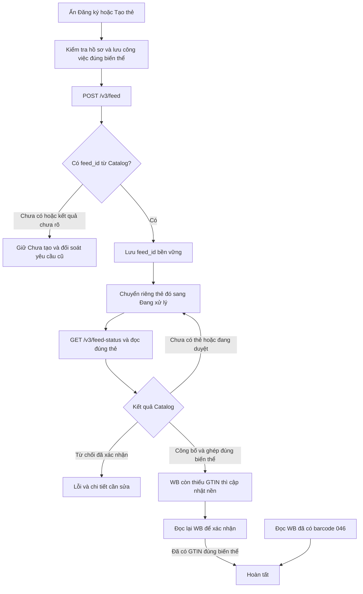

# Znack WB — nhận feed, bốn trạng thái và cập nhật GTIN nền

Ngày 07.11.2026. Nhánh `fix/wb-znack-auto-gtin`, kế thừa Ozon `86b1dcc` và nền đã công bố `61f5ae5`. Nguồn WB ban đầu `a95201d`; nguồn cuối, lệnh, số ca và hash JAR nằm trong [biên nhận](wb-znack-auto-20261107/verification.json). **Chưa phát hành hotfix xuống app; Latest vẫn là 1.6.5 immutable.** JAR cục bộ có version POM 1.6.5 để kiểm build, không phải thay thế binary đã phát hành.

## Chẩn đoán và nguyên nhân đã tái hiện

- Hai regression cho thấy GTIN 046 có thật trong barcode WB vẫn bị giữ ở Đang xử lý/Cần kiểm tra vì giao diện ưu tiên việc ghép Catalog. Đây là trạng thái WB; không dùng quy tắc tiền tố để chứng minh chủ sở hữu Catalog hoặc quyền mua KIZ.
- Regression SQLite giữ shared writer và bắt đầu claim đăng ký tái hiện `SQLITE_BUSY`: claim cũ tự mở transaction, hết chờ 5 giây trước khi gửi HTTP. Đây là một bước chặn trước Catalog đã xác định; không kết luận mọi lỗi đăng ký trên máy seller đều do SQLite.
- Hàng đợi chỉ cho đăng ký một lô, nên một thẻ đang gửi làm các nút tạo thẻ khác không thể thêm công việc. Không được khắc phục bằng cách tạo lô trùng hoặc reset danh tính của cả lô cũ.
- Theo yêu cầu cuối của seller, `feed_id` đã lưu phải đưa thẻ ngay vào **Đang xử lý**, dù Catalog chưa trả `good_id`. Baseline mới thất bại 2/2 trên cả query SQL và query có Catalog observation. Sau khi sửa bộ lọc, một regression JavaFX khác vẫn thất bại: số feed được nhận tăng nhưng bộ đếm đã tạo/chờ đọc thẻ chưa đổi, nên màn Chưa tạo không làm mới. Đã thêm cả `acceptedFeeds`/`awaitingReadback` vào điều kiện làm mới.

## Hành vi sau sửa

- Bộ lọc giữ bốn mục Chưa tạo, Đang xử lý, Hoàn tất, Lỗi và lựa chọn Tất cả. Nhận `feed_id` là đang xử lý yêu cầu, **chưa khẳng định Catalog đã tạo/công bố thẻ**. HTTP 200 thiếu biên nhận không được chuyển thành gửi thành công. Không có biên nhận vẫn cần đối soát trước khi gửi lại.
- Mỗi biên nhận mới cập nhật danh sách, kể cả đang lọc Chưa tạo. Không chờ cả lô xong. Thông tin feed và công việc được lưu trước GET trạng thái; mở lại tiếp tục đọc yêu cầu cũ. Thẻ đã có barcode WB theo quy tắc 046 luôn ưu tiên Hoàn tất.
- GTIN 046 đọc thật từ WB, kể cả EAN-13 chuẩn hóa thành GTIN-14, đánh dấu Hoàn tất và bỏ nút cập nhật lại. Không dựng Catalog publication, KIZ mapping hoặc bằng chứng sở hữu từ barcode này.
- Với Catalog đã công bố nhưng WB thiếu GTIN: ghi nhận quyền cập nhật nền theo đúng cửa hàng, khóa và biên nhận đọc hai nguồn thành công. Quyền cũ vô hiệu khi cấu hình/owner/nguồn thay đổi. Giữ kiểm tra biến thể, owner, thẻ mới nhất, hàng đợi giá, giới hạn tốc độ và đọc lại barcode; không ghép theo tên gần giống hoặc bỏ guard khi thiếu chứng cứ.
- Claim, cập nhật tiến độ, lưu batch sản phẩm WB và command journal dùng cùng cơ chế tuần tự ghi SQLite. Chỉ giữ transaction cục bộ; không bọc HTTP trong transaction. Lỗi đọc `SYNC_STORAGE_BUSY` có thể thử đọc lại nguồn ở nhịp nền tiếp theo.
- Có thể thêm thẻ mới đã xem duyệt vào lô đang chạy: gộp nguyên tử, loại trùng, không đổi intent/danh tính của thẻ cũ, không tự đổi chế độ ký của lô. Lô tạm dừng/hủy giữ nguyên cơ chế bảo vệ.
- Bỏ nút **Thao tác khác**; các chức năng nâng cao được giữ trong menu chuột phải/Shift+F10 của bảng. Cấu hình giấy tờ cục bộ vẫn mở được khi nguồn Catalog chưa sẵn sàng.

## Tệp runtime chính

| Tệp | Vai trò |
| --- | --- |
| `features/gtinsync/WbRegisteredBarcode.java` | Quy tắc hoàn tất theo barcode WB, dùng chung Java và SQL |
| `features/sync/RegistrationCardIndex.java` | Tách biên nhận đang xử lý khỏi bằng chứng có thẻ và quyền gửi lại |
| `ui/znackregistration/ZnackRegistrationQueryRepository.java` | Bộ lọc, đếm và lựa chọn toàn bộ theo trạng thái đúng |
| `ui/znackregistration/ZnackCardRegistrationController.java`/FXML | Trạng thái/nút, làm mới từng biên nhận và bỏ menu phụ trên thanh lọc |
| `features/sync/WbAutomaticGtinUpdate.java`, `ZnackAutoSyncService.java`, `RegistrationSources.java`, `SyncRuntime.java` | Cập nhật nền gắn với biên nhận nguồn và phạm vi cửa hàng |
| `ZnackCardRegistrationRepository.java`, `WbProductRepository.java`, `v3/RegistrationCommandJournal.java`, `CatalogFeedback.java` | Sửa cạnh tranh writer và phân loại lỗi đọc có thể thử lại |
| `RegistrationSourceConsent.java`, `ZnackRegistrationBatchService.java`, `ZnackRegistrationBatchStore.java` | Thêm công việc đã duyệt vào lô đang chạy, giữ intent và chống trùng |

## Kiểm chứng

- Lệnh chính xác, từng lớp, baseline trước sửa, source hash, số ca và package nằm trong JSON liên kết đầu trang. Nhóm hồi quy gồm query/JavaFX, SQLite writer, command journal, source consent, HTTP feed/429/mất mạng/khởi động lại, WB readback/giá và guard Ozon không đổi.
- HTTP integration kiểm ngay **bên trong GET feed-status đầu tiên**: biên nhận vừa lưu đã xuất hiện ở Đang xử lý trong khi `good_id` còn null. Ba feed chưa có thẻ không được tính thành ba thẻ đã tạo. Lượt phục hồi chỉ đọc feed cũ, không POST trùng. Đây là HTTP fixture cục bộ, không phải Catalog thật.
- [Ảnh JavaFX](assets/wb-znack-auto-20261107/README.md) dùng dữ liệu tổng hợp, có màn vừa nhận feed và màn Hoàn tất theo WB. Không chứa dữ liệu seller.
- [Đọc API thật](wb-znack-auto-20261107/live-read.json): WB một trang 100 bài/504 biến thể và Catalog đọc kết nối, HTTP 200. 420 barcode có chuỗi đầu 046; thêm 20 EAN-13 tương đương khi chuẩn hóa. JSON WB thật đi qua model/repository/query production trong DB riêng: **440 Hoàn tất, 64 Chưa tạo** khi không dựng quan sát Catalog. Không phải đối chiếu toàn danh mục hoặc bằng chứng công bố Catalog. Biên nhận giữ đúng SHA đã chạy lượt đọc này.

## Giới hạn và quyết định bàn giao

- Không có POST Catalog mới, ký/công bố, giá/GTIN WB, mua KIZ, nhận đơn hoặc kích hoạt license thật trong lượt này. Chưa được cung cấp hồ sơ OMS/chứng thư ký thật để kiểm chuỗi đăng ký end-to-end; không fake license/chứng thư hoặc tắt guard để lấy kết quả xanh. API đọc được không chứng minh quyền ghi/ký.
- Chưa chạy Windows/seller UI/bộ cài trên source hotfix, chưa chạy lại toàn bộ khoảng 4.000 ca hoặc security/AI review độc lập. Không dùng kết quả Windows của release 1.6.5 để chứng nhận mã sửa sau đó.
- Phần Ozon hoàn tất trước và được kế thừa: [bàn giao](2026-11-07-ozon-auto-kiz-handoff.md), [237 ca](ozon-auto-kiz-20261107/verification.json). Quy tắc KIZ seller nhập theo danh mục và kho mua theo mapping được giữ riêng; không dùng việc nhận feed để mở quyền mua/ghi sàn.
- Nếu có yêu cầu phát hành mới, tạo version/tag mới và chạy gate Windows từ đúng SHA; **không ghi đè 1.6.5 immutable**, không tự merge/publish từ bàn giao này. Dữ liệu seller, DB thật, API raw và credential chỉ ở vùng riêng ngoài Git; bằng chứng công khai chỉ chứa số đếm và hash.

Kinh nghiệm: tách ba bằng chứng **Catalog nhận yêu cầu**, **Catalog có/công bố thẻ**, **GTIN có trên đúng biến thể WB**. Một bộ đếm đã tạo không thay được số biên nhận đã nhận; trạng thái hiển thị không được trở thành quyền lặp lại POST. Dùng cùng writer cho các thao tác SQLite liên quan thay vì tăng timeout từng repository.
