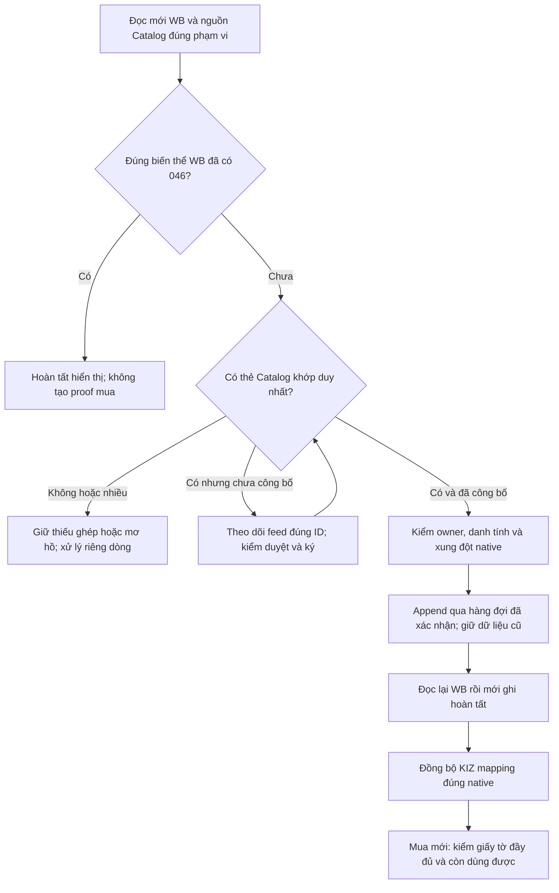

# Kiểm KIZ mapping, đăng ký Znack và GTIN WB — 08.11.2026

Nguồn **`6905fe0a73b5300b6f5390ed0c71dbeca62ea81a`**, nhánh `fix/kiz-znack-wb-gtin-audit-20261108`, nền `4cea038`; giữ giao diện native đã duyệt (`5f816b1`) và sửa WB màu/giấy tờ `ae2d48a`. Dùng Code Doctor, tái hiện trước sửa, kiểm hồi quy và review nguồn độc lập. [Biên nhận](2026-11-08-kiz-znack-wb-gtin-audit.json).

## 1. Chẩn đoán từ ảnh và API thật

Ảnh của seller có 1.854/1.982 đã xác nhận, 110 chưa ghép và 18 cần xử lý; nhóm lý do 5 `GTIN_AMBIGUOUS`, 105 `ZNACK_MAPPING_UNVERIFIED`, 18 `GTIN_ON_ANOTHER_PRODUCT`. Hai nhóm đầu cộng 110, không phải cả 128 đều đã gửi API rồi thất bại.

Đọc mới bằng Secrets môi trường: **62/62 HTTP 200**, gồm bốn lượt WB Content list, hai lượt Catalog list, 56 lượt Catalog detail. Đây là đọc; POST WB `/content/v2/get/cards/list` không phải ghi thẻ. Không gửi feed, mua KIZ, ký, kích hoạt license hay Gmail. Parser/index production chạy trên dữ liệu thực, không test-license/chứng thư giả hoặc DB seller.

- WB: 388 bài, 1.982 biến thể; 1.854 có barcode 046, 128 chưa có. Mọi barcode hợp lệ có đúng một chủ `nmID/chrtID`. Năm biến thể có hai mã 046 nằm trong nhóm 1.854 hoàn tất; không được lấy số năm đó làm bằng chứng cho lỗi mơ hồ trong ảnh.
- Catalog: đủ chi tiết 1.380 thẻ, gồm 1.260 published, 117 not-signed, hai draft, một errors. List không có đủ article/màu/size nên không dùng list để kết luận ghép.
- Trong 128 biến thể WB chưa có 046: ba có thẻ published khớp chính xác, 11 có thẻ not-signed khớp, 114 không có tổ hợp khớp trong tập API này. Đây là ứng viên theo thuộc tính/trạng thái, chưa chứng minh đầy đủ quyền chủ/chứng thư hoặc đã ghi.
- Trong **114**: **113 dòng thuộc 26 article** không trùng bất kỳ giá trị article đã quan sát trên Catalog sau chuẩn hóa; **một dòng** khớp article/màu nhưng khác size thực hoặc size Nga. Không có trường hợp chỉ lệch màu; không dùng TN VED để loại ứng viên WB. Bốn thẻ Catalog có nhiều giá trị article bị `.single()` trả rỗng, nhưng không thẻ nào giải thích 114 dòng này.

**114 không có nghĩa 114 thẻ chưa đăng ký.** Article khác có thể do cách ghi, thẻ không thuộc tập trả về hoặc dữ liệu của khóa/tài khoản khác. Bộ khóa môi trường chưa được ràng buộc với hồ sơ/chứng thư trên máy seller. Tập đọc này không tái hiện đúng các nhóm 5/18/105 hoặc chỉ ra từng dòng trong ảnh. Không tự chọn GTIN theo tên gần giống hay suy đổi size.

CSV riêng ngoài Git `/workspace/vncode-flow-audit-20261108/private-wb-pending-128.csv` giữ 128 dòng, đầy đủ màu, mã native, ứng viên/trạng thái/lý do; UTF-8 BOM, quyền 0600, thư mục 0700. Không commit article/SKU/GTIN hoặc raw HTTP vào repo. Receipt lưu hash, số dòng và phạm vi nguồn. Nếu workspace mất, cần khôi phục artifact hoặc đọc lại theo quyền hiện hành.

## 2. Nguyên nhân đã tái hiện và thay đổi

| Phần | Lỗi đã chứng minh trước sửa | Sửa tối thiểu |
| --- | --- | --- |
| WB KIZ mapping | GTIN bị sao sang article khác nhưng cùng màu/size vẫn báo mapped | Kiểm article theo đúng chuẩn hóa của proof mua hiện có; không đổi quy tắc Ozon liên kết đã duyệt |
| WB KIZ mapping | Biến thể không có barcode GTIN dùng được biến mất khỏi cả mapped và issues | Báo `GTIN_BARCODE_MISSING`, hướng dẫn cập nhật GTIN cho đúng biến thể |
| WB KIZ mapping | Nhiều thẻ đều không đủ điều kiện vẫn báo mơ hồ | Chỉ báo mơ hồ khi có nhiều thẻ đủ điều kiện; còn lại giữ lý do thật như giấy tờ hết hạn |
| Mua KIZ mới | Giấy tờ hết hạn/thu hồi/chưa hiệu lực vẫn qua proof; projection làm mất hiệu lực khi chuyển sang goods | Kiểm rich Catalog permit ngay trước yêu cầu mua mới; projection chỉ mang giấy tờ còn dùng được và xóa projection lỗi đã xác minh, giữ rich cache để chẩn đoán |
| Đọc đăng ký Znack | Phản hồi ghi rõ `feed_id` khác có thể làm tiến trạng thái hoặc từ chối nhầm yêu cầu đã lưu | Chặn ID khác trước khi đọc trạng thái/thẻ; phản hồi cũ không có trường ID vẫn tương thích |
| Cập nhật GTIN WB | Receipt nguồn còn hạn 24 giờ khiến nút cập nhật phân loại NO_MATCH/046 từ cache trước khi đọc mới WB | Khi receipt đã đủ, chỉ đọc mới WB trước ghép; dùng lại Catalog cache còn hợp lệ, không gửi lại các GTIN đã có |
| Worker WB đang chờ | Dòng chưa gửi bị chặn giữ trạng thái cũ dù cache đúng biến thể đã có 046 | Hoàn tất riêng dòng chưa có child journal bằng cập nhật nguyên tử có so sánh owner, khóa native, GTIN/trạng thái/timestamp và barcode còn hiện diện |
| Thông báo | Ba lý do trong ảnh hiện raw code; xung đột dùng lời khuyên chỉ Ozon ngay cả trên WB; lỗi giấy tờ rơi về VN_LOCAL | Hiển thị lý do cụ thể, trung lập theo sàn; giữ mã giấy tờ chính xác, bỏ wrapper/secret khỏi nội dung người dùng |
| Đổi API Catalog | Khóa mới đã được xác minh nhưng receipt/cached observation của khóa cũ vẫn còn được coi là mới; đổi A → B → A có thể làm client cũ hợp lệ lại theo digest | Tách phiên bản lần đọc khỏi danh tính chủ vật lý; đổi/xóa khóa làm cần đọc mới, chặn worker/cursor/merge cũ, giữ nguyên feed/job/lịch sử và nhận diện kho có sẵn |

Nhóm chính được thay: `WbCatalogMappingService`; `KizPurchaseMappingProof`, `ZnackCatalogSyncService`, `ZnackPurchaseCoordinator`; `ZnackNationalCatalogService`; `ZnackGtinReviewService`, `ZnackAutoSyncService`, `SyncRunRepository`; formatter/diagnostics và bốn locale. Receipt ghi hash và toàn bộ tệp kiểm thử.

Giữ scope cửa hàng/chứng thư, đúng article/màu/size, barcode cũ, owner/publication, journal/unknown mutation, feed dedupe, readback, lịch giá WB và giới hạn API. Không coi 046 là proof mua KIZ hoặc quyền Catalog. Không đổi `RegisteredGtinProof.currentObservation` chung hoặc `resolve` cho kho có sẵn. Kho seller nhập, in hiện có và đăng ký prepublication được chấp nhận giữ quy tắc cũ; guard giấy tờ mới chỉ dành cho mua trả phí. Resume đơn mua đã tồn tại chạy trước điều kiện tạo đơn mới, không mua lặp.



## 3. Kiểm chứng

Lượt tập trung: **481 ca / 27 lớp, 0 failure/error/skip**, Maven test thành công tại nguồn đã đóng băng. Có repro đỏ trước sửa và kiểm tra xanh bằng compile/JUnit riêng cho từng nhóm; các lượt giao nhau không cộng dồn. Lượt WB riêng cuối bị mất dependency trong lúc Maven biên dịch lại `target`, không dùng làm proof cuối; dùng Maven tập trung/rộng trên nguồn cuối.

Lệnh kiểm tập trung được lưu cùng receipt và danh sách lớp; lệnh thực thi:

```bash
PATH=/workspace/toolchains/xvfb-current/root/usr/bin:$PATH xvfb-run -a -s '-screen 0 3200x1800x24' /workspace/toolchains/mvn-vncode -B -Dtest="$(cat /workspace/vncode-flow-audit-20261108/focused-test-names.txt)" test
```

Lượt hồi quy rộng/package chọn 260 lớp thuộc KIZ/mapping/GTIN/nguồn sản phẩm/WB/Catalog và UI liên quan; tách ba phương thức `GtinBulkPipelineTest#*TenThousand*`, không sửa annotation hoặc nới test để xanh. Receipt ghi kết quả thật, log/hash/command, các suite và nguồn cuối. Đây không phải toàn bộ suite app hay kiểm 10.000 GTIN thật.

Lượt rộng này **2.424/2.424 ca, 260 lớp, 0 skip, package PASS** trước sửa bổ sung read-epoch khi đổi khóa. Snapshot từng tệp và JAR trung gian được giữ để không dùng kết quả nguồn trước chứng nhận nguồn sau. Lượt kiểm cuối cho read-epoch và các đường bị ảnh hưởng được ghi riêng trong receipt; không cộng các ca giao nhau.

```bash
PATH=/workspace/toolchains/xvfb-current/root/usr/bin:$PATH xvfb-run -a -s '-screen 0 3200x1800x24' /workspace/toolchains/mvn-vncode -B -Dtest="$(cat /workspace/vncode-flow-audit-20261108/related-test-names.txt)" package
```

**Nguồn cuối: 707 ca / 44 lớp, 0 failure/error/skip; package PASS**. JAR SHA `e6db5f330f5bd345bda3d3beee4f0ba1323babc9197cfb3ee8558525107f1fab`, 1.977 class khớp byte output, resources khớp source và Git, không fixture/probe. Trước guard phục hồi một dòng, 907 ca / 79 lớp đã đạt; chỉ `RegistrationSources.java` trong production khác lượt 907, đã kiểm lại trong 707. Không cộng các ca giao nhau.

Lệnh chốt:

```bash
PATH=/workspace/toolchains/xvfb-current/root/usr/bin:$PATH xvfb-run -a -s '-screen 0 3200x1800x24' /workspace/toolchains/mvn-vncode -B -Dtest="$(cat /workspace/vncode-flow-audit-20261108/acceptance-test-names.txt)" package
```

[Replay bằng đúng JAR cuối](kiz-znack-wb-20261108/final-production-replay-proof.json) chạy lại hai probe trên dữ liệu API đã chụp, không mạng/DB/license fixture: toàn bộ aggregate khớp, gồm 114 = 113/26 article + một size.

Review độc lập đọc 41 tệp diff/tests và snapshot hash: không còn finding vật chất đã xác nhận trong patch được xem; không phải scanner toàn source hoặc chứng nhận API. Không dùng HTTP 200 đọc dữ liệu làm chứng nhận đăng ký/ký/mua/cập nhật thật.

## 4. Giới hạn và bàn giao

Chưa nghiệm thu ghi WB/Catalog, mua KIZ/lưu thông, ký CryptoPro hoặc hồ sơ seller Windows trong lượt này. Không dùng giấy tờ, license hoặc quyền chủ giả để mở ghi thật. Chưa kiểm Windows/bộ cài; chưa phát hành, không bump version/ghi đè asset 1.6.6. Candidate cục bộ có thể cùng tên phiên bản nhưng là binary khác Latest; nguồn UI cũ và ảnh review giữ phạm vi lịch sử riêng.

Các xung đột GTIN trên sản phẩm/size khác vẫn cần đối chiếu đúng chủ native; không gỡ chặn để ép ghi. Nếu thẻ Catalog cùng sản phẩm nhưng khác article, cần liên kết chính xác được xác nhận hoặc sửa đúng hồ sơ, không tự ghép bằng tên. Muốn chốt từng dòng 5/18/105 trong ảnh phải đối chiếu report/journal và cấu hình Catalog đúng hồ sơ đó; bộ đọc môi trường chưa thay thế được bằng chứng này.

Read epoch được lưu riêng trong `app_config`, không đổi schema hoặc hash chủ vật lý. Phân biệt current/complete, ràng buộc client/cache/cursor/quan sát; common writer và projection kiểm trước commit, kể cả kết quả rỗng. Quan sát Ozon giữ epoch đọc ban đầu qua hai đường SQL publication/link. Trường local `readRevision` tương thích JSON cũ và bị loại khỏi fingerprint nội dung vật lý để giữ job/approval cũ. Marker paired đọc WB+Catalog phải hoàn tất trước khi readiness được dùng; thiếu marker sau crash dẫn đến đọc lại an toàn, vẫn hiển thị lịch sử.

**Rollout dữ liệu cũ:** default read epoch rỗng giữ tương thích. Nếu khóa đã đổi trước phiên bản này, cache cũ không ghi lịch sử theo từng khóa nên không thể suy ra hồi tố. Khi đưa bản sửa vào app, chạy Đồng bộ Znack đầy đủ một lần trước khi so sánh báo cáo 5/18/105; không xóa profile/feed/job hoặc tạo lại thẻ. Thay đổi khóa sau đó được theo dõi bằng epoch mới, kể cả A → B → A.
