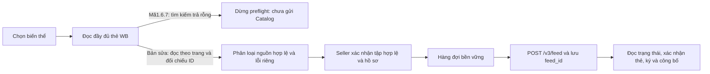

# Đăng ký Znack 300–10.000 biến thể: lỗi đọc nguồn WB trước khi gửi Catalog

Nguồn phát hành đối chiếu: VN Code1.6.7, `d0231cd6913ce3a1764067bad0901b32c535de41`. Nhánh sửa `fix/znack-preflight-bulk-20261110` xuất phát từ commit tài liệu `95d89425b5c97764571a28466b3acc61a2913090`, giữ nguyên toàn bộ mã1.6.7. Người dùng báo cửa hàng **cửa hàng WB được xác nhận**, lỗi lúc14:31:06 MSK ngày10.11.2026. Đây là bản sửa nguồn, chưa phải một bản phát hành mới.

## Chẩn đoán đã xác minh

Chuỗi lỗi dừng tại `RegistrationSnapshotReview` → `WbProductSnapshotReader`, trước khi tạo/phê duyệt nguồn và gọi `batchStarter`. Vì vậy **lượt bấm trong log chưa đi tới `POST /v3/feed`**. Điều đó không chứng minh API Catalog không hỗ trợ tạo thẻ hoặc tất cả các lượt gửi trước đều thất bại.

Mã cũ chỉ đọc trang đầu của tìm kiếm `textSearch=nmID`, rồi ném cùng lỗi `Complete WB card unavailable` khi không tìm thấy thẻ hoặc thiếu `sizes`, `characteristics`, `dimensions`, `subjectID`. Một lỗi làm hủy toàn bộ preflight; báo cáo sau đó gán lỗi chung cho toàn bộ lựa chọn. Preflight cũ có thời hạn ba phút tính cả thời gian chờ hàng đợi.

Kiểm tra **API thật, chỉ đọc**, tách khỏi các bài tải tổng hợp:

- WB trả100 thẻ/511 biến thể trong một trang mới; cả bốn trường bắt buộc đều có. Tìm lại11 thẻ thuộc chính trang đó bằng cách gọi cũ: cả11 HTTP200, nhưng **ba phản hồi rỗng**, tám có đúng thẻ. Đây là bằng chứng false absence của cách tìm, không phải bằng chứng ba sản phẩm đã mất.
- API Catalog người dùng cung cấp trảHTTP200, `total=999`, lấy được100 thẻ ở trang thử. Đây chỉ là quyền đọc; không xác nhận quyền ghi hoặc tạo/công bố thẻ mới.
- Sau các lượt đọc, người dùng xác nhận khóa WB trong môi trường thuộc **cửa hàng WB được xác nhận**; ghi riêng trong [xác nhận cửa hàng](znack-bulk-20261110/wb-store-attestation.json), không sửa hồi tố metadata lúc đo. Probe chọn300 biến thể từ nguồn mới, không khẳng định đó là đúng toàn bộ lựa chọn300 ban đầu của seller. Log hiện tại không chứa `nmID/chrtID` gây lỗi. Không lưu khóa, mã KIZ hoặc dữ liệu sản phẩm thật trong Git.

## Thay đổi mã

- `WbProductSnapshotReader`: theo cursor; phân biệt `WB_CARD_NOT_FOUND`, `WB_CARD_INCOMPLETE`, `WB_VARIANT_NOT_FOUND` cùng đúng khóa sản phẩm/trường thiếu. Tìm kiếm trả rỗng hợp lệ sẽ được đối chiếu bằng một lượt đọc danh sách WB đang hoạt động, không dùng cache cũ làm chứng cứ. Lỗi HTTP/xác thực/cấu trúc không bị biến thành “không có thẻ”.
- `WbRegistrationSnapshotBatch`: đọc tối đa100 thẻ/trang, giữ chỉ các sản phẩm đã chọn, dừng khi đã tìm đủ hoặc WB xác nhận trang rỗng. Trang ngắn không kết thúc lượt đọc; cursor lặp, số lượng mâu thuẫn, ID trùng và thay đổi chủ sở hữu vẫn là lỗi. Bộ nhớ dữ liệu thô16MiB; spill riêng tư có giới hạn512MiB/20MiB mỗi thẻ và được dọn khi đóng. Không đọc thùng rác, không ghi sàn/Catalog.
- `RegistrationSnapshotReview`: dùng cách đọc theo trang khi có hơn năm `nmID` khác nhau; nhóm nhỏ giữ tìm trực tiếp với đường đối chiếu dự phòng. Chỉ lỗi riêng thẻ WB đã phân loại mới thành vấn đề từng dòng; ngắt, mất mạng, xác thực hoặc đổi owner dừng toàn lượt. WB ghép chính xác `chrtID`, không dùng seller article dạng số thay ID. Lưu snapshot đầy đủ một lần, giữ guard128MiB và đối chiếu owner hiện hành.
- `RegistrationBatchPreflight` và `RegistrationPreflightReport`: kiểm tra bằng snapshot mới, báo đủ lựa chọn ban đầu và lỗi đúng từng biến thể, luôn ghi `catalogSubmitted:false` cho preflight. Không có nguồn hợp lệ thì không mở Catalog. Các kiểm tra owner dùng prepared statement nhưng đọc lại dữ liệu hiện hành; không cache kết quả xác thực.
- Controller/Editor: hiển thị tổng số/đọc được/lỗi; chỉ loại thẻ lỗi sau khi seller bấm tiếp tục với tập hợp lệ. Hủy không tạo batch hoặc consent đăng ký. Nếu lần đọc lại có thẻ lỗi mới phải xác nhận lại. Tập SKU, targets và source consent phải khớp chính xác; không nới owner, revision, schema hoặc payload.
- `AppTaskExecutor`: tác vụ chuẩn bị lô lớn có thời hạn riêng mười phút, vẫn hủy được; tác vụ Catalog thông thường giữ ba phút. UI từ chối quá10.000 biến thể trước đọc mạng; trang hiển thị vẫn300 dòng. Không tăng mù giới hạn ký tay1.000 thẻ hoặc bỏ kiểm tra trước ghi.

## Kiểm chứng

[Nghiệm thu tập trung](znack-bulk-20261110/focused-final-receipt.json): **283 ca khác nhau/16 lớp,0 failure,0 error,0 skip**. Bảy lớp đã đạt không thay mã, chín lớp chạy sau cùng176/176 đạt; không cộng trùng44 ca controller. Đây không phải full suite toàn app hoặc10.000 thẻ ghi lên Catalog thật.

- [Hai lượt RED trên đúng mã phát hành](znack-bulk-20261110/baseline-red.json): test trang tiếp theo và test tìm kiếm rỗng đều thất bại với `Complete WB card unavailable`, mỗi lượt1 ca/1 error/0 skip.
- GREEN tập trung gồm reader, source review, report300/10.000, UI xác nhận300→299/Hủy/toàn bộ lỗi/10.001, consent, cancellation và hàng đợi HTTP. Lượt cuối176/176 đạt,14phút43giây. Lượt đầu dừng sau151 ca với hai kỳ vọng fixture mới sai; sửa truy cập button map của dialog chưa hiển thị và giữ trạng thái nút khi chưa chọn dòng. Test10.000 dùng cùng prepared-owner-check scope như production; giữ đủ số lượng, mọi assertion và timeout. [Lịch sử](znack-bulk-20261110/focused-attempt1.json).
- Test hàng đợi300 dùng **300 HTTP POST thật tới localhost**, gồm server từ chối, HTTP200 thiếu `feed_id`, mất mạng trước mục200 và mở lại:298 xác minh,2 cần xử lý,0 POST/cấp GTIN lặp. Toàn bài410,804giây gồm nhiều lượt đối soát và báo cáo, không phải benchmark Catalog thật. Test10.000 SQLite/phê duyệt/append/checkpoint qua mở lại đạt20,414giây,0 gọi mạng. Hai ca giữ timeout600giây; không giảm số lượng hoặc bỏ assertion.
- [Probe API WB thật qua production source review](znack-bulk-20261110/wb-live-300-review-summary.json) đã **đọc đủ300/300 biến thể của60 thẻ,4 HTTP call,15,696 giây**, lưu300 snapshot trong profile tạm. Đây là bước đọc/lưu nguồn trước hồ sơ Catalog, không phải thời gian đăng ký/công bố. Transport thật, dữ liệu thật, không license giả/Catalog POST; profile tạm chứa cấu hình và dữ liệu đọc đã được xóa.
- Giữ lịch sử probe riêng: lượt đầu HTTP503, không PASS; lượt lặp reader thuần đọc đủ300 nhưng mất114,725 giây do chưa dùng dedupe/owner-check scope của caller. Chỉ lượt production source review15,696 giây mô tả bước chuẩn bị thực tế này; không trộn thời gian các lượt hoặc gọi đó là end-to-end toàn app.

Một lệnh thử ban đầu bị khởi chạy sai thư mục và đã dừng; log đó không được coi là baseline hoặc nghiệm thu. Lượt RED đúng chạy từ worktree `vncode-znack-bulk-red`, các lượt GREEN chạy từ `vncode-znack-bulk-20261110`.

## Hồi quy Windows và xử lý chi phí lô lớn — đang kiểm chứng

Lượt Windows đầu trên đúng core commit `8fed8f717169aeb888ffa080674df35b66d42c74`, run `42817045823`, **170/171 đạt,1 error,0 skip**. Bài300 timeout600giây ở lần đối soát cuối sau khi các assertion300 POST/300 cấp GTIN đã đi qua; trạng thái cuối vẫn RUNNING. Giữ [bằng chứng thất bại](znack-bulk-20261110/first-windows-failure.json), không tăng timeout hoặc giảm số lượng/assertion. Chưa có thread trace Windows để quy kết chắc chắn một điểm nóng; profile Linux cho thấy nhiều `SQLite.prepare` tại `RegistrationAttemptReports.begin/finish`.

Candidate keepalive đầu vẫn mở sau `reports.begin`; lượt kết hợp dừng có chủ đích sau108ca/6lớp đạt, trước khi bài300 hoàn tất. [Receipt lượt dừng](znack-bulk-20261110/first-keepalive-candidate-stopped.json) không phải nghiệm thu. Bản sửa tiếp theo bao cả reporting/catch trong keepalive từng item, đóng trước checkpoint; tra report item có sẵn, tránh INSERT/recount mỗi lần bắt đầu; cập nhật trạng thái tổng bằng indexed `EXISTS` trong transaction kiểm owner thay vì quét toàn bộ run ở mỗi chuyển trạng thái. Mỗi receipt/event vẫn lưu ngay; không dùng bộ đếm chỉ trong RAM hoặc giữ transaction qua HTTP.

Test mới dùng3.000 và10.000 dòng tổng hợp, ngân sách lệnh SQLite có negative control bằng aggregate cũ, cùng kiểm precedence, append/reopen/ID/owner; đây không phải3.000/10.000 yêu cầu gửi lên Catalog. [Static review](znack-bulk-20261110/report-scale-static-review.json) và [manifest nguồn](znack-bulk-20261110/scaled-source-manifest.json) ghi phạm vi; lượt thực thi cuối Linux/Windows đang chờ, chưa thay kết luận core283ca bằng một tuyên bố full pass cho mã mới.

## Phương án tối ưu tiếp theo và giới hạn

1. **Checkpoint cả bước chuẩn bị:** chia nhóm100–500, lưu cursor/khóa lựa chọn/owner/config/revision; mở lại app tiếp tục, đọc lại chứng cứ quan trọng trước ghi. Hiện hàng đợi gửi đã bền vững nhưng preflight mới chưa có checkpoint qua khởi động lại.
2. **Hàng đợi10.000 là10.000 mục**, không phải10.000 thẻ trong một HTTP request. Giữ ưu tiên gửi mục chưa gửi, lưu `feed_id` ngay, theo dõi trạng thái riêng; một thẻ bị từ chối không làm mất các mục đã nhận.
3. **Giới hạn tốc độ theo dịch vụ:** chia sẻ schema/giấy tờ/danh mục trong phạm vi đọc hiện hành; chờ `Retry-After`, backoff có giới hạn và tiếp tục. Chỉ tăng concurrency khi đã xác minh giới hạn API. Mất mạng sau POST phải đối soát trước khi gửi lại.
4. **Giảm chi phí báo cáo:** indexed existence/lookup và `Database.openBatchSession()` theo từng item đã triển khai, đang hồi quy như mục trên. Không giữ transaction qua HTTP hoặc giữ DB cả pass. Vẫn có thể tối ưu refresh giao diện và tải chỉ các item đang chờ; không trì hoãn lưu `feed_id`/journal. Vòng đọc lại hiện chưa có checkpoint updater giữa từng item, nên updater có thể phải chờ hết pass đọc lại; đây là giới hạn có sẵn, không dùng test handoff vòng gửi để chứng nhận vòng đọc lại.
5. **Trạng thái có bằng chứng:** tách chưa gửi, đã nhận `feed_id`, đang kiểm duyệt, bị từ chối và công bố; không dùng HTTP200 hoặc GTIN được cấp làm bằng chứng thẻ đã tồn tại/công bố.

Không thể cam kết không có bất kỳ lỗi bên ngoài nào: API có thể từ chối hồ sơ, thiếu quota, giới hạn tốc độ hoặc mất mạng. Mục tiêu là xác định đúng thẻ/bước lỗi, giữ những gì đã làm và tiếp tục an toàn. Guard128MiB là ước tính dữ liệu serialized, không bảo đảm mọi payload10.000 đều vừa bộ nhớ; thời hạn mười phút vẫn có thể hết với catalog lớn hoặc dịch vụ chậm. Chưa nghiệm thu ghi, ký/công bố10.000 thẻ Catalog thật hoặc Windows seller trong lượt này.

Windows: workflow tập trung sẽ chạy lại đúng commit nguồn kết hợp sau push,38suite yêu cầu, thu XML và hash; không tạo installer/Latest. Lượt đầu FAIL đã lưu riêng, không bỏ lịch sử. [Các tệp kiểm chứng và che định danh](znack-bulk-20261110/README.md).

Lệnh các lượt kiểm chứng được ghi nguyên văn trong trường `commands` của [receipt](znack-bulk-20261110/focused-final-receipt.json). Chỉ chạy lại chín lớp cần thiết sau hai sửa fixture; bảy lớp không đổi mã đã đạt được giữ đúng phạm vi, không gọi đây là một full run toàn app.
