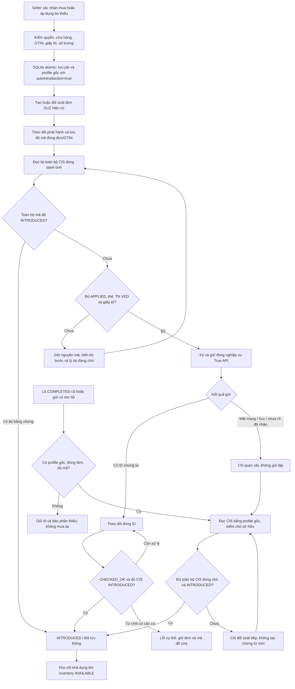

# Mua KIZ: phân biệt đã nhận mã và đã lưu thông

Ngày 11.11.2026, giờ Moscow. Nguồn cuối: **`d8a48594e46d3298bf3eed0ac7cbf6d989afb5b5`**; nhánh `fix/kiz-circulation-20261111`, nền `4fa9ba08977a9c29e51845d3c25d9527cd9a2069`. Giữ phần sửa ngày hết hạn giấy tờ nguồn `80e9324c24e1d1fdee1dbbdbc56854b1e8f0149f` và bộ công cụ Windows-MCP ở nền 4fa9. **Chưa tạo bộ cài hoặc phát hành lên Latest**; không ghi đè bản 1.6.8 đã công bố.

## Chẩn đoán và căn cứ

Ảnh người dùng cho thấy cột mua/lưu thông có **“Hoàn tất”**, trong khi tồn kho khả dụng bằng 0. Đây chưa phải bằng chứng mã đã mất, mua thất bại hoặc đã lưu thông. Mã nguồn trước sửa có đường `autoIntroduction=false` chuyển pipeline sang `COMPLETED` ngay khi nhận đủ mã. Cột trạng thái dịch nó thành “Hoàn tất”, còn tồn kho chỉ đếm mã có cả trạng thái kho `AVAILABLE` và trạng thái pháp lý `IN_CIRCULATION`.

Vì vậy, một lô đã tải đủ nhưng còn `RECEIVED` có thể hiện “Hoàn tất” cùng tồn kho 0. Cấu hình tự đưa vào lưu thông cũ cũng có thể được giữ trong snapshot kết nối của từng lô. **Chưa đọc được cấu hình, đơn SUZ, chứng từ hoặc CIS thật của máy trong ảnh**, nên không kết luận đây chính xác là lịch sử lô của seller.

Người dùng sau đó yêu cầu app mua KIZ phải tiếp tục đưa vào lưu thông, **không thêm lựa chọn bật/tắt để seller phải thao tác thêm**. Chính sách cuối của bản sửa áp dụng cho các yêu cầu mua thực mới qua app; việc đối soát đơn cũ giữ phạm vi riêng bên dưới.

## Đối chiếu WBCode và nguồn gốc đang có

[Biên nhận tham chiếu](kiz-circulation-20261111/wbcode-comparison.json) ghi phiên bản, checksum, các lớp đã đọc, giới hạn dịch ngược và căn cứ bytecode.

| Khâu | Nguồn gốc sẵn trong workspace | WBCode mới nhất đã kiểm | VN Code sau sửa |
| --- | --- | --- | --- |
| Danh tính nguồn | WCode **1.1.32**, public `rupphi/test-wcode`, commit `8f7c3d1ac8598158029b8d037e2d3c128e240727`, ngày 09.09.2026 | **v1.3.24**, release `441445892`, công bố 11.11.2026 12:46:05 MSK | Nguồn cuối `d8a48594e46d3298bf3eed0ac7cbf6d989afb5b5`, kế thừa các bản sửa chưa phát hành ở nền 4fa9 |
| Tự lưu thông | `Settings.empty()` mặc định false; có checkbox, lưu giá trị checkbox | Mặc định true; hàm lưu cấu hình truyền literal true; không có checkbox đó trong FXML đã kiểm | Không đưa lựa chọn ra giao diện; ý định mua mới được lưu với `autoIntroduction=true` riêng từng job |
| Nhận đủ mã khi cờ false | `COMPLETED`, dịch “Hoàn tất” | Vẫn có nhánh `COMPLETED` và cách dịch tương tự | Không dùng từ “Hoàn tất” để thay bằng chứng lưu thông; hiển thị rõ đã tải mã nhưng chưa xác nhận |
| Điều kiện chuẩn bị | Đọc CIS, phân biệt `APPLIED` và `INTRODUCED`, kiểm thẻ/giấy tờ | Cùng nguyên tắc; batch CIS tối đa 1.000; có nhánh commission riêng | Giữ gate CIS/thẻ/giấy tờ, đủ mã và đúng danh tính; chờ đúng bước khi chưa đạt |
| Xác nhận lưu thông | Chứng từ `CHECKED_OK`, sau đó CIS `INTRODUCED` | Cùng nguyên tắc; có đường nhận biết cả lô đã `INTRODUCED` | Chỉ xác nhận theo kết quả đọc lại thực; đối soát lô cũ còn kiểm chủ sở hữu đúng hồ sơ gốc |
| Tồn kho khả dụng | `AVAILABLE` và `IN_CIRCULATION` | Cùng gate pháp lý; có thêm loại trừ mã đã liên kết Ozon | Giữ nguyên quy tắc kho, không biến mã vừa tải thành hàng khả dụng |
| Khôi phục | Một số lỗi giấy tờ/chứng từ có đường tiếp tục | Có thêm các nhánh retry introduction | Giữ chống mua/gửi trùng; kết quả gửi không rõ phải đi đường quan sát, không coi là bị từ chối chắc chắn |

Latest được xác minh bằng EXE 149.638.144 bytes, SHA-256 `58d97a9c98fd42ee52c5239a98c9e1e4a820661f61aa65e06dd9033f55561d78`, khớp digest GitHub và `checksums.sha256`. JAR ứng dụng SHA-256 `7294c9116d98d00f86ec0268952b04bdfd6ee5cdedd09eef0d616e8adb9f1ae8`, 1.379 class. Phân tích bằng 7-Zip 25.01, CFR 0.152 và `javap`; những phương thức CFR không khôi phục được được ghi rõ và đối chiếu bytecode ở phạm vi cần thiết. Không chạy installer/WBCode, không kích hoạt license, không đưa binary hoặc mã dịch ngược vào repo.

Nguồn 1.1.32 là **snapshot gốc đang được giữ trong workspace**, checkout sạch và shallow. Không gọi đây là commit đầu tiên của toàn bộ lịch sử, mã nguồn nội bộ 1.3.24 hoặc một archive khác chưa xác định được.

## Hợp đồng API chính thức

[Biên nhận hợp đồng](kiz-circulation-20261111/official-contracts.json) lưu URL, phiên bản và SHA tài liệu:

- **SUZ API 3.0.40, §4.4.11, trang PDF 238–239 và §4.4.20, trang 401–402:** với hàng công nghiệp nhẹ và các nhóm được liệt kê, SUZ tự hình thành báo cáo нанесения/application khi phát hành mã. Việc không thấy `POST utilisation` thủ công trong code không chứng minh thiếu bước cho nhóm hàng này. Có ngoại lệ theo vai trò và phương thức dịch vụ; xử lý tự động vẫn bất đồng bộ.
- **SUZ §10.1.6, trang 655–660:** kết quả phát hành mã `GET_CODES_RESULT/SUCCESS`, báo cáo phát sinh và các sự kiện được GIS xử lý là những bằng chứng khác nhau. Nhận mã thành công chưa xác nhận lưu thông.
- **SUZ §4.4.18–19:** có Receipt 2.0 để đọc/tra cứu kết quả báo cáo. Đây là căn cứ chẩn đoán bổ sung; lượt này chưa đọc receipt thật của seller và không ghi nhận app đã triển khai một service gửi báo cáo thủ công mới.
- **True API:** `EMITTED`, `APPLIED`, `INTRODUCED` là các trạng thái riêng; `cises/info` phải được đối chiếu với toàn bộ tập mã dự kiến. `LP_INTRODUCE_GOODS/OWN_PRODUCTION`, nhập khẩu và commission là các nghiệp vụ khác nhau. Bản sửa không tự đổi phương thức pháp lý hoặc bịa nguồn gốc sản phẩm.

## Thay đổi của bản sửa

### Mua mới luôn mang ý định lưu thông trong chính job

Các đường mua thực qua màn kho/mapping, bù thiếu khi đóng/in nhãn và FBO đi vào enqueue có lưu ý định lưu thông. Trong cùng giao dịch SQLite, app kiểm cấu hình kỳ vọng còn hiện hành rồi lưu snapshot với `autoIntroduction=true` cho pipeline mới. Cấu hình shop dùng chung không bị tự đổi sang một chủ thể/OMS/chứng thư khác, và các job đã tạo không bị thay toàn bộ profile theo lần lưu cấu hình sau.

Không thêm checkbox/menu chọn tự lưu thông trong giao diện. Quyền KIZ, xác minh chứng thư, phạm vi cửa hàng, số lượng thiếu, chống replay và kiểm thẻ/giấy tờ vẫn áp dụng. Bấm mua không làm trạng thái pháp lý của mã đổi ngay; app vẫn phải chờ và đọc lại từng bước tương ứng.

### Lô cũ và kết quả gửi không rõ được quan sát trước

`COMPLETED` cũ không bị dùng làm lý do tạo đơn mua mới. Đối soát chỉ tiếp tục nếu tìm được **snapshot kết nối gốc**, đúng shop/đơn/GTIN, số lượng order và pipeline trùng nhau, toàn bộ mã đã lưu đủ và không trùng/sai danh tính. Hồ sơ thiếu hoặc không nhất quán được giữ lại với lý do cụ thể, không mượn cấu hình shop mới để xác nhận.

Đường quan sát dùng đúng hồ sơ/chủ thể gốc, đọc True API và yêu cầu cả tập CIS thuộc đúng chủ sở hữu, đúng mã/GTIN và đều `INTRODUCED` trước khi đánh dấu lưu thông. Lô cũ từng mua với cờ false giữ chế độ chỉ quan sát: **không mua lại, không tự tạo/ký/gửi chứng từ lưu thông mới**. Nếu mới `APPLIED`, `EMITTED`, thiếu phản hồi hoặc chưa chứng minh được chủ sở hữu thì tiếp tục chờ đối soát.

Timeout, mất mạng, 5xx hoặc phản hồi gửi không xác định không được diễn giải thành một từ chối chắc chắn để gửi lặp. Những bản ghi cũ đã mang `REJECTED` nhưng thực chất là kết quả mơ hồ được đưa về đường quan sát phù hợp. Chứng từ đã có ID được theo dõi đúng ID; chỉ nhánh bị từ chối có căn cứ mới có thể đi qua xử lý retry hiện hành. Giữ đủ số lượng mã không thay thế bằng chứng pháp lý.

Thứ tự đối soát sau khi đã có mã được sửa để đọc tập CIS trước các lượt kiểm thẻ Catalog/TN VED dành cho việc tạo chứng từ mới. Khi đã có đủ bằng chứng toàn bộ mã `INTRODUCED`, việc thiếu TN VED hoặc lỗi đọc lại thẻ không được giữ lô ở trạng thái chờ một nghiệp vụ không còn cần thực hiện. Nếu mã chưa lưu thông, các điều kiện thẻ/giấy tờ/TN VED vẫn phải đạt trước khi ký và gửi mới. Thiếu TN VED giữ lô ở trạng thái đối soát đang hoạt động, không tạo chứng từ thiếu dữ liệu; một lần đọc sau có thể xác nhận INTRODUCED mà không cần sửa metadata.

### Trạng thái và kho phản ánh đúng bước

- `COMPLETED` cũ hiển thị **“Đã tải mã · chưa xác nhận lưu thông”**.
- `WAITING_INTRODUCTION_READINESS` hiển thị **“Đang đối soát lưu thông”**, kèm lý do đang chờ hoặc trường chưa xác minh.
- `INTRODUCED` mới được trình bày **“Đã lưu thông”** và dùng màu xác nhận. Lỗi và trạng thái chờ giữ màu riêng, chip dài xuống dòng và có tooltip.
- Tồn kho khả dụng vẫn đòi `AVAILABLE + IN_CIRCULATION`; đối soát chỉ cập nhật phần pháp lý khi có đủ bằng chứng, không reset mã đã reserved/consumed hoặc cộng số lượng chưa lưu thông vào kho dùng được.

## Sơ đồ luồng cuối

Nhánh SUZ tự hình thành báo cáo theo nhóm hàng là xử lý phía dịch vụ; sơ đồ không biểu diễn nó thành một lần gửi báo cáo thủ công mới của app. Hai nhánh quan sát không cấp quyền tự ký hoặc mua bù lại lô đã có.

## Tệp và phạm vi kiểm chứng

| Nhóm | Tệp chính và vai trò |
| --- | --- |
| Ý định mua và snapshot | `ZnackPurchaseCoordinator`, `ZnackRepository`, `KizStockReplenisher`, `FboPurchaseService` và các handler mua thực |
| Đối soát pháp lý | `ZnackCisReadback`, `ZnackIntroductionReadinessService`, `ZnackIntroductionService`: đúng tập mã/số lượng, chủ sở hữu ở observer, kết quả gửi mơ hồ |
| Hiển thị | `KizMappingController`, `ZnackAutomationController`, FXML cấu hình và bốn locale |
| Hồi quy | Policy enqueue, owned CIS readback, kết quả gửi/5xx, thông báo bốn ngôn ngữ, UI trạng thái, recovery/restart và quyền/giới hạn hiện có |

Nguồn cuối: **`d8a48594e46d3298bf3eed0ac7cbf6d989afb5b5`**. [421 ca/24 lớp đạt, 0 failure/error/skip](kiz-circulation-20261111/focused-tests.json), có lệnh đầy đủ, hash từng source và báo cáo test. [Build JAR cục bộ đạt](kiz-circulation-20261111/local-package.json), 1.996 class production; đối chiếu byte 69 class/resource liên quan. SHA-256 JAR: `09f48e84a40a5c60c2b8fcadcd6e31bd2307c4911696596dafd6747a4b39ba87`.

Các receipt cuối đã được chốt theo nguồn sau thay đổi chính sách. [Lịch sử kiểm thử](kiz-circulation-20261111/verification-history.json) giữ lượt lỗi và lượt xanh trung gian; [RED chính sách](kiz-circulation-20261111/policy-baseline-red.json) là 60 ca/42 failure, [RED thứ tự CIS](kiz-circulation-20261111/ordering-baseline-red.json) là 3/3 failure. Không lấy lượt xanh trước đó để chứng nhận byte mã cuối hoặc cộng số ca các lượt trùng nhau. `git diff --check` sạch; [review giới hạn](kiz-circulation-20261111/source-review.json) không phát hiện blocker mới trong phạm vi đã rà.

## Giới hạn và bàn giao tiếp

- Lượt tham chiếu WBCode là phân tích tĩnh; không có nghiệm thu ứng dụng WBCode đang mua KIZ thật.
- Môi trường có quyền đọc WB/Ozon/Catalog nhưng chưa có phiên OMS/SUZ và chứng thư CryptoPro của seller để mua/ký-công bố đầu-cuối. Lượt này không mua KIZ, phát sinh phí, ký giấy tờ, gửi chứng từ pháp lý hoặc kích hoạt license thật.
- Chưa có kết nối tới Windows-MCP trên máy người dùng, chưa mở VN Code Windows của seller hoặc kiểm chứng profile/CIS thật trong ảnh. Native Windows CI của công cụ MCP ở phiên trước không thay thế nghiệm thu luồng này.
- Luồng đã bị giữ ở `WAITING_INTRODUCTION_DOCUMENTS` vẫn dùng cơ chế đồng bộ giấy tờ/tiếp tục hiện có; bản sửa không tự bỏ yêu cầu giấy tờ hoặc đổi nghiệp vụ pháp lý PRODUCTION/OWN_PRODUCTION.
- Chưa đổi version, tạo bộ cài, merge hoặc phát hành lên Latest. Mã ngày hết hạn giấy tờ và bộ công cụ Windows-MCP ở nền được giữ; không dùng bản build nội bộ cùng nhãn POM 1.6.8 để ghi đè tài sản public 1.6.8.
- Bước nghiệm thu thật còn lại là đọc đúng đơn/profile và từng CIS của lô đã mua, xác nhận dòng trạng thái/kho theo kết quả thực, rồi kiểm một yêu cầu mua mới có đủ cấu hình ký/OMS trong phạm vi seller cho phép. Không suy kết quả từ một HTTP200 hoặc chữ “Hoàn tất”.
