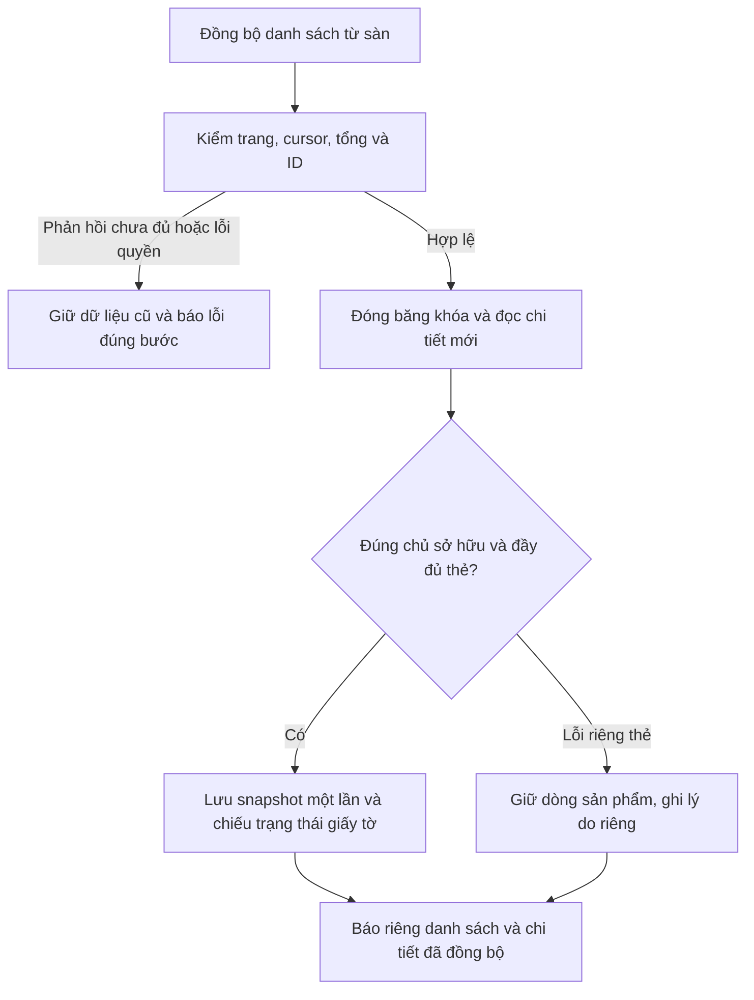

# Đồng bộ sản phẩm WB/Ozon và trạng thái giấy tờ

Ngày 11.11.2026, giờ Moscow. Nguồn cuối: **`0cd111c9931bb9993b47c2c787d3944d0ec564d6`**. Nhánh `fix/product-sync-permits-20261111`, kế thừa `911a3b0`. Đây là sửa nguồn sau 1.6.8, **chưa yêu cầu phát hành, chưa đổi version hoặc ghi đè Latest**.

## Giữ toàn bộ phần sửa trước khi làm việc mới

Đã lưu [checkpoint sau 1.6.8](../memory/POST-1.6.8.md) bằng commit **`5c650dc3b6a81751a04c9344b9540e9e065d47be`** trước khi sửa runtime. Nhánh giữ nguyên sửa KIZ luôn theo dõi lưu thông `d8a48594e46d3298bf3eed0ac7cbf6d989afb5b5`, hạn giấy tờ `80e9324c24e1d1fdee1dbbdbc56854b1e8f0149f` và nền công cụ Windows-MCP `4fa9ba0`.

Không dùng checkpoint để coi các phần đó đã có trong bộ cài 1.6.8. Giữ lựa chọn cuối của người dùng: mua KIZ không có tùy chọn bật/tắt lưu thông; chỉ hiển thị đã lưu thông khi có bằng chứng thực.

## Ảnh 327 sản phẩm, kiểm tra 195 và chưa lấy được 132 nói lên điều gì

Nhãn cũ `products.sync_summary` nhận `Report.snapshots()` và `Report.failed()`. Các con số **195/132 thuộc bước đọc chi tiết đầy đủ sau khi tải danh sách**, không phải một phép đếm chứng minh sàn chỉ có 195 hoặc app đã mất 132 sản phẩm. Danh sách 327 sản phẩm trong ảnh vẫn có thể chứa cả các dòng chưa đọc được chi tiết.

Luồng cũ đồng bộ danh sách, rồi đọc lại từng thẻ riêng. WB có thể trả tìm kiếm `nmID` rỗng và buộc dò danh sách bổ sung; làm riêng cho từng thẻ tạo nhiều yêu cầu và chi phí lưu lặp. Mọi `IOException` ở bước chi tiết bị cộng chung vào một bộ đếm, nên không thấy thẻ nào thiếu trường, bị giới hạn tốc độ hoặc mất kết nối. Đây là các đường lỗi đã xác định trong mã; chưa đọc được hồ sơ cục bộ của đúng máy trong ảnh để quy mọi lỗi 132 về một nguyên nhân duy nhất.

## Các thay đổi

| Thành phần | Hành vi sau sửa |
| --- | --- |
| WB: `WbProductSyncService` | Đồng bộ ban đầu/incremental và phục hồi sản phẩm tiếp tục theo cursor hợp lệ đến trang rỗng; không coi trang dưới 100 dòng là đã đọc hết. Giữ checkpoint và thời điểm thành công cũ nếu trang sau lỗi. |
| WB: `WbGtinProductReader` | Cùng quy tắc trang rỗng cuối để nguồn GTIN không bị cắt sau một trang ngắn; giữ kiểm tra trùng ID, biến thể và chủ sở hữu. |
| Ozon: `OzonCatalogSyncService`, `OzonJson` | Đối chiếu danh sách, cursor, tổng đã công bố và tập ID; không coi phản hồi thiếu/mâu thuẫn là catalog rỗng hoặc đầy đủ. Kiểm đủ dữ liệu thông tin/thuộc tính/barcode trước khi lưu trang và tiến cursor; giữ trang đã lưu khi lỗi ở trang sau. |
| `ProductSnapshotReader.openBatch`, batch WB | Dùng một lượt đọc danh sách mới cho một tập thẻ đã đóng băng; giữ raw JSON, kiểm chủ sở hữu và parser đầy đủ hiện có. Không dùng DTO danh sách đã mất trường giấy tờ làm bằng chứng. |
| `ProductRefreshService` | WB đọc chi tiết theo batch tối đa 10.000 khóa mỗi phần; lưu một lần cho mỗi snapshot thành công. Chuẩn bị batch lỗi mạng/quyền thì dừng đúng lỗi chung; thẻ thiếu dữ liệu có báo cáo riêng và không làm mất các thẻ hợp lệ khác. |
| Báo cáo và UI sản phẩm | Tách số sản phẩm tải từ sàn, số đọc được chi tiết và số chưa đọc được; có danh sách lý do theo thẻ/trường. Không đưa nguyên thông báo có thể chứa token vào báo cáo. Hủy tác vụ và lỗi quyền không bị tính thành hàng loạt sản phẩm mất. |

Thẻ đầy đủ vẫn phải có đúng danh tính, biến thể và các trường cần thiết. Bản sửa không hạ tiêu chuẩn snapshot dùng cho chỉnh sửa/đăng ký để làm bộ đếm xanh. Một thẻ thiếu `dimensions` được giữ trong danh sách và báo đúng trường thiếu; thẻ khác trong cùng batch tiếp tục được lưu.

## Giấy tờ hợp lệ nhưng bị báo chưa xác minh

- **WB:** thiếu verdict của giấy tờ là đang chờ kiểm tra; trạng thái đã xác minh chỉ nhận đúng kiểu boolean/số và mã đã biết. Mã không biết không bị bịa thành từ chối. Giấy tờ chưa đến ngày hiệu lực giữ `PENDING`, hết hạn giữ `EXPIRED`.
- **WB tổng hợp:** chỉ dùng `documents.overallVerdict` có kiểu và trạng thái hợp lệ từ snapshot mới đúng chủ sở hữu để hỗ trợ chiếu trạng thái. Vẫn phải có ít nhất một giấy tờ được xác minh riêng, đúng nguồn và còn hiệu lực; overall một mình không tạo ra giấy tờ hợp lệ. Giấy tờ phụ đang chờ/bị từ chối không bị sửa thành `VALID` trong dữ liệu từng giấy tờ.
- **Ozon:** parser trước sửa đặt mọi giấy tờ chưa hết hạn thành `UNVERIFIED`, kể cả phản hồi có trạng thái được duyệt. Bản sửa phân biệt `approved`, `awaiting_verification`, `verification`, `declined`; giữ trạng thái chưa xác minh cho giá trị/kiểu không biết hoặc liên kết sản phẩm mâu thuẫn.
- **Nguồn bằng chứng:** WB đối chiếu tài liệu chính thức; enum Ozon đối chiếu hai bản sao OpenAPI được ghim theo commit và lưu provenance, không mô tả đó là phản hồi enum sống từ tài khoản seller. Các nguồn/hash được chốt trong [thư mục bằng chứng](product-sync-20261111/).
- **Ngày và dữ liệu cũ:** truy vấn dùng `validFrom` trong payload sẵn có và `valid_until` hiện hữu, theo ngày địa phương; không thêm cột/migration. Không nâng dữ liệu lịch sử hoặc khác owner thành proof mới. Bản sửa cuối còn kiểm chặt phản hồi mảng giấy tờ/phân trang và ngày ISO của Ozon để phản hồi lỗi không xóa cache tốt; 31 ca bảo toàn cache/ngày đã đạt trong lượt nguồn cuối bên dưới.

Đây là trạng thái giấy tờ theo sàn và dữ liệu đọc được. Số/ngày cấu hình trong app không tự trở thành chứng minh registry hoặc giấy phép mua KIZ cho một GTIN khác.

## Bằng chứng lỗi trước sửa và hồi quy

| Lượt | Kết quả và cách hiểu |
| --- | --- |
| Baseline RED | **27 ca, 19 failure, 2 error**; lỗi hành vi đã tái hiện, không phải lỗi biên dịch. Gồm trang ngắn làm thiếu sản phẩm và trạng thái giấy tờ không được bảo toàn. [Receipt](product-sync-20261111/baseline-red.json). |
| Focused đầu | **166 ca, 6 failure Ozon còn dự kiến và 53 error** do SQL mới tham chiếu nhầm cột `valid_from` không tồn tại. Đây là hồi quy của candidate, đã sửa sang đọc payload; không coi lượt này là đạt. [Receipt](product-sync-20261111/first-focused-failure.json). |
| Focused sau sửa | **211 ca/12 lớp đạt** trên nguồn trước guard phản hồi Ozon cuối. Đây là một tập kiểm riêng, không phải full Windows hoặc chứng nhận source thay đổi sau đó. |
| Hồi quy bổ sung | **268 ca/17 lớp đạt**, là tập không trùng focused nói trên nhưng vẫn ở nguồn trước guard cuối. Giữ số riêng, không gọi các lượt này là một full suite. |
| RED bảo toàn giấy tờ Ozon | **30 ca, 22 failure, 0 error/skip** trước sửa mảng/số trang/ID/ngày; thêm một ca ngày mâu thuẫn ở lượt cuối. [Receipt](product-sync-20261111/ozon-integrity-red.json). |
| Nguồn cuối | **`510 ca/30 lớp đạt, 0 failure/error/skip; JAR build đạt, so byte 47 class/resource`**. Lệnh, source manifest, phạm vi và lịch sử có trong receipt cuối của [thư mục bằng chứng](product-sync-20261111/). |

Các trường hợp bao phủ gồm trang ngắn có trang tiếp theo; lỗi ở trang sau không báo đầy đủ; cursor/tổng mâu thuẫn; giữ dữ liệu cũ; đọc WB 327 thẻ bằng 4 lượt danh sách thay 327 tìm kiếm; một thẻ thiếu trường không chặn các thẻ khác; dừng khi bị hủy hoặc mất quyền; enum giấy tờ, ngày tương lai/hết hạn, owner/revision cũ và báo cáo không lộ nguyên lỗi nhạy cảm.

Lượt review độc lập chỉ đọc phát hiện cột SQL sai và đường fallback có thể nhận giấy tờ chưa đến hiệu lực. Hai phần đã được sửa trước nghiệm thu nguồn cuối. Review không tự chạy Maven hoặc gọi API seller; kết quả test phải lấy từ lượt root thực chạy.

## Đọc API WB thật, tách khỏi dữ liệu kiểm thử

1. Đọc danh sách bằng API WB thật qua **5 yêu cầu chỉ đọc**: 100 + 100 + 100 + 88 + 0. Có **388 thẻ duy nhất/1.982 biến thể**. [Receipt đã loại dữ liệu seller](product-sync-20261111/wb-live-list.json).
2. Chạy đường batch/parser/repository production với lựa chọn trên và hồ sơ tạm riêng: **388/388 snapshot lưu được, 4 HTTP, 23,208 giây**. Chiếu được **338 `VALID`, 50 `MISSING`**, không lỗi đọc chi tiết. Không dùng license fixture, không sửa sản phẩm/sàn; hồ sơ tạm đã xóa. [Receipt](product-sync-20261111/live-wb-batch-read.json).
3. Bước thứ hai đo đọc/phân tích/lưu chi tiết của tập đã chọn, không phải toàn thời gian đăng nhập, tải danh sách ban đầu hoặc chạy app Windows. Hai lượt đọc không chứng minh đây là đúng cửa hàng/hồ sơ 327 sản phẩm trong ảnh; không suy rằng đã xác nhận trực tiếp toàn bộ 132 dòng đó.

API enum giấy tờ Ozon hiện trả **HTTP 403/code 7**. [Receipt](product-sync-20261111/ozon-status-enum.json) không chứng minh quyền đọc hoạt động hoặc enum đã được tài khoản xác nhận. Không nhận đơn, mua mã, ký, kích hoạt license hoặc ghi API seller trong công việc này.

## Build, trạng thái phát hành và bàn giao

Build cuối: **`PASS — JAR cục bộ 7.664.061 bytes/2.000 class production; SHA-256 0cd9ac48f6eaf5cb6d614b32857852b3480bc8fbb1b3cc61732e7ae2b0ab52d7`**. Source/manifest cuối: **`0cd111c9931bb9993b47c2c787d3944d0ec564d6`**. [Receipt kiểm thử](product-sync-20261111/focused-tests.json), [build](product-sync-20261111/local-package.json) và [review](product-sync-20261111/source-review.json) đã đối chiếu đúng source; không dùng kết quả candidate trước guard cuối để chứng nhận byte mới.

- Chưa full suite Windows, chưa mở app trên máy người dùng hoặc nối Windows-MCP seller trong lượt này.
- WB đã đọc API thật trong phạm vi nêu trên; Ozon mới được kiểm bằng hợp đồng/fixture vì quyền hiện bị từ chối.
- Khi một lần đọc lỗi, dữ liệu tốt đã lưu được giữ lại; báo cáo chi tiết phải được xem cùng trạng thái cache. Không cam kết mọi cửa hàng đều đã được đối soát thật hoặc không còn bất kỳ lỗi API nào.
- Không đổi schema, dependency, version hay phạm vi license; không phát hành lên Latest. Giữ toàn bộ sửa sau 1.6.8 trong checkpoint đã lưu và cập nhật bộ nhớ/bàn giao bằng source cuối khi hoàn tất.
