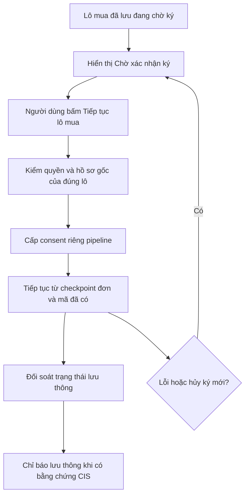

# Bàn giao mã nguồn VN Code 1.6.10 — 14.11.2026 MSK

Phạm vi là bốn yêu cầu: tìm repo rút gọn nguồn; tìm nguồn VNCode đầu tiên và sửa lỗi mua KIZ trên nền mới nhất; đề xuất repo phát hiện hồi quy để duyệt; giao ZIP mã nguồn. Bổ sung nghiên cứu WBCode mới nhất theo yêu cầu tiếp theo. **Không tạo bộ cài hoặc phát hành Latest trong tác vụ này.**

Nguồn app đã kiểm: **`75691c68fa14f728856b0418fb6008083787ef7c`**, nhánh `fix/kiz-original-flow-20261114`; nền phát hành 1.6.9 là `4ef0f1e2b8ef7b28190de3034b0c67ebf615be0b`, checkpoint tài liệu `f36d03f35167c75bcf6249c5923d9aa8a54b1339`. Commit tài liệu sau nguồn này không đổi runtime, POM hoặc test. ZIP được tạo từ Git tree của commit bàn giao cuối; SHA/receipt kiểm ZIP nằm trong tệp đi kèm để tránh tự tham chiếu hash bên trong ZIP.

## 1. Repo rút gọn nguồn và phòng lỗi hồi quy

[Bảng đề xuất để duyệt](../research/2026-11-14-code-quality-proposals.md) ghi repo chính thức, phiên bản, pin, license, Java 25 và giới hạn tích hợp:

| Mục tiêu | Đề xuất | Trạng thái |
| --- | --- | --- |
| Refactor nguồn từng recipe, xem patch trước | [OpenRewrite](https://github.com/openrewrite/rewrite); [Spoon](https://github.com/INRIA/spoon) là phương án processor riêng | Đã nghiên cứu; chưa cài/chạy recipe. |
| Bắt phá ranh giới kiến trúc | [ArchUnit](https://github.com/TNG/ArchUnit) | Đề nghị duyệt cùng JaCoCo trước. |
| Tìm nhánh chưa được test | [JaCoCo](https://github.com/jacoco/jacoco) | Đã xác minh hỗ trợ Java 25; chưa tích hợp. |
| Kiểm test có phát hiện điều kiện sai | [PIT](https://github.com/hcoles/pitest) | Pilot phạm vi KIZ sau; chưa tích hợp. |

Không công cụ nào bảo đảm tuyệt đối không có lỗi. OpenRewrite plugin mới có thay đổi nơi phân phối/xác thực; ứng viên public Central và license recipe được ghi riêng trong đề xuất. Không bật obfuscation, không nâng dependency, không rút gọn toàn app trong lần sửa KIZ.

## 2. Đã tìm đúng nguồn VN Code đầu tiên

Repo chính thức [ntccong2468-lab/Vncode](https://github.com/ntccong2468-lab/Vncode) được đọc bằng mirror đầy đủ, không shallow: 21 commit reachable, 3 nhánh, 2 tag. [Provenance](kiz-source-20261114/original-provenance.json) và [đối chiếu luồng mua](kiz-source-20261114/original-source-comparison.json).

| Mốc | Commit | Kết luận |
| --- | --- | --- |
| Root Git, 06.10.2026 22:02:26 MSK | [`8ad0b6c…`](https://github.com/ntccong2468-lab/Vncode/commit/8ad0b6c95ee6d8cca9a7904f1b700c6dd074a059) | README duy nhất, chưa có app. |
| Mã app đầu tiên, 06.10.2026 22:04:47 MSK | [`4e46a1c…`](https://github.com/ntccong2468-lab/Vncode/commit/4e46a1cb7883a7cf636ac211ec84bea89eaca5f6) | 504 tệp, bản nhập WCode 1.1.32 đã có mua KIZ. |
| Mốc đầu mang tên VN code, 07.10.2026 23:29:50 MSK | [`27c27a4…`](https://github.com/ntccong2468-lab/Vncode/commit/27c27a4dd77e27d886eb7ad054340b060cc21cda) | 518 tệp, 1.1.34. |

Đây là lịch sử public còn reachable, không chứng minh lịch sử private/đã xóa. Không lấy boundary shallow của Bancapnhat hoặc một snapshot WBCode làm nguồn đầu tiên. Auth service, safety và queue executor từ nguồn đầu giống 1.6.9 sau chuẩn hóa package; chép lại toàn bộ module cũ không giải quyết lỗi chờ ký và có thể mất các sửa mới.

## 3. Chẩn đoán và sửa lỗi mua KIZ

Thông báo `Waiting for the user to select this shop before signing.` là marker **cục bộ**, có từ nguồn đầu, không phải lỗi trả về từ SUZ/Catalog. Đọc mã hoặc đối soát CIS cũng có thể cần ký challenge để lấy lại phiên. Khi lỗi/hủy ký, ứng dụng giữ lô và dừng poll để không mở hộp PIN liên tục. Ảnh/marker cũ không đủ xác định lỗi PIN, chứng thư hay driver ban đầu.

Đã xác nhận lỗi thao tác: chọn lại shop đang mở không đổi `selectedItemProperty`, nên không chạy callback tiếp tục. Hàng chờ ký trước sửa cũng thiếu hành động tiếp tục phù hợp. Test UI trên nền 1.6.9 tái hiện **4 error** do `ExecutionException` bọc assertion thiếu nút; không phải compile failure. [RED và assertion](kiz-source-20261114/red-assertions.json).

| File runtime đổi | Nội dung |
| --- | --- |
| `ZnackPurchaseCoordinator.java` | `resumeSigning` tiếp tục đúng shop/pipeline, dùng hồ sơ gốc và kiểm quyền KIZ/chữ ký; giữ order, request key, mã đã tải; không enqueue yêu cầu mua thay thế. |
| `ZnackSigningSession.java` | Cấp consent cho đúng một pipeline theo thế hệ pause; lỗi CryptoPro thật mới vô hiệu grant cũ. Giữ các API cấp quyền cũ và operational code CANCELLED. |
| `KizMappingController.java` | Hiện **Chờ xác nhận ký**, dùng nút **Tiếp tục lô mua** ngay trong shop đang chọn; ẩn mua thêm ở chính hàng này; giữ retry chứng từ cũ. |
| `ZnackErrorMessages.java`, `ZnackPurchaseDiagnostics.java` | Giữ mã nguyên nhân CryptoPro đã biết và hướng dẫn; chưa biết thì báo cần xác nhận ký, không đoán PIN/cert. |
| Bốn locale en/ru/vi/zh | Bổ sung nhãn và chẩn đoán tương ứng. |
| `ThemeService.java` | Đồng bộ class theme của skin popup đang giữ lại; giữ bound style, ID và class riêng. |



Review còn phát hiện một lỗi **chỉ trong candidate thử ban đầu**: API resume mới dùng cách gỡ block toàn shop, có thể mở lô anh em chưa được poll. Test một ca RED đã chứng minh; nguồn cuối dùng consent riêng/generation và kiểm lô đã chờ/lô chưa thăm/shop khác. Không gán lỗi API mới này cho bản 1.6.9. [Review đầu](kiz-source-20261114/review.json), [đóng phát hiện](kiz-source-20261114/manual-review-final.json).

Lượt toàn bộ đầu trên nguồn signing `53a22c1…` thực sự **FAIL: 4.539 ca/569 suite, 1 error, 2 skip** vì popup Quản lý trộn màu chữ sáng với nền tối. Chạy lại riêng/class lúc đầu đạt, nhưng chưa đủ giải thích. Ca mới bằng public ContextMenu API đã tái hiện ổn định skin giữ `theme-dark`; sửa 11 dòng trong `ThemeService` chỉ đồng bộ năm class thuộc theme lên node skin, không ghi đè style đang bind hoặc class của caller. RED trước sửa và GREEN sau sửa gồm cả contrast≥4,5. [Lượt full đầu](kiz-source-20261114/full-first-failed.json), [RED](kiz-source-20261114/retained-skin-red.json), [bàn giao sửa](kiz-source-20261114/retained-skin-fix-closure.md). Kết quả toàn bộ cuối bên dưới thuộc nguồn mới đã sửa popup; không xóa lịch sử FAIL hoặc coi các lần chạy lại source cũ là đã sửa lỗi.

Kiểm kê nguồn: **800/800 tệp runtime còn đủ, 790 tệp giữ nguyên byte, 10 tệp sửa, không thêm/xóa**; dependencies, build plugins, API wire, schema, license và native signer giữ nguyên. POM chỉ đổi project/app.version thành 1.6.10. [Manifest](kiz-source-20261114/source-preservation.json). Kiểm kê không thay thế hồi quy hành vi.

## 4. Kiểm thử đã chạy trên đúng nguồn

| Phạm vi | Kết quả |
| --- | --- |
| Core/UI chọn lọc | 101 ca/7 suite, 0 failure/error/skip. [Receipt](kiz-source-20261114/combined-tests.json). |
| Maven Java toàn app và JAR | **4,540 ca/569 suite; 4,538 đạt; 0 failure/error; 2 skip**, BUILD SUCCESS. [Receipt từng suite](kiz-source-20261114/full-linux-result.json). |
| Node source tools | 174/174 đạt, 0 fail/cancel/skip; phạm vi riêng, không cộng với ca Java. [Receipt](kiz-source-20261114/node-tools-result.json). |
| So JAR production | 2.000 class; 2.041 tệp compiled/resource khớp byte `target/classes`; manifest do Maven sinh được kiểm riêng. Không chứa top-level test class. SHA `52441955325af1a33b23b3c8ec690bcf94ba90d3ddc40315f0cef90cc3533245`. |

Lệnh đã chạy:

```sh
PATH=/workspace/toolchains/xvfb-current/root/usr/bin:$PATH xvfb-run -a /workspace/toolchains/mvn-vncode clean verify
node --test tools/*.test.mjs
```

Ca skip thực tế:

- `com.vncode.app.features.gs1.Gs1PrefixTemplateStoreTest#refusesNtfsJunctionDirectoryAndAncestors` — Disabled on operating system: Linux
- `com.vncode.app.shared.WindowsSecretProtectorTest#separatesLicenseAndExistingMailEntropyOnWindows` — Disabled on operating system: Linux

Ba bài 10.000 GTIN Ozon/WB/xác nhận chậm đều nằm trong lượt full; receipt lưu ở thư mục bằng chứng. Đây là Linux/Xvfb, SQLite thật với signer/API tổng hợp, **không phải 10.000 giao dịch seller thật**. Không cộng 101 ca chọn lọc vào tổng full. Không bỏ test/giảm assertion để xanh.

## 5. Nghiên cứu WBCode bổ sung

Đã xác minh WBCode Latest **1.3.25**, release 443286851, EXE/JAR đối chiếu SHA; phân tích tĩnh, không chạy installer/app/license. [Báo cáo kèm sơ đồ](../research/wbcode-20261114/README.md), [bảng đối chiếu VNCode](../research/wbcode-20261114/VN-CODE-COMPARISON.md).

GTIN Ozon nằm trong barcode sản phẩm, không phải SKU hoặc mã vận đơn; không có luật chung 046. Mapper WBCode ưu tiên liên kết product ID → barcode GTIN địa phương → article gốc/size Nga/technical size; không so độc lập màu/brand/TN VED tại hàm match. Binder đăng ký có readback, mapper chung không đọc lại ngay trong chuỗi đã kiểm. VNCode tách direct native proof cho mua KIZ, mapping đã quan sát barcode và cross-only WB→Ozon; direct native proof hợp lệ vẫn cho mua trước khi barcode lên Ozon. Không thay thuật toán theo WBCode trong lượt nghiên cứu.

### Thử ghép Ozon/Catalog theo tiêu chí cuối của người dùng

Đã đọc thật **1.380 thẻ Catalog và 533 sản phẩm Ozon**; cặp Ozon mới trả đủ **21/21 HTTP 200**. Phản hồi 403/code 7 bằng khóa cũ được giữ làm lịch sử. Phép thử cuối so **đúng toàn bộ mã mẫu `152NAU`** sau chuẩn hóa hoa/thường/khoảng trắng và tách đúng phần size. Các mã có thêm B3/DASH hoặc tiền tố/hậu tố mẫu khác bị loại; nhóm size `2XL / XXL / 52` chỉ dành cho ví dụ này. Không dùng thương hiệu, màu, TN VED, giới tính, trạng thái hoặc giấy tờ làm bộ lọc của phép thử.

Kết quả: **1 GTIN Catalog, 1 `good_id`, 1 sản phẩm Ozon, 1 cặp**. Kết quả tìm chứa 4/3/12 trước đó được đánh dấu đã thay thế (SUPERSEDED). [Báo cáo và provenance tổng hợp](../research/simple-ozon-match-20261114/README.md). Các tệp GTIN/ID cụ thể được giao riêng cho người dùng, không vào Git/ZIP nguồn. Đây là đối chiếu dữ liệu API thật đã đọc; 24 ca parser cục bộ là phạm vi riêng. **Chưa ghi GTIN, mua KIZ hoặc đổi thuật toán app** theo quy tắc mới; không tự biến nhóm size của ví dụ thành bảng quy đổi toàn cục.

## 6. ZIP nguồn và giới hạn

Tên giao: **VN-code-1.6.10-source-20261114.zip**, prefix `VN-code-1.6.10-source/`. Tạo bằng `git archive` từ commit tài liệu cuối, giữ toàn bộ src/main/src/test/resources/POM/wrapper/build và các chức năng nền 1.6.9. Không đóng `.git`, target/cache, appdata seller hoặc EXE/JAR/decompiled WBCode. Receipt checksum/đọc lại ZIP được tạo riêng sau archive.

Helper kiểm byte Git tree/prefix/CRC/path/duplicate/POM/source-preservation có 21 control dương/âm đạt; đó là kiểm helper, chưa tự coi là nghiệm thu ZIP. [Nguồn và lệnh](kiz-source-20261114/tools/README.md). Prescan có đúng một JWT fixture chẩn đoán synthetic đã xác minh bằng file/pattern/hash; không cho phép mọi token trong test. [Giải thích](kiz-source-20261114/source-zip-secret-fixture-review.json).

Chưa có phiên SUZ/chứng thư riêng của seller hoặc máy Windows nối vào để nghiệm thu mua/ký thật. Không mua có phí, seller API write, kích hoạt license, gửi Gmail hay deploy portal trong tác vụ này. Không khẳng định app không còn mọi lỗi hoặc đã mua KIZ thật. Không chạy CodeQL mới; finding kế thừa của 1.6.9 chưa được xử lý bởi đợt sửa này. Latest được đọc lại độc lập; không publish/bump tag/asset cũ.
