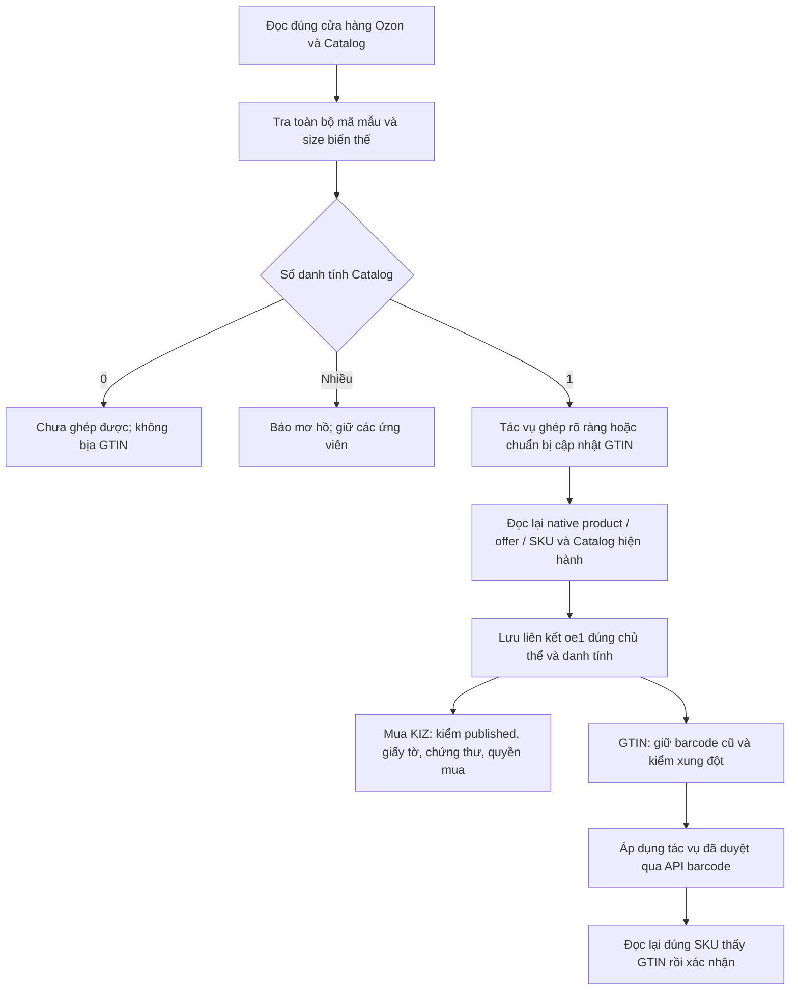

# Ozon: ghép GTIN theo toàn bộ mã mẫu và size — 14.11.2026

Nguồn triển khai: `a86048ec57521bc4d32b0a27c86d2eb1ee70fcb3`, nhánh `fix/ozon-exact-model-size-20261114`. Phiên bản nguồn **1.6.10**, chưa phát hành Latest. Kế thừa [KIZ/source repair](2026-11-14-kiz-source-repair.md), [nghiên cứu WBCode](../research/wbcode-20261114/README.md) và [phép thử API đọc](../research/simple-ozon-match-20261114/README.md). Đây là yêu cầu triển khai mới sau checkpoint nghiên cứu `e277d30`.

## Quy tắc đã áp dụng

- So toàn bộ mã mẫu sau NFKC, chuẩn hóa hoa/thường và khoảng trắng. Chỉ bỏ một hậu tố size có dấu phân cách, đang được quan sát trên chính biến thể. Không tìm chuỗi con hoặc mở rộng hậu tố `DASH` thành mẫu khác.
- `152 NAU` khớp `152NAU`; không khớp `B3152NAU`, `152NAU DASH`, `D152NAU`. Không hardcode mã mẫu, GTIN hay ID seller trong thuật toán.
- `XXL`/`2XL` là cách viết cùng size. Size Nga `52` chỉ liên kết với size nhà sản xuất khi hai giá trị có trong cùng biến thể Ozon; Catalog ghi hệ Nga thì đối chiếu trường Nga. Không tự suy `2XL=52` cho mọi sản phẩm/cửa hàng.
- Ưu tiên article chuyên biệt; ghi chú có đánh dấu article là nguồn dự phòng khi không có article rõ ràng. Không dùng một ghi chú để ghi đè mã mẫu khác đã biết. Giữ phân biệt vai trò size và phạm vi từng biến thể.
- Không so màu, thương hiệu, giới tính hoặc TN VED để loại một cặp mới có đúng mẫu và size. Các giá trị trên Catalog không bị sửa để ép khớp.
- Giữ tất cả ứng viên. Nhiều GTIN hoặc nhiều `good_id` cho cùng danh tính phải báo mơ hồ, không chọn mã nhỏ nhất/đầu tiên. Liên kết máy mất hiệu lực khi phát hiện thêm ứng viên; liên kết seller duyệt giữ quy tắc cũ.

## Luồng sử dụng

Tra cứu, làm mới nguồn, `validateIdentity`, `hasBarcode` và đối soát không tự cấp một liên kết mới. Chỉ tác vụ ghép cục bộ hoặc chuẩn bị kế hoạch cập nhật mới được tạo `oe1`; bản thân liên kết không phải chứng cứ barcode đã lên sàn. Không kích hoạt license, ký hay mua trả phí để chạy kiểm thử này.

## Các lỗi được tìm và sửa trong tích hợp

1. Index cũ loại cặp đúng vì khác màu và che một GTIN trùng mẫu/size. Regression qua API index hiện hữu thất bại 2/3 ca trước sửa.
2. Những kiểm tra article/màu/TN VED cũ còn ở trạng thái thẻ, đăng ký và AutoSync. Đã dùng chung matcher mới cho Ozon; giữ WB/manual `ov2` và kế hoạch cũ có quy tắc riêng.
3. Reader chỉ truy vấn bảng ghép thủ công, bỏ receipt GTIN đã xác nhận. Đã ưu tiên receipt Ozon đúng owner/source, rồi kiểm barcode và proof bằng snapshot mới.
4. Thuộc tính trùng có thể che SKU mới trong reader. Regression riêng RED1, sau sửa GREEN; native proof phải được kiểm cả khi article/màu/size cũng trùng theo quy tắc cũ.
5. Claim hết hiệu lực có thể bị hiểu là không có thẻ, dẫn đến tạo trùng. Nay báo chưa xác minh riêng thẻ đó, các thẻ độc lập vẫn tiếp tục.
6. Refresh exact vẫn đọc giá/chứng từ Ozon không dùng cho nhận diện; đổi sang đọc GTIN. Chứng từ Catalog phục vụ mua KIZ vẫn được kiểm.
7. Proof có thể dùng article cũ trong snapshot dù article cache mới đổi. Nay đối chiếu article và size native hiện hành.
8. `claims/matchingIndex` quét/parse toàn Catalog mỗi liên kết. Nay mỗi lượt đọc một snapshot/index, kiểm owner/source/revision trong lượt; không cache qua lần gọi tiếp theo.

## Kiểm chứng và giới hạn

Lượt `clean verify` đã thực sự kết thúc **BUILD SUCCESS/exit0**,14.11.2026 lúc14:31:58UTC,15phút36giây. Lệnh thực đã chạy là `python3 /tmp/vncode-ozon-exact-20261114/run-related.py`; [runner](ozon-exact-20261114/run-related.py) lưu chính xác argv Maven/Xvfb và [225 selector](ozon-exact-20261114/related-selection.json). [Receipt đầy đủ](ozon-exact-20261114/related-result.json), [selection](ozon-exact-20261114/related-selection.json), [lịch sử RED/GREEN](ozon-exact-20261114/regression-history.json).

**2.198 ca/225 suite,0failure/0error/0skip** trên nguồn đóng băng nêu trên. Đây là nhóm hồi quy liên quan, không phải full app mới: có Ozon/GTIN/KIZ mapping/registration/listing/sync, WB và11 bài bulk nhỏ; ba bài10.000 GTIN ghi tên trong selection không chạy lại. Full4.540 ca của nguồn KIZ/theme trước vẫn giữ nguyên bằng chứng lịch sử.

JAR `VNcode-1.6.10.jar`:7.694.799byte,SHA256 `ff73d0966be0137f3bd310fed9598e1066db38c99ac12c30f295fac85503c396`. So byte2.048 class/resource với output compile,2.006 class trong JAR, không class chỉ thuộc test; manifest generated kiểm riêng. 1.409 input nguồn/test/build so byte đúng commit. Đây là JAR kiểm build cục bộ, không bộ cài Windows được phát hành.

- Tập trung ban đầu159 ca có3 lỗi loại exception ở biên adapter, đã giữ hợp đồng `IllegalArgumentException` cho đúng lỗi danh tính; không nuốt lỗi storage/security.
- Tập trung tiếp224 ca có1 lỗi reader; giữ nguyên assertion và sửa đường đọc, sau đó225 ca đạt.
- Reader cuối53 ca đạt sau khi thêm regression SKU riêng. Các tập này trùng nhau, không cộng thành tổng độc lập.
- Production parser/matcher Java chạy offline trên snapshot API đã đọc thật: 1.380/1.380 Catalog, 533/533 Ozon, 1 GTIN/1 sản phẩm/1 cặp cho mẫu đã đối chiếu. Không dùng lại thuật toán Python để tuyên bố production đã chạy; không gửi thêm HTTP hay ghi sàn.
- Chưa nghiệm thu GTIN POST, mua KIZ có phí, ký CryptoPro, Windows seller hoặc dữ liệu mới hơn snapshot trong lượt này. Không tuyên bố app không còn mọi lỗi.
- Chưa đo lô tự ghép10.000. `claims/matchingIndex` được lập chỉ mục một lần; factory/dispatch vẫn có bước đọc Catalog hiện hành theo từng target để kiểm chứng.
- Không dependency/schema mới; 800 runtime nền còn đủ, thêm đúng một matcher. KIZ resume/theme của checkpoint trước giữ nguyên byte. ZIP là nguồn để lưu, không phải bộ cài và không đổi Latest.

Kiểm archive dùng helper kế nhiệm [được ghim và có36 control](ozon-exact-20261114/archiveguardnew-README.md), không sửa helper lịch sử. Positive CODE-only và ba ZIP bị sửa/thêm/xóa đều được kiểm; đó là control của verifier, **không thay receipt ZIP cuối**. Checksum và receipt của ZIP cuối giao cạnh ZIP ngoài repository để tránh tự tham chiếu.
