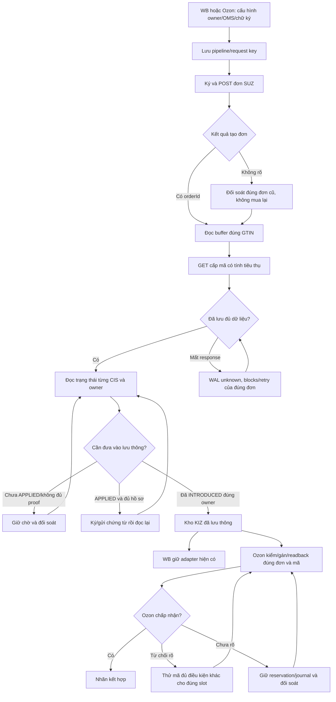

# Đối chiếu luồng mua KIZ — bản công bố đầu tiên và mã mới nhất

Ngày 16.11.2026 UTC; nghiên cứu chỉ đọc. Target hiện hành: `/workspace/vncode-ios-motion-20261114`, HEAD nền `a7c4d008ae450a82b6cfbfbb79e5532eca6bfa1e` cộng sửa ECC/UI/Ozon chưa commit. Hash trong `purchase-source-comparison.json` là snapshot trước các sửa của nhiệm vụ mới, không phải chứng nhận nguồn cuối sau sửa.

## Xác định đúng bản đầu

Đã đọc GitHub API mới cho `ntccong2468-lab/Vncode`: còn hai release công khai, đều được đánh dấu prerelease. Bản công bố đầu tiên hiện còn truy cập được là **[VN code 1.1.33](https://github.com/ntccong2468-lab/Vncode/releases/tag/v1.1.33)**, release **406111854**, công bố **07.10.2026 20:05:18 UTC /23:05:18 MSK**. Tag `v1.1.33` trỏ commit **`3b5c725ec8b481556cb6635859b08dcdb66ab053`**; trường `target_commitish` của release là tên nhánh, nên không dùng nó thay SHA tag.

Đã tải riêng asset JSON `build-info.json` 1.125 byte, SHA-256 `5670efe976ddcdf609e766a6e220740ac38370a2dcf914c0596a89c2ae226bc7`, khớp digest GitHub. JSON này xác nhận đúng source commit `3b5c725…` và installer gốc 141.037.056 byte/SHA `4214ed4a5f0f230389a69f87089404ad8ef200ba4f05dea75d4230e5eeee2731`. Không tải/chạy bộ cài hoặc dựa vào metadata để gọi đây là nghiệm thu KIZ thật; ghi chú bản đầu cũng nói chưa nghiệm thu GS1/CryptoPro/seller thật.

Mốc này khác root Git `8ad0b6c…` (README), import mã app đầu tiên `4e46a1c…` (1.1.32, 06.10.2026), và mốc đổi package/thương hiệu `27c27a4…` (1.1.34, 07.10.2026). POM của source 1.1.33 vẫn mang tên WCode/package `com.tuandev.fbsbarcode`, dù release được công bố với tên VN code. Không tự chọn 1.1.32 hay 1.1.34 thay bản release đầu. Mirror đầy đủ, không shallow, có 21 commit reachable. Không chứng minh được lịch sử private/release đã xóa.

Nguồn/bằng chứng: `release-provenance.json`, `first-release-build-info.json`, `upstream.git`, `first-release-source/` và `diffs/`.

## Luồng mua giữ lại và các khác biệt thực tế

Đã so 10 lớp core sau chuẩn hóa package. `ZnackAuthService`, `ZnackPipelineQueueExecutor`, `ZnackSafety` vẫn giống nhau. Payload tạo đơn vẫn có productGroup `lp`, releaseMethodType `PRODUCTION`, serialNumberType `OPERATOR`, templateId10, cisType `UNIT/BUNDLE`; mã mới thêm các guard license/danh tính và fallback hồ sơ đăng ký bản địa. Không có căn cứ chép toàn bộ module cũ để sửa được lỗi mua hiện nay.

| Bước | Bản công bố 1.1.33 | Mã mới trước lần sửa này | Kết luận |
| --- | --- | --- | --- |
| Xác thực/ký | Auth challenge → CMS → simpleSignIn/OMSconnection, token SUZ tách True API | Cùng core auth, thêm signing queue/consent đúng pipeline và lỗi CryptoPro cụ thể | Không bỏ quyền ký hoặc dùng token WB/Catalog thay SUZ |
| Enqueue/mua | Lưu request key/order trước POST; không tự tạo lại đơn khi POST không rõ kết quả | Giữ, thêm quyền KIZ và kiểm hợp đồng/mapping | Phải bảo toàn checkpoint hiện có |
| Đọc buffer | Lặp mọi buffer và dùng trạng thái cuối, có thể lẫn GTIN khác | Đọc đúng một buffer theo GTIN; thiếu/trùng/status rỗng giữ checkpoint | Lỗi cũ đã sửa, không phục hồi cách cũ |
| Tải mã | Một response không rỗng đủ để báo downloaded, kể cả thiếu số lượng | Chỉ số mã đã lưu bền vững đủ quantity mới báo downloaded | Lỗi partial cũ đã sửa |
| Mất response cấp mã | Không có WAL ghi rằng GET cấp mã đã có thể tiêu thụ buffer trước khi app lưu response | Trước sửa mới cũng chưa có WAL riêng; recovery chủ yếu khi nhận CLOSED/EXHAUSTED | Khoảng trống cụ thể cần tái hiện: mất response khi buffer vẫn ACTIVE, lần sau có thể cấp tiếp thay vì phục hồi khối đã cấp |
| Retry khối | Nếu một mã đã có blockId thì bỏ qua cả khối | Kiểm quantity của khối, retry khối thiếu/không rõ quantity, giữ trạng thái mã cũ, kiểm identity OMS/order/GTIN | Lỗi recovery cũ đã sửa |
| Hoàn tất/lưu thông | autoIntroduction tắt → `COMPLETED`; thiếu TN VED có thể dừng ở trạng thái skipped | Luôn giữ chờ/đối soát tới khi đọc được lưu thông, không gọi downloaded là introduced | Không phục hồi tùy chọn hoàn tất sớm |
| CIS readback | Đếm INTRODUCED/GTIN, chưa nhận diện đúng từng code và owner đầy đủ | Nhận diện từng code tốt hơn; observer-only dùng owner, nhưng auto-introduction readiness/confirm vẫn dùng `inspect` không owner | Khoảng trống được đọc xác nhận; giao reviewer circulation tái hiện/sửa, không gọi là test đã chạy ở báo cáo nghiên cứu này |
| Ký đang chờ | Marker local “select this shop” và pause poll | Có nút tiếp tục đúng pipeline, thế hệ pause và nguyên nhân CryptoPro | Đã sửa trước nhiệm vụ; không reset hoặc mua lại |
| Ozon | Đã có dashboard mua KIZ theo GTIN/quantity qua cùng ZnackPurchaseCoordinator, native exemplar/ship/print; print bundle mặc định stage local-only và ghi “KIZ is never submitted to Ozon” | Có buyer thiếu hụt theo đơn, nguồn mua/nhập riêng, mọi paid combined-print phải kiểm Ozon exact readback; chỉ thay slot bị từ chối | Giữ cải tiến mới; shared SUZ/circulation sửa phải áp dụng cả WB và Ozon |

Vị trí bản đầu: `ZnackKizOrderService.java:21` buy, `:59` refresh; `ZnackKizCodeService.java:16` download và `:38` block recovery; `ZnackPurchaseCoordinator.java:549` download, `:610` complete, `:629` readiness, `:705` confirm; `ZnackIntroductionReadinessService.java:121` CIS parser và `ZnackIntroductionService.java:64` confirm. File được chép từ đúng tag trong `first-release-source/`.

Sửa đính chính nghiên cứu: bản đầu **có** native Ozon workflow và nút mua, không được nói toàn bộ Ozon chưa tồn tại. Điều chưa có là các lớp `OzonAcceptanceKizService`, `OzonPurchasedKizAssignment`/`Stock` và shared order-shortage buyer của source mới. Không thấy ký hiệu `IMPORTED` hoặc `kiz_import_entries` trong toàn bộ source Java 1.1.33; không dùng source này để khẳng định kịch bản import không có entry trong dữ liệu mới.

Sơ đồ trên là hướng giữ và bổ sung an toàn cho source mới, **không** mô tả toàn bộ là hành vi 1.1.33 hoặc kết quả API thật.

## Hợp đồng cấp mã và recovery SUZ được đọc lại mới

Đã tải lại [PDF SUZ chính thức](https://docs.crpt.ru/gismt/files/pdf/API_%D0%A1%D0%A3%D0%97_3.0.pdf), HTTP200, 4.578.785 byte, 761 trang, SHA-256 `0a019c4208f8a781aa431a6a3dad60c537e33f268529e24a0678721022fe1313`, giống byte tài liệu đã kiểm 10.11. Bản hướng dẫn 5.03/API3.0.40, lần biên soạn67. Xem `suz-issuance-contract.json`, `suz-codes-blocks-excerpt.txt` và PDF ngoài repo; không sao chép mẫu token công khai trong tài liệu vào bộ nhớ dự án.

- §4.4.4/trang PDF174–176: `GET /api/v3/codes` cấp mã từ đơn, không phải read-only; query chỉ `omsId`, `orderId`, `quantity` dương tối đa150000, `gtin`14 chữ số. Response `omsId`, `codes`, `blockId`. **Không có keepOpen/autoClose=false trong hợp đồng đã đọc.** Ghi chú nêu đơn tự đóng khi in mã cuối, có thao tác đóng thủ công riêng khi chưa in hết. Không tự phát minh tùy chọn để giữ đơn mở.
- §4.4.5/trang177–180: `/api/v3/order/codes/blocks` liệt kê khối từng cấp cho đúng OMS/order/GTIN. Response có `omsId`, `orderId`, `gtin`, `blocks`; mỗi khối `blockId`, `blockDateTime`, `quantity`. Điều kiện suborder chưa đóng và yêu cầu in đầu qua API.
- §4.4.6/trang181–183: `/api/v3/order/codes/retry` lấy lại mã đã cấp sau lỗi truyền thông. Điều kiện mã đã yêu cầu qua API, đơn chưa đóng, phương thức/nhóm TN VED chưa bị đóng hoặc khóa. Không tạo đơn mua mới.
- Bảng83/trang169: `availableCodes` là tổng khả dụng trong buffer/pool; `leftInBuffer` là mã chưa sử dụng trong local buffer; `totalCodes` là lượng đã đặt; **`totalPassed` là tổng mã đã lấy từ buffer**. Đây là thông tin đối soát hữu ích, không phải bằng chứng mặc định rằng một request timeout đã kết thúc hoặc không cấp mã.
- Không tìm thấy cam kết block index hoàn chỉnh/strongly consistent hoặc rằng `blocks=[]` xác nhận chắc chắn request không cấp mã. Không dùng chỉ empty list hay scalar count để tự lặp GET tiêu thụ. WAL phải giữ unresolved, đọc/retry mã đã cấp trước; chỉ rời unresolved bằng bằng chứng có căn cứ hoặc xử lý riêng minh bạch.

Giới hạn thực: endpoint retry không được hợp đồng bảo đảm cho đơn đã đóng, API-first không đạt hoặc nhóm hàng bị khóa. App có thể giữ đúng dữ liệu và chẩn đoán thay vì mua lại/trả thành công giả; không thể cam kết phục hồi được mọi mất mạng hoặc lỗi phía server. Không lấy mã khác ngoài đơn mua để che số lượng còn thiếu.

## Latest và phạm vi thực hiện

Đã đọc GitHub mới: `Bancapnhat/releases/latest` vẫn **1.6.10**, release445977967 immutable, published15.11.2026 10:40:34UTC, source`b74b5edfd46636e8779c94f467eef01c03c50a14`, 16asset. Receipt `latest-public-release.json`; chỉ đọc, không thay đổi Latest.

Không chỉnh source target, không chạy lịch sử installer/upstream code, không cài dependency, không dùng API seller/SUZ, không mua/ký/nhận đơn/activation/Gmail, không chạy test Java trong phần nghiên cứu. Các kết luận thực thi và số test sau sửa thuộc parent/agent triển khai, không thuộc báo cáo chỉ đọc này. Không coi historical553test metadata hoặc snapshot1954test nhiệm vụ trước là nghiệm thu cho sửa mới.
