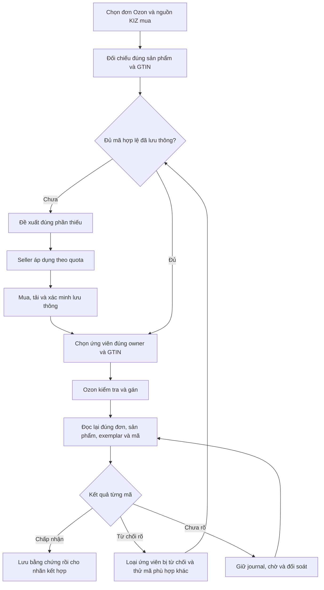

# Ozon — đăng ký Znack và mua/gán KIZ theo đơn

Ngày 16.11.2026, Europe/Moscow. Đã triển khai và đạt kiểm thử phạm vi ảnh hưởng trên Linux; chưa nghiệm thu giao dịch thật hoặc phát hành. Nhánh `feature/ozon-znack-order-kiz-20261116`, HEAD nền `a7c4d008ae450a82b6cfbfbb79e5532eca6bfa1e` cộng working-tree diff. Giữ toàn bộ thay đổi ECC/UI chưa commit có trước nhiệm vụ.

## Sao lưu trước khi sửa

Đã lưu và kiểm CRC/hash từng tệp của **3.740 tệp nguồn**, gồm mọi chỉnh sửa trước đó, trước lần sửa tính năng đầu tiên. [Biên nhận](backup-receipt.json).

- Nguồn: `/workspace/artifacts/VNCode-before-ozon-znack-orders-20261116-134914-MSK/VNCode-full-source-before-ozon.zip`, 92.551.608 byte, SHA-256 `e7f3b8eb264b43a9b2d80a8c300c73d00e46f090502f321f4830b14de9dbb10f`.
- Cùng thư mục có ZIP app Linux đã kiểm trước nhiệm vụ với 74 thư viện; EXE/MSI Windows gốc của bản công bố 1.6.10 cũng được giữ và so checksum. Đây là các bản sao riêng biệt: bộ cài gốc không chứa sửa ECC/UI chưa phát hành, ZIP nguồn có chứa chúng.
- Cloud không có hồ sơ, credential, khóa riêng hoặc dữ liệu thực trên máy Windows của seller; không tuyên bố đã sao lưu các dữ liệu đó. Không ghi đè những gói sao lưu đã giao.

Baseline đúng của nhiệm vụ là `source-manifest.json` trong thư mục sao lưu, không phải chỉ Git HEAD: trước nhiệm vụ đã có 7 tệp sửa và 25 tệp mới.

## Đã thay đổi

**Đăng ký Ozon:** engine đăng ký Catalog, theo dõi feed, ký/công bố và cập nhật GTIN đã tồn tại. Lỗi thực tế là sidebar chỉ cho WB hiển thị mục đăng ký. Đã mở mục này cho Ozon và thêm nút đi thẳng từ FBS Ozon, dùng lại trang/engine hiện có. Kiểm tra cửa hàng hiện tại, credential đã thay đổi, cửa hàng bị xóa, callback, trạng thái bận và view đã đóng trước khi chuyển trang. Mở trang không tự tạo thẻ, mua mã hoặc ký. [Chi tiết bốn tệp production và hai tệp test](registration-implementation.md).

**Mua theo đơn:** dùng lại proposal/Áp dụng, pipeline mua và chờ lưu thông chung đang có. Cả nhận đơn và in đều tính phần thiếu chính xác của các đơn vị cần mã; khi mã mua đã gán bị Ozon từ chối, chỉ bổ sung phần bị từ chối, không tính lại những đơn vị đã nhận, đang chờ kết quả hoặc đã in/tiêu thụ. Giữ ngân sách và xác nhận mua hiện có.

**Kho và chờ mã:** cùng một chính sách Ozon được dùng để đếm tồn, chờ mua xong và chọn mã. Mã có GTIN thô khác mapping, chưa lưu thông, sai chủ cửa hàng, nguồn chưa xác minh hoặc đã giữ cho đơn khác không được làm tồn kho khả dụng giả. Bổ sung tùy chọn vào bốn tệp dùng chung, giữ nguyên hành vi mặc định của WB. Không xây thêm bộ xử lý mua song song.

**Chỉ gán thành công khi Ozon chấp nhận:** mã tải về là ứng viên. Mã mua phải có nguồn mua thuộc cửa hàng, đúng GTIN/biến thể và trạng thái lưu thông. Giữ nguyên chuỗi GS1, ký tự phân cách và đuôi mật mã. Trước khi dùng trong nhãn kết hợp, app gửi kiểm tra/gán và đọc lại kết quả đúng posting, sản phẩm, exemplar và fingerprint mã. HTTP 200, số lượng tổng hoặc trạng thái local `ACCEPTED`/đã in không thay thế xác nhận của Ozon.

- Ozon từ chối rõ ràng: tách mã đó khỏi khả năng dùng lại, ghi nhận kết quả và tự thử ứng viên đủ điều kiện cho đúng đơn vị. Giới hạn thử và quota mua vẫn giữ.
- Timeout hoặc chưa rõ server đã nhận: giữ reservation/journal và đối soát; không gửi, đổi mã hoặc mua lại ngay.
- Các đường xuất đơn lẻ, theo lô, cache và in lại đều có kiểm tra cho mã mua. Giữ cách tải nhãn vận đơn chính thức theo lô.
- Bằng chứng chấp nhận gắn với cửa hàng, job và toàn bộ binding; kết quả từ chối mới làm bằng chứng cũ mất hiệu lực. Đơn đã in/tiêu thụ cũ nhưng thiếu bằng chứng chỉ được đọc đối soát, không tự mở lại hoặc gửi lại mã đã dùng.

Chính sách KIZ seller nhập theo danh mục/không ép cùng GTIN được giữ theo yêu cầu trước. Không nới quy tắc bắt buộc của Ozon. [Chi tiết 18 tệp mua/gán và các lần RED/GREEN](purchase-implementation.md), [hash nguồn](purchase-source-sha256.json).

## Kiểm thử đã thực hiện

Đã dùng Code Doctor và ba workflow ECC đã điều chỉnh: review tác động, security và TDD/verification, thông qua đọc SKILL.md trực tiếp theo AGENTS. Không coi tệp Markdown là hook hoặc native skill tự kích hoạt trong Codex Web.

| Kiểm tra | Kết quả thực tế |
| --- | --- |
| Fresh `clean verify` trên source snapshot độc lập, JDK25/Maven cached/offline, Xvfb, SQLite tổng hợp | **1.954/1.954 đạt, 189 suite, 0 failure/error/skip**, exit 0; không suite được chọn nào thiếu |
| Bảy lớp test mới | 62 ca đã nằm trong 1.954; gồm 54 nghiệp vụ và 8 UI/navigation, không cộng lại |
| Đăng ký/UI vòng riêng trước đợt cuối | 100/100, gồm regression Ozon 40/WB 44 và FXML/layout; kết quả riêng, chồng lặp với đợt cuối |
| Reviewer độc lập tự chạy | 55/55, gồm 54 ca nghiệp vụ và 1 fixture ngoài repo kiểm terminal job với ba trạng thái ticket; không cộng vào 1.954 |
| Bảo toàn nguồn | Không mất tệp baseline; 24 tệp nguồn/test thay đổi đúng phạm vi; mọi test cũ giữ nguyên byte |
| ECC validator và whitespace | Validator đạt 15 skill/61 liên kết; `git diff --check` đạt. Chế độ validator này không đọc lại hash nguồn upstream |

[Kết quả cuối từng suite và hash JUnit](combined-result.json), [lệnh thực thi](verification-command.json), [review độc lập](independent-review.md), [55 ca độc lập](independent-result.json), [biên nhận UI](registration-result.json), [đối chiếu nguồn](preservation.json).

Phạm vi cuối bao gồm nhận đơn, exemplar, paid rotation, thiếu hụt, stock/wait, nguồn nhập/mua, cache/reprint, nhãn kết hợp, PDF theo lô, split/FBO, WB export/GTIN/giá, đăng ký/resume, sidebar/Home và các ma trận bố cục. Không gọi đây là chạy toàn bộ test ứng dụng: bài 10.000 GTIN không liên quan trực tiếp không được chạy lại. Các số 4.700/280/191/67 của nhiệm vụ ECC trước là bằng chứng lịch sử riêng.

Có các lần RED có ý nghĩa trước sửa: nhãn mua dùng trạng thái local; đường SUZ tải tay không có block/pipeline; gửi lại terminal qua đường nhận thông thường; thiếu hụt bound slot; kho đếm được nhưng allocator không chọn được; chờ mua dùng bộ đếm khác. Các lỗi môi trường DISPLAY/launcher và lỗi fixture ban đầu được giữ riêng, không gọi là RED nghiệp vụ.

## Gói chạy hiện hành

JAR vừa build: **7.798.913 byte**, SHA-256 `5956f0ed009d52d259b594ded6e6b781048ba7187dbae44ec60d4611d51ff553`. 2.074 production entry/2.033 class trùng đầu ra compile; manifest Maven/POM metadata kiểm riêng; 74 runtime JAR; không lọt class test/fixture. Cả 1.434 build input và 24 tệp do owner chốt giữ nguyên qua kiểm thử/build.

Reviewer độc lập cũng kiểm CRC, tên entry, byte nguồn/compile, metadata POM, class Java25 và đủ hash 74 thư viện giống bản sao lưu: [biên nhận artifact](independent-artifact-review.json). [Biên nhận cuối](FINAL-RECEIPT.json) chốt các kiểm tra và phần chưa thực hiện.

Đã thực sự chạy `com.vncode.app.Launcher.main` từ JAR này đứng đầu classpath, mở workspace sau **6,276 giây**, đóng bình thường và nhả data lock. Hồ sơ tổng hợp 0 cửa hàng, SQLite integrity OK, 0 vi phạm FK; outbound bị chặn, license tổng hợp. Đây là kiểm khởi chạy Linux, không phải giao dịch thật hoặc đo tốc độ xử lý đơn của seller. [JAR](jar-integrity.json), [Launcher](launcher-result.json).

## Bảo toàn và giới hạn

Đúng **14 tệp production sửa +3 production mới +7 test mới**. Phần dùng chung chỉ gồm `KizPurchaseAvailability`, `KizStockReplenisher`, `KizPurchasePendingException`, `KizPrintPurchaseSession`; các overload mặc định giữ nguyên. Không đổi WB-specific production, schema/migration, dependency/POM, CSS, CI, portal, license hoặc metadata phát hành. Các sửa ECC/UI và test cũ vẫn còn; chỉ tài liệu bộ nhớ được nối tiếp. [Đối chiếu độc lập](preservation.md).

Không có giao dịch Catalog/SUZ/Ozon thật, mua KIZ tính phí, ký CryptoPro, nhận đơn seller, kích hoạt license hoặc gửi Gmail trong đợt này. Fixture/local HTTP không chứng minh Ozon thật sẽ nhận mọi mã, và thời gian PDF tổng hợp 100/1.000 đơn không phải benchmark cho xác minh mã mua qua mạng thật. Chưa kiểm Windows/CryptoPro/DPAPI/installer ở source mới. Vẫn còn nợ security Java lịch sử 8 finding và giới hạn extraction GS1; chưa chạy CodeQL mới, không miễn gate hoặc gọi security toàn ứng dụng xanh.

Chưa commit/push, tăng version, tạo bộ cài Windows hoặc phát hành Latest. Bước nghiệm thu thương mại riêng là dùng cửa hàng/cấu hình hợp lệ để kiểm từ Catalog công bố → mua/lưu thông SUZ → Ozon chấp nhận đúng đơn → nhãn kết hợp, gồm mất mạng và khởi động lại. Không suy quyền mua/ghi thật từ các yêu cầu lịch sử.
