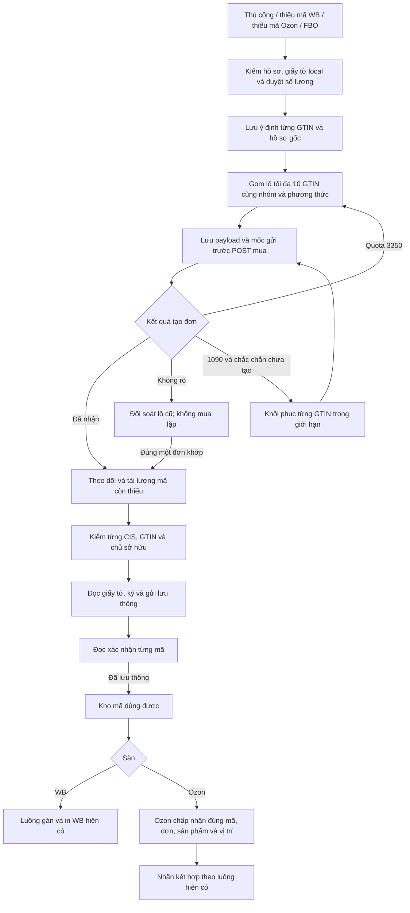

# VN Code — thay luồng mua KIZ theo WBCode 1.3.26 và gom các sửa chưa phát hành

17.11.2026, Europe/Moscow. Nguồn: nhánh `feature/ozon-znack-order-kiz-20261116`, HEAD nền `a7c4d008ae450a82b6cfbfbb79e5532eca6bfa1e` cộng toàn bộ working tree. Đây là thay đổi mã nguồn; chưa phát hành Latest. Số phiên bản nguồn vẫn 1.6.10, không dùng số đó để suy rằng các sửa này đã có trong bộ cài công khai.

**Đã thay luồng, gom nguồn và kiểm trong phạm vi ảnh hưởng.** Kết quả hiện hành: **2.296 ca/232 suite đạt**, không failure/error/skip, từ hai lượt trên cùng mã production; đây không phải một lượt full-suite. JAR mới và actual Launcher đạt. [Biên nhận cuối](FINAL-RECEIPT.json) · [Kiểm hợp nhất](affected-result.json) · [Kiểm kê các sửa chưa phát hành](all-pending-inventory.json).

## Luồng mua mới

Đã triển khai độc lập trong VN Code theo hành vi quan sát của đúng WBCode 1.3.26; không đưa binary, license hay mã decompile của WBCode vào app. Nguồn đối chiếu: [nghiên cứu binary đã ghim](../../research/kiz-purchase-20261116/wbcode/REPORT.md). JAR tham chiếu SHA-256 `d10efde1c0ef6e6f8cf3e850e1dd7615966b0aa1e83082181f6c8dd26380f1b6`.

- Một bộ điều phối dùng chung cho mua thủ công, thiếu KIZ khi in WB/Ozon, thiếu KIZ khi nhận Ozon và FBO. Các phương thức cũ chỉ là cửa vào tương thích của engine mới; không giữ nhánh mua cũ để dự phòng.
- Gom tối đa 10 GTIN cùng hồ sơ/tài khoản, nhóm hàng và phương thức mua. Giữ riêng số lượng, request key, pipeline, order và mã của từng GTIN.
- Ba hàng đợi theo cửa hàng: tạo đơn 4, tải mã 2, lưu thông 2; cùng GTIN vẫn giữ thứ tự. Quota 3350 chờ 30 giây ở khâu tạo, không chặn khâu tải mã.
- Nhóm `lp`/template 10 và giày `shoes`/template 1. Hỗ trợ sản xuất và hàng ký gửi; lựa chọn được lưu riêng theo cửa hàng và đóng băng lúc duyệt mua.
- Kiểm giấy tờ có sẵn trước mua, không còn bắt buộc toàn bộ lượt đồng bộ Catalog phải hoàn chỉnh. Vẫn giữ kiểm biến thể, GTIN, cửa hàng và quyền ký; không thay thuật toán đăng ký hay ghép GTIN chung.
- Lưu payload/hash và ý định gửi trước POST. Mất phản hồi chỉ đối soát đúng tài khoản, thời gian và toàn bộ GTIN/số lượng; không tự mua lại khi chưa biết kết quả.
- Lỗi chứng thực 1090 chỉ được khôi phục sau bằng chứng chắc chắn chưa tạo đơn, tách từng GTIN, giới hạn ba lần theo lịch 0/5/15 phút. Không coi timeout, HTTP 408/5xx hoặc danh sách rỗng là bằng chứng đó.
- Tải theo lượng còn lại/khả dụng; ghi nhận bền vững mỗi lần cấp mã và khôi phục đúng khối đã cấp nếu mất phản hồi. Không gửi lặp ngầm POST mua, GET cấp mã hoặc POST lưu thông.
- Sau tải: kiểm CIS, chủ sở hữu và điều kiện sẵn sàng; tạo/ký đúng loại chứng từ rồi đọc xác nhận. Chỉ báo đã lưu thông khi mã thực sự được xác nhận, không dựa riêng HTTP 200 hoặc tải đủ mã.
- Khôi phục nền nhiều cửa hàng WB/Ozon đã xác minh, đúng hồ sơ gốc. Pause, hủy, generation và thay cấu hình được kiểm ngay trước thao tác ghi/ký; cắm lại USB được tự kiểm lại trong đúng trạng thái mất kết nối tạm thời.

Các bảo vệ mạnh hơn của VN Code được giữ có chủ đích: toàn bộ CIS/GTIN/chủ sở hữu, mã đã dùng không trở lại khả dụng, WAL của lần cấp mã và xác nhận chính xác của Ozon. Đây là phần thích nghi chất lượng, không phải hạ điều kiện để giống bản tham chiếu.

## Những lỗi đã sửa khi tích hợp engine mới

Đây là lỗi được phát hiện ở baseline hoặc các checkpoint đang triển khai, không phải tuyên bố tất cả đã xảy ra trong bộ cài seller:

- Luồng FBS vẫn còn gate Catalog toàn cục bên ngoài coordinator; đã đưa về chính sách local thống nhất mà giữ proof biến thể WB/Ozon.
- Getter cấu hình vô tình mở ghi SQLite lồng nhau; đã trở lại chỉ đọc. Serialization `Settings/Instant` trên Java 25 dùng adapter phù hợp.
- Cache phiên SUZ/chủ thể bị dùng chung khi đổi OMS/chứng thư, và quyền ký còn sót giữa các hồ sơ thử trùng shop ID; đã tách theo danh tính và vòng đời hồ sơ.
- Mất phản hồi lần cấp 3 mã trong đơn 5 mã có thể kẹt đối soát cả đơn; đã lưu mục tiêu riêng của lần cấp, kể cả khi làm mới trạng thái xóa mất thông báo hiển thị.
- Retry ở transport có thể gửi lặp thao tác mua/lưu thông/cấp mã; đã bỏ retry ngầm, chỉ cho engine quyết định theo trạng thái bền vững và bằng chứng phản hồi.
- Quota, 429, lịch thức dậy và lỗi của thành viên lô có thể chỉ cập nhật dòng đầu; đã cập nhật toàn lô. API mua tương thích trả đúng dòng GTIN mà caller yêu cầu, không lấy dòng đầu ngẫu nhiên.
- Migration có cửa sổ uniqueness mới đã commit nhưng schema vẫn mang số cũ; đã commit fence schema 7 trong cùng giao dịch và kiểm cả lỗi giữa/sau migration.
- App khởi động lại có thể mất dấu chờ USB tạm thời; đã phục hồi từ marker bền vững, giữ lệnh hủy và quyền ký gốc. Thông báo USB được tách khỏi thông báo pause cần người dùng tiếp tục.
- Đọc lại đơn cũ chưa có pipeline bỏ qua cấu hình caller và dùng địa chỉ SUZ mặc định. Đã dùng fallback truyền vào chỉ cho trường hợp chưa có context; hồ sơ mua đã ghim vẫn thắng cấu hình caller sai hoặc cấu hình hiện tại đã đổi. Kiểm HTTP giữ đủ OMS/order/GTIN/token và chỉ gửi GET.

[Review 21 tiêu chí](parity-review.md) và [review bảo toàn/bảo mật](source-preservation-review.md) ghi rõ bằng chứng, giới hạn và các ranh giới không thay đổi.

## Toàn bộ nhóm sửa chưa phát hành được giữ trong gói nguồn

| Nhóm | Nội dung và hồ sơ chi tiết |
|---|---|
| ECC và công cụ kiểm mã | Ba skill Codex Web, hướng dẫn review/security/TDD, provenance/MIT, validator; giữ Code Doctor, OpenQodex và memory cũ. Sửa helper chụp và thông báo rỗng Znack. [Bàn giao](../ecc-codex-web-20261115/REPORT.md). |
| Đăng ký Znack Ozon | Mở cửa vào từ sidebar và FBS, dùng engine Catalog có sẵn; giữ guard cửa hàng/credential/callback/busy. [Bàn giao](../ozon-znack-orders-20261116/REPORT.md). |
| Mua/gán KIZ Ozon theo đơn | Duyệt phần thiếu chính xác, chỉ bổ sung đơn vị chưa được chấp nhận; xác nhận đúng mã/đơn/sản phẩm/exemplar. Giữ chính sách mã seller nhập và luồng nhãn theo lô. [Bàn giao](../ozon-znack-orders-20261116/REPORT.md). |
| An toàn tải mã, lưu thông và tiếp tục FBS | Giữ kiểm toàn gói CIS, WAL/khôi phục, owner gốc, thông báo pending, nút tiếp tục đúng lô và summary không che lô đang chờ. Nội bộ mua/điều phối cũ đã được thay bằng engine mới; các bảo vệ này được mang sang. [Bàn giao cũ](../kiz-first-public-20261116/REPORT.md). |
| FBS Ozon theo bố cục WB | Giữ bố cục và kích thước bảng/hàng/ảnh/thanh công cụ đã duyệt, năm tab Ozon và mọi thao tác/phân trang. Không sửa CSS kính hay bố cục WB trong lần thay mua KIZ. [Ảnh/bàn giao](../ozon-fbs-wb-layout-20261116/REPORT.md). |
| Nghiên cứu và bộ nhớ | Giữ đối chiếu VN 1.3.0/public đầu/Latest và WB 1.3.26, checksum, sơ đồ và các checkpoint; không biến kết quả lịch sử thành kiểm thử của mã mới. [Nghiên cứu](../../research/kiz-purchase-20261116/REPORT.md). |
| Thay toàn bộ mua KIZ WB 1.3.26 | Engine, lô bền vững, hàng đợi 4/2/2, nhóm/phương thức, xác thực, khôi phục, lưu thông, migration 6→7 và kiểm hợp nhất trong báo cáo này. |

## Dữ liệu cũ và khôi phục

Trước sửa đã sao lưu đủ 3.947 tệp, gồm toàn bộ sửa chưa commit; ZIP 107.165.680 byte, SHA-256 `8e73de42982b9e50bc13e9776a4dd4ef4e8074deb11f5b6d177b8faf5e360533`, đã kiểm CRC và hash từng tệp. [Biên nhận](baseline-backup.json).

Migration schema 6→7 cho phép nhiều GTIN cùng mã đơn SUZ, giữ local ID, mã đơn thật, request key, CIS, trạng thái CONSUMED, chứng từ, FK/index/trigger/sequence. Phép kiểm thực dùng JAR cũ schema 6: cùng phiên bản app 1.6.10 vẫn tạo snapshot schema 6 trước migration, giữ dữ liệu tổng hợp sau migration và đổi marker sang 7; JAR cũ từ chối mở schema 7 qua cả migration gate và Database. So sánh toàn bộ schema/hàng/sequence không đổi sau hai lần từ chối. Không áp dụng vào dữ liệu seller thật trong cloud.

## Kiểm chứng và giới hạn

Đã dùng Code Doctor, ECC review/security/TDD qua SKILL.md; không cài thêm dependency, scanner hoặc runtime WBCode. Các kết quả của owner được giữ trong [components](components/); chúng có chồng lặp và không cộng vào tổng kiểm thử mới.

| Kiểm đã thực thi | Kết quả và phạm vi |
|---|---|
| Nhóm hiện hành đã đóng | **2.296 ca/232 suite đạt**, 0 failure/error/skip. Lượt 231 suite có 2.238 ca và một kỳ vọng UI cũ thất bại; lượt clean package cuối chạy lại 4 suite/92 ca, sửa kỳ vọng đó và bổ sung FXML smoke. Ba suite trùng chỉ tính một lần. Đã đối chiếu đủ 821 input production/POM và 2.119 entry compiled main: hai lượt giống byte hoàn toàn. Bốn tệp test thay đổi đều đã chạy lại. [Biên nhận](affected-result.json). |
| Build cuối | Fresh offline JDK 25/Maven `clean verify`, Linux/Xvfb: biên dịch **778 tệp main và 646 tệp test**, 92/92 ca cuối đạt, exit 0, 84,06 giây; mọi input build vẫn khớp nguồn sống. [Biên nhận](final-build-result.json). |
| Lượt kiểm rộng đầu | **FAIL**, 5.062 ca/620 suite, 51 failure/12 error/2 OS skip; giữ nguyên bằng chứng. Phát hiện lỗi đọc đơn cũ đã sửa và các fixture/kỳ vọng chính sách cũ đã cập nhật, sau đó kiểm lại nhóm liên quan nêu trên. Không gọi 63 kết quả thất bại là 63 lỗi app. Không chạy lại `GtinBulkPipelineTest` 10.000 GTIN không đổi; không tuyên bố full Java-suite của nguồn cuối đạt. [Biên nhận](initial-broad-result.json). |
| Popup theme trong lượt rộng | Hai ca popup báo lỗi; **11/11 ca ThemeServiceTest đạt khi chạy riêng**, dùng chính bytecode của lượt rộng, không biên dịch lại hoặc sửa nguồn. Theme/header/CSS trùng baseline. Nguyên nhân ngữ cảnh/focus chưa được chứng minh; kết quả FAIL của lượt rộng vẫn giữ. [Phân loại](components/theme-isolation.md). |
| Dữ liệu và quy mô local | Migration/rollback/legacy context đạt; actual JAR schema 6 từ chối schema 7, snapshot trước nâng cấp cùng version giữ dữ liệu. Probe **1.000 GTIN → 100 lô**, 4.003 mã theo số lượng đã duyệt, đọc đủ sau JVM mới, không đổi nhóm/phương thức/hồ sơ khi cấu hình hiện tại thay đổi. Đây là kiểm SQLite/phân lô, không đo API mua. [Probe](components/scale-1000.json). |
| JAR cuối | **7.921.339 byte**, SHA-256 `f9d623f91e1dcf9e567c82ddc0067a722cc216530ee52b4fb9cb94c8a61926b9`; 2.077 class Java 25 và 41 resource đúng đầu ra compile; CRC/entry an toàn/không lẫn test fixture, 74 thư viện runtime giữ nguyên byte, POM không đổi. [Artifact](jar-integrity.json). |
| App thực từ JAR | Gọi actual `Launcher.main`, xác minh Launcher/MainApplication/Database/BatchStore/Coordinator đều từ JAR cuối. Workspace mở sau **6,184 giây**, process exit 0, đóng và nhả lock; schema/marker 7, integrity OK/FK sạch/0 shop. Hồ sơ và license tổng hợp, outbound bị chặn. [Receipt](artifact-launcher-result.json) · [ảnh](actual-launcher-workspace.png). |
| Công cụ ECC | Validator cấu trúc đạt; **17/17 test Node đạt**, không skip. Lượt validator này không truyền upstream root nên không gọi là kiểm lại byte upstream; provenance ghim cũ giữ nguyên. [Receipt](ecc-validator-result.json). |

Hai OS skip của lượt rộng: `Gs1PrefixTemplateStoreTest.refusesNtfsJunctionDirectoryAndAncestors`, `WindowsSecretProtectorTest.separatesLicenseAndExistingMailEntropyOnWindows`. Không thêm skip hay tắt test để có kết quả đạt. [Review đổi fixture](test-modernization-review.md) tách rõ điều kiện đã được thay theo yêu cầu, lỗi dựng fixture và lỗi production đọc đơn cũ.

Kiểm trong Linux/Xvfb dùng SQLite và HTTP tổng hợp, không phải nghiệm thu mua thật. Chưa chạy Windows/CryptoPro/USB thật, SUZ trả phí, ghi WB/Ozon/Catalog, license activation, Gmail hoặc bộ cài Windows. Các finding CodeQL lịch sử/giới hạn extraction GS1 không được coi đã xử lý. Không thể bảo đảm dịch vụ bên ngoài luôn chấp nhận mọi yêu cầu chỉ bằng kiểm mã nguồn.

Không commit/push, đổi tag, tạo bộ cài hoặc phát hành Latest trong nhiệm vụ này.

## Gói nguồn để lưu

Gói đầy đủ `/workspace/kiz-wb1326-replacement-20261117/VNCode-all-unreleased-WB1326-source-20261117.zip` chứa nguồn, kiểm thử, tài liệu và mọi sửa chưa phát hành; không chứa Git database, output build bị ignore, hồ sơ seller hay bộ cài Windows. Manifest và `SHA256SUMS.txt` đặt cạnh ZIP, kiểm CRC và hash từng tệp sau khi đóng gói. Giữ riêng bản sao lưu trước sửa, không ghi đè.
