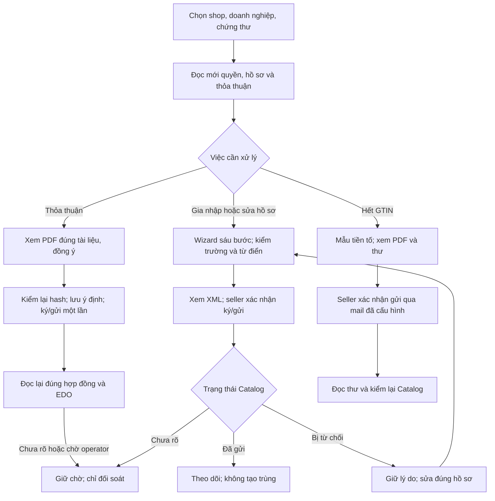
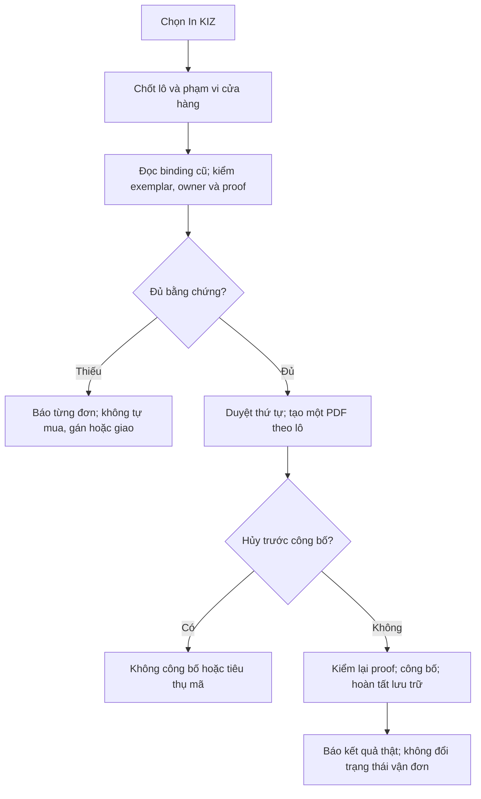

# VN Code: chẩn đoán theo 19 hướng dẫn WBCode và phạm vi gom bản mới

Ngày 18.11.2026, Europe/Moscow. Người dùng yêu cầu kiểm tra bản 1.6.10 đã phát hành, hoàn tất các phần còn thiếu rồi phát hành bản mới. Vì 1.6.11 chưa công bố, các bổ sung GS1, Sản phẩm và Ozon được gom vào nguồn chuẩn bị **1.6.11**, thay cho kế hoạch cũ để chúng ở bản sau 1.6.11. Không thay binary/tag 1.6.10 đã phát hành.

## Trạng thái phát hành tại thời điểm lập báo cáo

- Latest đọc lại ngày 18.11 vẫn là **v1.6.10**, release `445977967`, nguồn `b74b5edfd46636e8779c94f467eef01c03c50a14`, công bố 15.11.2026 lúc 13:40:34 MSK. Release immutable và có đủ 16 asset, gồm EXE/MSI. Điều này chứng minh bản đã được cung cấp, không chứng minh máy seller đã cài.
- Windows run `44128536997` của nguồn 1.6.11 cũ `4f3b71aa108008c49e865652159ca5377ddb22f8` đã thất bại: 5.079 ca, 0 failure, 1 error, 2 skip. Error nằm trong `OzonFbsUiTest.allFourOrderTabsKeepActionsAndPagingVisibleAcrossLanguagesThemesAndSmallWindows`, assertion vị trí phân trang được bọc trong `ExecutionException`. Native/package/DPAPI/install chưa chạy ở lượt này. Không dùng lượt đó làm bằng chứng bộ cài đạt.
- Nguồn gom ngày 18.11 còn phải qua kiểm định cuối riêng. Báo cáo này ghi phạm vi triển khai và các kết quả đã có; biên nhận công bố, hash bộ cài và kết quả updater phải được ghi sau khi kiểm định thực tế hoàn tất.

## Cách đối chiếu

Đã thu thập **19 bài, 19 MP4, tổng 18 phút 42,38 giây** từ ba trang danh sách tại [WBCode Guides](https://wbcode.pro/guides). Bài 1 chỉ có ảnh; bài 2 có hai video. Hash tải về và giải mã video đã kiểm. Hai lượt review đã xem 305 khung hình/34 contact sheet, lấy mỗi bốn giây và khung cuối, cùng nội dung các bài. Đây là **đối chiếu hình ảnh theo mốc, không phải xem/nghe liên tục toàn bộ video**. ASR của 19 audio có nhạc/câu nhận sai nên không dùng làm căn cứ nghiệp vụ.

WBCode 1.3.27 đã được đối chiếu chỉ đọc: 81/81 entry GS1 và hỗ trợ khớp byte với 1.3.26. Không chạy binary WBCode hoặc dùng license/backend riêng của họ. Luồng mới của VN Code dựa trên hợp đồng [True API](https://docs.crpt.ru/gismt/True_API/) và [National Catalog](https://docs.crpt.ru/gismt/API_%D0%9D%D0%9A/).

Trong ma trận, “có xử lý” nghĩa là đã lần theo UI → service/API → lưu trữ/đối soát. Sự hiện diện trong mã chưa phải nghiệm thu sàn, GS1, chữ ký hoặc mail thật. [Chỉ mục bằng chứng](evidence-index.json) ghi phạm vi và hash; không sao chép video, toàn văn bài, binary hay mã dịch ngược vào repo.

## Ma trận đủ 19 bài

| Bài | Nội dung | Kết luận cho VN Code |
|---|---|---|
| [3](https://wbcode.pro/guides/3) | Cài đặt và cập nhật | Có bộ cài/updater Windows; chưa nghiệm thu macOS. Kiểm định bộ cài mới là công việc riêng. |
| [1](https://wbcode.pro/guides/1) | Mua/kích hoạt license | Có dịch vụ license VN Code. QR thanh toán WBCode thuộc dịch vụ khác, không sao chép. |
| [2](https://wbcode.pro/guides/2) | Thêm WB/Ozon, OMS, chứng thư | Có cấu hình, discovery và kiểm chữ ký; chưa dùng hồ sơ seller thật trong lượt đối chiếu. |
| [4](https://wbcode.pro/guides/4) | Đăng ký Catalog, ký, đẩy GTIN | Có feed/trạng thái/đối soát. Đã bổ sung điều hướng lỗi GS1; HTTP 200 không thay xác nhận nghiệp vụ. |
| [5](https://wbcode.pro/guides/5) | FBS WB | Có shipment, mua phần KIZ thiếu, nhãn kết hợp và giao shipment; giữ luồng WB. |
| [6](https://wbcode.pro/guides/6) | FBS Ozon | Có nhận đơn, tách tự động, gán mã, in/in lại. Chưa xác minh hợp đồng cho nút bàn giao vật lý như video. |
| [7](https://wbcode.pro/guides/7) | FBO WB | Có số lượng theo size, kiểm GTIN/KIZ, in phần đủ điều kiện và báo phần thiếu. |
| [8](https://wbcode.pro/guides/8) | Lịch sử và in lại | WB/FBO có xử lý; Ozon có in lại tại đơn. Lịch sử chung Ozon vẫn khóa in lại khi thiếu dữ liệu/proof. |
| [9](https://wbcode.pro/guides/9) | Thiết kế mẫu tem | Có kéo/chỉnh kích thước/font, căn lưới, lưu/khôi phục. Chưa nghiệm thu máy in vật lý. |
| [10](https://wbcode.pro/guides/10) | Sửa hàng loạt và danh mục | Năm nút có đường API/đọc lại. Đã thêm bộ lọc nhiều danh mục, giữ năm thao tác hiện có. |
| [17](https://wbcode.pro/guides/17) | Gia nhập/đăng ký lại GS1 | Đã bổ sung trạng thái hồ sơ/từ chối, điều kiện đăng ký lại và wizard sáu bước. |
| [11](https://wbcode.pro/guides/11) | Kiểm tài khoản, thỏa thuận, tiền tố | Đã thêm PDF/consent/ký/đối soát thỏa thuận và mẫu 01.04.01 mặc định. Mail dùng SMTP/IMAP seller. |
| [12](https://wbcode.pro/guides/12) | Lỗi GS1/quota/166 | Đã nối lỗi WB/Ozon sang tác vụ GS1 tương ứng; mở nháp không tự mua/gửi/ký. |
| [13](https://wbcode.pro/guides/13) | Sửa lỗi thẻ Catalog | Có chi tiết lỗi, sửa/gửi lại đúng hồ sơ/GTIN/feed; không tự bịa dữ liệu sản phẩm hoặc chứng từ. |
| [14](https://wbcode.pro/guides/14) | KIZ Mapping, tồn và mua thêm | Có xử lý thực; giữ proof lưu thông/binding của mã mua và chính sách riêng cho mã seller nhập. |
| [15](https://wbcode.pro/guides/15) | Gia hạn và thêm shop bằng QR | Cần dịch vụ/thanh toán riêng VN Code; không thêm QR hoặc nút thanh toán không có backend. |
| [16](https://wbcode.pro/guides/16) | Tra cứu TN VED | Có tìm mã/tên, lọc giới tính và sao chép. |
| [20018](https://wbcode.pro/guides/20018) | Khôi phục mua KIZ lỗi | Có mua tay/đối soát; không mua lại để che yêu cầu chưa rõ kết quả. |
| [20019](https://wbcode.pro/guides/20019) | Ozon chặn nhãn → in KIZ riêng | Đã thêm “In KIZ” theo lô từ binding đã có, kèm STT/mã đơn; giữ nguyên in vận đơn và kết hợp thông thường. |

## Những phần đã bổ sung vào nguồn

| Vấn đề xác định | Hành vi sau thay đổi |
|---|---|
| Cache chỉ giữ `isSent`, làm mất trạng thái bị từ chối | Lưu `UNKNOWN/DRAFT/SUBMITTED/REJECTED` và lý do có giới hạn; gắn đúng nguồn/thời điểm. Cột bổ sung nullable, giữ khả năng đọc dữ liệu cũ. |
| Mọi doanh nghiệp `EXCLUDED` bị hướng sang thư khôi phục | Cho sửa/gia nhập lại khi hồ sơ Catalog còn chỉnh được; hồ sơ đã gửi/chưa rõ kết quả vẫn theo dõi, không tạo trùng. |
| Checklist/trường bắt buộc chưa đúng hợp đồng | Kiểm hình thức pháp lý/chức vụ/vai trò/các nhóm; chuẩn hóa theo ID từ điển khớp duy nhất. Giữ metadata/giá trị chưa biết, không tự xác nhận thay seller. |
| Wizard thiếu thao tác và có thể dùng GUID địa chỉ cũ | Có Tiếp tục/Quay lại/xem hồ sơ, trường tùy chọn, sao chép/thêm/xóa địa chỉ và liên hệ; sửa địa chỉ xóa GUID/mã bưu chính cũ, bỏ phản hồi tra cứu đã lỗi thời. |
| Cuộn form có thể đẩy tab/nội dung vào vùng trống | Đã tái hiện bằng chuột thật, sửa riêng chiều cao body và cuộn nội bộ từng bước; giữ header/footer. |
| Kiểm thỏa thuận truyền rỗng, chưa có đường ký đầy đủ | Đọc danh sách/PDF chính thức, xem từng trang, consent rõ; kiểm lại hash trước ký, lưu ý định và đọc lại đúng hợp đồng/EDO. Phân biệt seller đã ký với operator đã ký. |
| HTTP 503 có thể tự gửi POST nghiệp vụ lần hai | Guard theo từng Call cho chữ ký thỏa thuận, lưu hồ sơ GS1 và gửi XML đã ký; kết quả chưa rõ chỉ đối soát. |
| Đổi shop/API key có thể tạo ý định ký khác | Dedup theo doanh nghiệp + môi trường + đúng hợp đồng; quyền ký vẫn gắn hồ sơ/chứng thư/shop đã duyệt. |
| PDF có tài nguyên quá lớn làm preview không ổn định | Giới hạn tài nguyên trước render và bật subsampling. Không coi đây là bộ xử lý chấp nhận mọi biến thể PDF. |
| SMTP từ chối rõ nhưng hồ sơ giữ đối soát | Chỉ về nháp khi có bằng chứng SMTP có cấu trúc rằng chưa chấp nhận người nhận nào; timeout/nhận một phần giữ đối soát. |
| Xin tiền tố lần đầu thiếu mẫu dùng ngay | Có mẫu mặc định theo biểu mẫu công khai 01.04.01, xem PDF trước gửi; mẫu tự nhập được ưu tiên, mẫu hỏng báo lỗi. |
| Lỗi quota/166 chưa mở đúng nơi xử lý | WB/Ozon có hành động mở nháp GS1 đúng shop/owner; giữ GTIN/good_id/feed khi quay lại. |
| Sản phẩm chỉ lọc một danh mục | Chọn tối đa 100 danh mục, giữ chính xác giá trị SQL, mục chưa có danh mục, phân trang/tìm kiếm/lựa chọn và năm nút chỉnh sửa. |
| Thiếu xuất KIZ khi Ozon không tải được vận đơn | Xuất một PDF KIZ theo lô từ binding hiện có; mã mua vẫn cần Ozon chấp nhận đúng mã/đơn/slot. Mã đã dùng chỉ in lại cho đơn gốc. Không tự mua/gán/giao từ nút này. |
| Hủy khi file đã công bố có thể báo kết quả sai | Hủy hợp tác trước điểm công bố; sau đó trả kết quả thật, giữ lease tới khi worker kết thúc. |

Nguồn bổ sung giữ engine mua KIZ chung và các sửa trước của VN Code, không thay dependency/framework. Kiểm file-retention tại checkpoint cho thấy **4.034 tệp nền đều còn**; đây không thay thế kiểm thử tương thích hành vi. [Receipt bảo toàn nguồn](receipts/source-preservation-checkpoint.json).

## Luồng GS1

## Luồng Ozon “In KIZ” riêng

Thứ tự dựa giờ nhận rồi mã đơn ổn định; giờ thiếu/trùng có cảnh báo. Chưa chứng minh luôn khớp website Ozon. Filesystem và SQLite không phải một transaction; lỗi lưu trữ sau công bố được báo cần đối soát.

## Bằng chứng kiểm thử đã thực thi

Các scope tập trung có chồng lấn, không cộng thành tổng duy nhất. Các kiểm dưới đây dùng loopback HTTP, SQLite tạm, dữ liệu tổng hợp và JavaFX Linux; không phải giao dịch GS1/sàn thật.

| Scope | Kết quả và giới hạn |
|---|---|
| Hợp nhất `source-v2` | **1.000 ca/94 suite, 999 đạt, 0 failure/error, 1 skip, exit 0**, 432,784 giây; `clean verify` có tạo package. Skip đúng `Gs1PrefixTemplateStoreTest.refusesNtfsJunctionDirectoryAndAncestors`, chỉ dành cho Windows/NTFS. [Kết quả và lệnh](receipts/combined-v2.json). |
| Node tooling | **244/244 đạt**, 0 failure/skip. [Lệnh](receipts/node-command.json), [tổng kết/hash log](receipts/node-summary.json). |
| Các lượt tập trung trước hợp nhất | GS1 trạng thái/cache 72; operator 37; chống replay hồ sơ GS1 24; SMTP 59; mẫu Word/PDF 40; sản phẩm 38; Ozon KIZ riêng 30, review riêng 28. Các lượt chồng scope với hợp nhất và với nhau. Hash/provenance trong [index](evidence-index.json). |
| UI GS1 | 112 ảnh = 28 trạng thái × 4 theme/kích thước; 364 kiểm tọa độ footer trong màn hình và Tab bốn tổ hợp. [Receipt tóm tắt](receipts/ui-summary.json). Ảnh là component production trong ngữ cảnh tổng hợp, không phải nghiệm thu Launcher/seller. |
| Nút đóng báo cáo | Đã dịch “Đóng”, giữ `CANCEL_CLOSE`; thêm bốn lượt chụp report riêng sau gallery 112 ảnh. [Biên nhận chụp bổ sung](receipts/report-close-capture.json). |

`source-v2` là snapshot trước các sửa cuối ngày 18.11. Kết quả 1.000 ca không tự chứng nhận các dòng đổi sau snapshot hoặc bộ cài mới. Lượt `source-v1` trước đó có một assertion lỗi câu thông báo; giữ lịch sử thất bại, không gọi lượt đó đạt.

## Sửa cuối ngày 18.11 và việc nghiệm thu phát hành

- **Hủy ký GS1 trước POST:** đã tái hiện rồi sửa. Chỉ khi seller mở lại PDF và service xác nhận hồ sơ vẫn là DRAFT mới mở khóa đồng ý/ký; kết quả chưa rõ vẫn chỉ được đối soát. [52/52 ca ở7suite đạt](receipts/gs1-retry-final.json), không lỗi/bỏ qua. Không tự ký/gửi lại.
- **Ozon A → B → A khi xuất KIZ:** đã tái hiện hai lỗi assertion và sửa marker chờ lease. Chỉ mở khóa lượt chờ cũ, giữ khóa task mới/lease khác. [42/42ca ở5suite đạt](receipts/ozon-busy-final.json), không lỗi/bỏ qua; review độc lập không có phát hiện cần sửa trong delta.
- **Kiểm bố cục FBS Ozon:** test cũ đo hình học cùng callback đổi tab/theme/kích thước, chưa chờ rendering. Thêm ba nhịp render và chờ cả idle lẫn kết quả FX thực tế, giữ nguyên assertion và thêm kiểm tra; [18/18ca UI/nativeWBparity đạt](receipts/ozon-ui-geometry-final.json), [phạm vi/bảo toàn test](receipts/ozon-ui-test-scope.json). Lỗi geometry Windows cũ chưa tái hiện giống hệt trên Linux; lỗi callback đổi shop được tái hiện riêng. Windows mới vẫn là bằng chứng bắt buộc.

- **Lỗi production thanh lọc Ozon ở cửa sổ nhỏ:** lượt Windows tiếp theo `44254027370`/nguồn3f4 cũng FAIL ở preflight665ca (664đạt/1error/0skip), do pager chồng bảng10px sau khi đã chờ render. Đã tái hiện với scene808×561 và bộ đếm1–100/1000: FlowPane cao43px trong khi cần86px. Sửa riêng FXML của Ozon để dùng min-height tính theo nội dung, thay minimum36px của toolbar chung. Không sửa controller, CSS chung hoặc WB. [Kiểm cuối24/24đạt](receipts/ozon-wrap-final.json), [hash hai tệp](receipts/ozon-wrap-source.json): đủ hồi quy808/760,14ca native đối chiếuWB và5ca KIZ UI. Bố cục rộng giữ nguyên. Đây là localLinux; vẫn cần Windows mới đúng nguồn sau sửa.

Các scope hẹp trên có chồng lấn, không cộng vào1.000ca source-v2. Nguồn sau sửa production sẽ chạy cleanverify hợp nhất và Windows mới/native/migration/DPAPI/install cùng reviewpackage. Hai lượt Windows thất bại được giữ làm lịch sử, không dùng cho công bố. Biên nhận cuối phải gắn đúng commit và run, kiểm đủ16asset public và updater sau công bố; không dùng checkpoint này thay nghiệm thu bộ cài. Latest1.6.10 ở đầu báo cáo là lịch sử đọc ngày18.11, không phải lệnh ghi đè release cũ.

## Ảnh đại diện

- [Wizard/checklist tối](screenshots/gs1-wizard-dark.png), [địa chỉ sản xuất sáng ở màn nhỏ](screenshots/gs1-address-light-small.png).
- [Thỏa thuận tối](screenshots/gs1-agreement-dark.png), [consent sáng](screenshots/gs1-agreement-light-consent.png).
- [PDF mẫu tiền tố](screenshots/gs1-prefix-default.png), [báo cáo với nút Đóng](screenshots/gs1-report-close-vi.png).
- [Sản phẩm: chọn nhiều danh mục tối](screenshots/products-dark-categories.png), [sáng](screenshots/products-light.png).

Ảnh dùng dữ liệu/PDF/chứng thư/nét vẽ mẫu; không có chữ ký hay giao dịch seller thật. Renderer Linux/Xvfb có backing trắng ngoài góc bo; chưa nghiệm thu compositor Windows, DPI/Narrator, chuyển động hoặc tốc độ máy seller. Sau snapshot ảnh, các sửa hành vi vẫn phải kiểm riêng.

## Giới hạn và các khác biệt chủ ý

- VN Code dùng SMTP/IMAP seller, chưa có backend GS1 inbox riêng như WBCode; giải thích thư trả lời tiếng Việt và nối thư không có thread còn cần hoàn thiện.
- Lịch sử Ozon chung cần thiết kế lưu PDF/proof trước khi bật in lại; không lấy renderer WB hoặc dữ liệu thiếu để báo thành công.
- Bàn giao vật lý Ozon và QR thanh toán license cần hợp đồng API/dịch vụ riêng. Xuất PDF không làm đơn thành đã giao.
- Chưa gửi GS1/Catalog/sàn, ký CryptoPro, gửi mail, mua KIZ, kích hoạt license/Gmail, in/quét vật lý hoặc benchmark 1.000 đơn thật trong lượt đối chiếu này. Không kết luận mọi chức năng không lỗi hoặc mọi đơn được sàn chấp nhận.
- Kết quả CodeQL/security của bản phát hành là bằng chứng riêng; báo cáo này không thay đổi kết quả FAIL đã ghi nhận hoặc xác nhận toàn bộ security đạt.

Các nhóm nguồn chính: `features/gs1`, `integration/gs1`, `OperatorAgreement/OperatorAgreementClient`, `ui/gs1`, `RegistrationGs1Recovery` và handler WB/Ozon/Home/Alert; `ProductsPane/CategoryFilterMenu`; `OzonKizOnlyPrintService/OzonKizOnlyLabelRenderer` cùng Ozon controller/FXML; mẫu XML, bốn locale và regression tests. [Index](evidence-index.json) và receipts đi cùng báo cáo chỉ chứa bằng chứng đã lọc, không profile/cache/credential hay dữ liệu seller.
