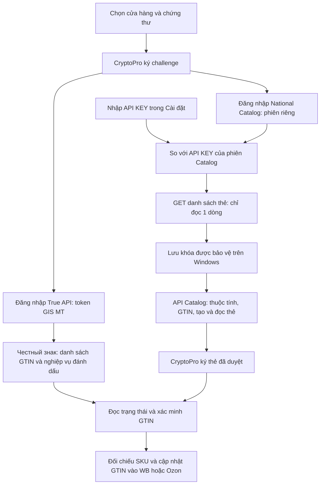

# API National Catalog trong VNCode 1.4.5

Trong **Cấu hình Znack → Cài đặt**, API KEY có ô nhập che riêng và hai nút
**Kiểm tra và lưu API KEY**, **Xóa API KEY đã lưu**. Lấy khóa bằng tài khoản
quản trị National Catalog tại **Профиль → Данные участника → API KEY**.

1. Chọn đúng cửa hàng và chứng thư CryptoPro; lưu cấu hình OMS nếu có thay đổi.
2. Bấm **Kiểm tra chữ ký** để đăng nhập bằng chứng thư của doanh nghiệp.
3. Nhập API KEY và bấm **Kiểm tra và lưu API KEY**. Chỉ lưu sau khi khóa khớp
   phiên Catalog đăng nhập bằng CryptoPro và API danh mục trả dữ liệu hợp lệ.
4. Khi thành công, mở **Đăng ký thẻ Znack** để tạo thẻ/ký thẻ/đồng bộ GTIN.
   Có thể để trống ô và bấm kiểm tra để kiểm tra khóa đã lưu.

API KEY xác thực các yêu cầu National Catalog; CryptoPro tiếp tục ký challenge
và hồ sơ. OMS ID/OMS Connection dùng cho SUZ. GS1 đọc hồ sơ qua phiên Catalog
đăng nhập bằng chữ ký; thêm API KEY không thay thế các bước này.

Khóa được bảo vệ bằng Windows DPAPI CurrentUser với mục đích riêng, trong bảng
SQLite bổ sung. Phạm vi gồm shop/credential của sàn, INN chứng thư, thumbprint và
môi trường True API. Đổi chứng thư/cửa hàng/môi trường cần kiểm tra lại khóa.
Xóa/đổi khóa chặn yêu cầu Catalog tiếp theo của phiên cũ; không hoàn tác yêu cầu
đã gửi. Khi chưa lưu khóa, app tiếp tục dùng token GIS MT theo luồng hiện có.
Không tự rơi về token khi một khóa đã lưu không còn đúng phạm vi hoặc không đọc
được trên máy Windows hiện tại.

API KEY chỉ gửi dưới query `apikey` đến host API Catalog HTTPS chính thức,
không gửi vào True API, SUZ, website license hoặc sàn. Các yêu cầu này bỏ header
Bearer, không theo redirect. Thông báo và nhật ký che khóa kể cả khi server trả
lại nội dung khóa. Kết nối được kiểm tra trên worker, không gọi mạng hay DPAPI
trên luồng giao diện.

Hợp đồng API: bản tài liệu National Catalog 5.68, phần 2.2 (`apikey` hoặc
Bearer), 3.1.1 (`/v3/feed-product?gtins=...`), 3.1.4
(`/v4/product-list?limit=1&offset=0`), 3.2/3.3 (tạo GTIN/feed, categories,
attributes). Mã frontend công khai của Catalog gọi `/rest/bootstrap` và đọc
`account.api.enabled/apikey`. Hash snapshot và kết quả kiểm thử được lưu tại
[evidence](validation/evidence/2026-10-15-vncode-catalog-api-config.json).
Wbcode là nguồn tham khảo giao diện; không có mã backend Wbcode để xác nhận
implementation. Đã kiểm thử bằng dữ liệu giả lập; chưa gọi Catalog của seller.

`unverified_catalog_owner` xảy ra trước khi gửi yêu cầu Catalog. Bản này giữ
kiểm tra sở hữu và hiển thị mã lý do cụ thể. Nhập thêm API KEY không tự sửa
metadata chứng thư hoặc INN chủ hàng không khớp. Nếu vẫn lỗi, dùng mã
`CATALOG_OWNER_...` để xác định đúng cấu hình cần sửa.

Portal 0.3.5 và khóa ký vncode-2 giữ nguyên; không cần deploy lại website cho
thay đổi Catalog hoặc dung sai giờ license trong VNCode 1.4.5.
