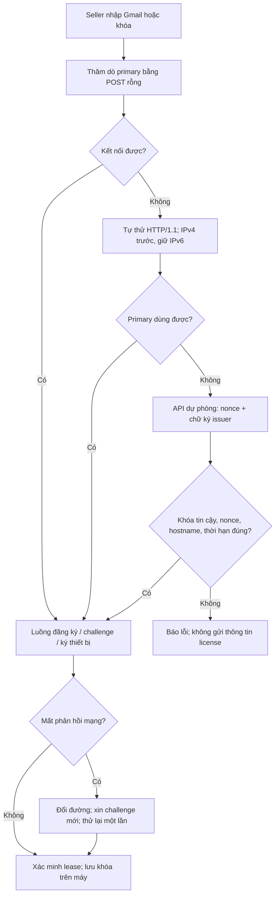

# API license dự phòng — Portal 0.3.6 / VNCode 1.4.10

Giữ nguyên `vncode-portal`, D1 `vncode-accounts`, khóa ký `vncode-2` và toàn bộ tài khoản/license hiện có. Worker `vncode-license-gateway` chỉ chuyển các API client được phép qua Service Binding tới Portal; không có database hoặc private key riêng.

## Triển khai trên Windows

Giải nén gói, mở PowerShell trong thư mục chứa `package.json` và `wrangler.jsonc`. Chạy từng lệnh riêng:

```powershell
npm ci
```

```powershell
npx wrangler login
```

Đăng nhập đúng tài khoản Cloudflare đang chứa Worker `vncode-portal` và zone `vncode.id.vn`. Kiểm tra tên Worker/database trong `wrangler.jsonc` khớp hệ thống hiện có trước khi deploy. Không tạo database mới, không chạy lại schema, không đổi khóa ký.

```powershell
npm run deploy
```

Sau khi Portal triển khai thành công:

```powershell
npm run deploy:gateway
```

Lệnh thứ hai tạo Worker riêng và Custom Domain `license.vncode.id.vn` trong cùng tài khoản Cloudflare. Nếu có bản ghi DNS cũ tại hostname này, xử lý xung đột trong Cloudflare trước khi chạy lại; không xóa bản ghi của website chính.

## Kiểm tra

```powershell
curl.exe -i --connect-timeout 10 --max-time 30 https://license.vncode.id.vn/api/config
```

Kết quả đúng: HTTP 200 và `portal_version` bằng `0.3.6`.

```powershell
curl.exe -i --connect-timeout 10 --max-time 30 -X POST -H "Content-Type: application/json" --data "{}" https://license.vncode.id.vn/api/client/license/activate
```

Kết quả đúng: HTTP 401 và `AUTH_REQUIRED`. Lệnh không gửi khóa, không kích hoạt thiết bị.

Trong VNCode 1.4.10, mục License → **Kiểm tra kết nối**: API dự phòng phải có kết quả `OK` ở ít nhất một giao thức. Bước này tạo nonce ngẫu nhiên, kiểm tra chữ ký Ed25519 từ issuer `vncode-2`, đúng hostname và thời hạn. Không gửi Gmail/license/token tới đường dự phòng chưa xác minh được.

Sau đó dùng khóa có giới hạn 2 máy trên hai máy thật, thử Wi-Fi và hotspot Việt Nam/Nga. Kiểm tra web chỉ ghi 2 thiết bị; lần thử lại sau mất phản hồi không cộng ngày hay chiếm thiết bị mới. Kiểm tra offline có thời hạn và thu hồi theo quy trình vận hành hiện có. Các bước mạng thật này chưa được xác nhận bởi bộ fixture.

## Luồng kết nối



App vẫn dùng primary khi chưa triển khai gateway. Cả hai Worker đều thuộc Cloudflare: dự phòng này giúp khi hostname/đường truy cập/giao thức gặp lỗi, không vượt được sự cố toàn Cloudflare hoặc nhà mạng chặn tất cả các hostname. Kích hoạt mới luôn cần kết nối thực sự tới API; không thể bảo đảm chỉ có Internet là mọi mạng đều truy cập được. TLS và chính sách license luôn được kiểm tra.

Nếu gặp Cloudflare browser challenge ở cả hai hostname, xem WAF/Security Events và cấu hình ngoại lệ cho đúng các API desktop của hostname license. Giữ kiểm tra bearer, challenge ký, rate limit trong Portal; không tắt bảo vệ toàn website. Không gửi private key hoặc mã license trong báo cáo hỗ trợ.
